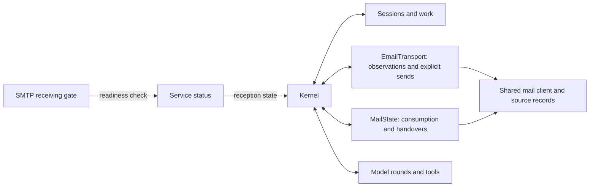

# Architecture

Ivenna coordinates independent external observations, model sessions, and explicit tool effects within one body. The application exposes health and reception status. The kernel retains execution histories in process memory and coordinates communication and autonomous memory as required capabilities.

The [design intent](design.md) explains these choices. The [input contract](input.md) defines observations, [communication](communication.md) defines outgoing messages, and the [usage guide](usage.md) explains external interaction.

## Responsibilities

| Component | Responsibility |
| --- | --- |
| [Application](../apps/ivenna) | Load configuration, assemble shared and domain components, and own startup and shutdown |
| [Service](../apps/ivenna/src/service.zig) | Serve listener health and the kernel's reception status |
| [Work](../packages/agent/src/work.zig) | Own input, assignment, and report deliveries, with optional consumption receipts |
| [Sessions](../packages/agent/src/sessions.zig) | Own contexts, queues, fork publication, and synchronized scheduling |
| [Kernel](../packages/agent/src/kernel.zig) | Coordinate execution, email, internal state, and worker scopes |
| [Communication](../packages/agent/src/communication.zig) | Define contacts, outgoing messages, and submission references |
| [Email transport](../packages/agent/src/email_transport.zig) | Project correspondence into observations, persist contact mappings, and submit messages |
| [Mail state](../packages/agent/src/mail_state.zig) | Track physical input consumption and store handovers by state key |
| [Mail sources](../packages/agent/src/mail_sources.zig) | Own shared source records, opaque receipts, caching, and immutable source artifacts |
| [Mail client](../packages/agent/src/mail.zig) | Decode the required JMAP operations into typed results |
| [Input](../packages/agent/src/input.zig) | Own native observation types and render them as YAML |
| [Engine](../packages/agent/src/engine.zig) | Execute one model response and its complete tool batch |
| [Context](../packages/agent/src/context.zig) | Own histories and copy complete contexts for forks and handovers |
| [Compaction](../packages/agent/src/compaction.zig) | Construct and bound summary requests and validate output |
| [Provider](../packages/agent/src/provider.zig) | Encode model requests and tool replies and decode output |
| [Memory](../packages/agent/src/memory.zig) | Exchange operations with the shared file workspace over SSH |
| [Host](../packages/agent/src/host.zig) | Route shell operations and select returned content |

The email adapter supplies native input with content, contacts, and optional provenance. The kernel pairs it with the mail integration's opaque physical receipt. Work owns that delivery; Sessions tracks the receipt to prevent duplicate intake while the message remains visible to polling. The kernel uses it to record consumption when processing completes. Model-facing input and communication use the native contracts independently of mail records or thread identifiers.

The application owns service, kernel, and shutdown tasks. The kernel owns intake and execution tasks within that scope. Task failures close reception and cancel and join concurrent work before shared dependencies are released. Sessions serializes queue and history changes; workers infer from owned snapshots and commit complete rounds before their model-round arenas end.

## Service and reception

The application discovers the mail account and checks memory, then binds `SERVICE_ADDRESS` before starting kernel tasks. While the listener is running, `GET /healthz` reports that the HTTP service is responding. `GET /readyz` returns success with `X-Ivenna-Ready: true` only while the kernel's reception state is open; otherwise it returns `503`. Readiness opens after the core's startup recollection. Closing is terminal for that kernel instance. The status endpoint reads this lifecycle state; it does not perform fresh dependency checks or reserve processing capacity.

The example Stalwart deployment checks readiness at SMTP recipient acceptance and rejects mail to Ivenna when the header is absent or the service cannot be reached. This is a receiving precheck, not a reservation: shutdown can follow a successful check, and an already accepted message can remain in ordinary mail storage. Direct mail API writes and same-service JMAP delivery do not pass through this gate. The [running guide](running.md#service-status-and-reception) defines the supported external path and deployment settings.

Reception status belongs to the service boundary. Model reasoning and tools do not manage transport availability, offline queues, or sender retries.

## Sessions, work, and communication

| Concept | Role and lifetime |
| --- | --- |
| Task | Work to be accomplished; it may continue across activations |
| Core session | Coordinating context retained for the kernel's lifetime, with its own queue and execution lane |
| Work session | A fork with an independent history, queue, parent, and any children |
| Input | Content with any contacts, source information, and context |
| Delivery | An owned input, assignment, or report being queued or executed, with an optional consumption receipt |
| Activation | One session processing a delivery through model and tool rounds, until a final response or a fork |
| Model round | One model response followed by all tools it invoked |

Every external input enters the core independently, including messages a mail client groups into one thread. Ivenna interprets the content alongside its retained understanding. Sessions own internal execution histories and queues; external conversation state does not route input or restore a work context.

The core exposes `send_message` and `fork_session`. Work sessions have the full tool interface and can fork further sessions. `send_message` is available independently of the active delivery's source or result destination. A response without tool calls ends the current activation: its final text is an internal result in the core or a report to a work session's direct parent. The broader task can remain open.

`MAX_PARALLEL_ATTENTION` bounds concurrent work-session execution; the core has a separate serial lane. `MAX_ATTENTION_CONTEXTS` bounds retained contexts, including the core. It also bounds each session's active and queued deliveries plus reserved child reports. Input that cannot be admitted stays with its producer; the mail integration leaves it available for later polling. Idle parents retain context while their children work without consuming a work slot. The core still processes its requests serially, so responsiveness also depends on short coordination turns and service latency.

Publishing a fork replaces the caller's active delivery with one reserved report slot in that caller's admission budget. Queue storage preserves room for outstanding report slots. When the child returns, its report consumes the slot and joins the queue, so later input cannot take its place. Runtime `queued_inputs` counts actual queued deliveries, excluding these reservations.

## Forks and work ownership

`fork_session` accepts a `task` and passes the current work to a new work session. A model round can create at most one fork. The [tool definitions](../packages/agent/src/tools.json) own its parameters.

Sessions reserves child identity and context capacity during tool invocation. It publishes the fork only after committing model output and one result for every tool call, so inherited history contains a complete exchange.

A fork copies the caller's complete current context, including any compaction handover. It receives an assignment and fresh runtime state. Histories then grow independently while the host, memory, and world effects remain shared. The [input contract](input.md#assignments-and-handovers) defines assignment and provenance fields.

Publishing a fork ends the caller's activation and transfers its delivery's consumption receipt, when present, to the child's assignment. The child handles that assignment in a new activation. Queued deliveries remain with the caller, which returns to its own queue without another inference to conclude the transfer. Later external messages still arrive at the core.

A work session's final text is delivered to the session that created it. The report enters the tail of that parent's FIFO queue and is added to context when it becomes the parent's next activation. It does not modify history during an ongoing model round. Nested forks return through their direct parents; a child does not inherit an ancestor's reporting destination. Report deliveries have no consumption receipt.

Session identifiers, queues, and report reservations last for one kernel process. Peer assignments, steering, parallel subtasks within one activation, and durable work recovery remain outside the implemented interface.

## Structured observations and response destinations

Input renders typed observations inside a common session envelope. The [input contract](input.md) owns their payload and field reference; the [system prompt](../packages/agent/src/system.md) explains their meaning to the model.

An ordinary request appends a fresh runtime observation to its inference snapshot. It describes the current session, execution counts, and result destination, and is discarded with that request view. Retained observations supply history; they do not override this current state. Compaction supplies current state inside its dedicated summary request.

## Content and provider boundary

[content.zig](../packages/agent/src/content.zig) defines text and image parts and classifies individual byte sources. The owning tool renders unavailable-content diagnostics as text. [image.zig](../packages/agent/src/image.zig) recognizes image signatures. Classification borrows bytes; a separate explicit interpretation can present source text as an image reference. Pixel decoding and URL retrieval belong to the model service.

Memory and Host return content in the model-round arena. Provider encodes the supplied parts for the configured model protocol, matching each tool reply to its call ID. Local image bytes become request data; remote URLs remain references whose contents can change. Image rejection preserves accompanying text and reports the omitted image. Provider's image checks apply alongside the whole-context budget. See [tool content](content.md) for formats and limits.

Provider decodes and validates the complete model output before Engine executes any tool in the response. It supplies parsed calls and final text to execution and compaction; malformed or unsupported output fails explicitly. Unknown tools and invalid arguments become tool errors available to the next model round. Image limits apply once to the complete tool batch.

## Activation completion and context release

Engine completes each tool batch with one result per call. Sessions copies accepted model output, including reasoning items, and tool results into retained history before the model-round arena ends. A published fork ends the caller's activation; otherwise, tool results feed another round. Intermediate assistant text and complete exchanges remain in history.

A final response without tool calls ends the activation. The kernel marks its physical receipt handled, when present, then completes the delivery in Sessions. A receipt follows successive forks and is consumed once at the final worker; returning reports do not consume it again. A work session's final text, including empty text, is copied into a report delivery for its direct parent. Core final text remains internal. Sending occurs only when a `send_message` tool call executes, so an activation can submit several messages or none.

Sessions checks active and queued deliveries, children, and worker ownership before releasing a work context. Children retain an idle parent without occupying a work slot; a worker's borrow keeps its session alive until the worker returns. A queued report owns its text independently of the child's context and model-round arena. No external conversation state is saved on completion.

The permanent core stays available between activations. Its context is summarized when it needs compaction.

## Bounded model context

`CONTEXT_REQUEST_BYTES` bounds the complete ordinary request, including instructions, tools, native observations, retained output, tool replies, and encoded images. `LLM_MAX_OUTPUT_TOKENS` separately bounds generated output.

Compaction builds a `context_compaction` observation from [compaction.md](../packages/agent/src/compaction.md) and current state with response `summary`. The frame retains session identity. Provider disables tools with `tool_choice: none`. `CONTEXT_COMPACTION_BYTES` bounds that complete request; `HANDOVER_MAX_BYTES` bounds its nonempty text result.

The kernel checks that the replacement fits the ordinary budget and installs the native handover in working context. Core compaction also saves the summary under the fixed internal state key `core`; work-session compaction remains in memory. The handover replaces the entire earlier working view; no raw transcript tail is retained. Summary instructions preserve needed session identifiers and source and contact references alongside ongoing work, commitments, and completed effects.

Byte counts are local measurements, not model-token estimates. Model-specific accounting remains planned. If a request or summary cannot meet its bound, execution fails explicitly rather than cutting an unfinished exchange.

## Email boundary and source materials

EmailTransport renders a nonempty subject, a blank line, and the body as input text; with an empty subject it uses the body alone. It supplies From descriptions as author provenance and contacts from Reply-To, falling back to From. Contact references identify available recipients independently of source provenance.

The adapter hashes each native recipient address into an opaque contact reference and atomically stores its native address record under `<DATA_DIR>/contacts/<reference>.json`. The mapping survives source-cache cleanup, context release, and restart. It is independent of any particular input or mail thread. Automatic contact retention and editing remain unimplemented.

`send_message` resolves references through those mappings. Each call submits a standalone email with subject `Ivenna`, the supplied text as its body, and no reply-chain headers. No native addressing or header fields appear in the tool contract.

`Mail.Submission` separates `mail_id` from a `sent_copy` outcome of `updated` or `unconfirmed`. Submission acceptance and the following implicit `Email/set` result are distinct under [RFC 8621 §7.5](https://www.rfc-editor.org/rfc/rfc8621.html#section-7.5). EmailTransport reports an unconfirmed sent-copy update diagnostically while preserving submission acceptance. It returns an opaque submission reference to the model. Service acceptance does not establish final recipient delivery.

Material within the excerpt budget is supplied inline. Longer material includes an excerpt and a reference to the complete projection. The boundary captures source artifacts for both representations.

EmailTransport derives source references from an available Message-ID, trimming surrounding whitespace and angle brackets before hashing; its fallback includes the service, account, and native letter identifier. MailSources derives physical receipts from the service endpoint, account, and native letter. MailState uses that receipt for consumption bookkeeping. Copies sharing a Message-ID can therefore share provenance while entering the core independently. Neither identifier establishes a conversation route.

Shared source-cache cleanup checks receipts still retained by work. It does not delete mail or artifacts. Under `<DATA_DIR>/sources/`, projected content uses `receipt-<receipt-hash>-<content-hash>.txt` and decoded details use `receipt-<receipt-hash>.json`. Both hashes use SHA-256; the content hash covers the projected bytes. The text resource contains the same full material represented inline or excerpted in input, and its hash distinguishes different projections of one receipt. Each file is published once through an atomic link, so later reads and polling do not truncate or rewrite it. The details file preserves the first captured snapshot of selected `Mail.Letter` fields, including its body, rather than original MIME or current mailbox state.

The boundary prefers decoded plain text and falls back to UTF-8 HTML source. Unsupported or incomplete bodies remain unavailable for intake, with a diagnostic. Intake uses polling; mail attachment intake is unimplemented.

## Internal mail state

MailState polls for physical input messages without the private `ivenna-handled` keyword. Intake spans ordinary mail folders and is independent of read and starred state. Runtime-created outgoing messages carry the private `ivenna-outbound` keyword; they are excluded along with drafts, Junk, Trash, and recognized state records. The supported deployment uses a dedicated Ivenna account, with ordinary correspondents sending from other accounts.

Completion sets `ivenna-handled` on the input copy. This records consumption of that physical message; it does not store model or tool progress. Sessions keeps receipt bookkeeping in memory. The completion operation leaves ordinary read, answered, and folder state unchanged.

Handovers are internal state records with their own mail identity. MailState creates self-addressed letters in Archive with subject `Ivenna state: <key>`, header `X-Ivenna-State-Key`, and the private `ivenna-state` keyword. The mail client stores them through `Email/set`; creation confirmation completes storage. These records remain local to the mailbox, separate from external reply chains.

State lookup narrows candidates by header and keyword, then checks the exact key and private keyword. The sole From address and at least one To address must match Ivenna, ignoring case. Recognized state records are excluded from ordinary input and recent evidence. Loading the latest matching record returns its summary and resource reference as a native handover; a read failure propagates to the kernel.

The only runtime state key is `core`. Work sessions can compact in memory, but have no cross-restart handover lookup contract. Durable identities and lifetimes for independent internal work remain undecided; external messages and source references do not supply them.

## Mail retention

External correspondence and internal state records have their own retention lifecycles. Normal completion records consumption with a private keyword; handover storage creates a separate record in Archive. Source correspondence stays in its existing folders.

Automatic retention and deletion remain unimplemented. Operators manage retained records and source artifacts through their services and files; context release and cache cleanup do not delete either.

## Startup and interruption

Startup discovers the mail account and checks memory through a read-only `inspect_memory_space` exchange. Both must succeed before the kernel starts. Memory is required throughout operation.

MailState supplies the latest handover for the fixed core key. The email boundary supplies recent external material and contacts as evidence. Startup and reconstruction respect excerpt and complete-request budgets. A later fork inherits that reconstructed context rather than a restored execution checkpoint.

Communication, memory infrastructure, model execution, and handover generation or storage errors propagate through the kernel's intake and execution tasks. An error returned by either task ends the kernel and its task scope. Defined tool outcomes, including invalid arguments, command failures, and memory-handler domain errors, remain results for the model to interpret.

Restart reconstructs understanding from the core handover and recent external material. Ordinary unhandled mail remains eligible for intake. Transcripts, delivery queues, source caches, and the branch tree have process lifetimes; source artifacts and contact mappings remain on disk. Automatic retry, reconnection, and execution resumption remain undefined.

A host command, memory change, or submission may have taken effect before interruption was observed. Losing a submission response can leave acceptance unknown; repeating it can produce a duplicate. Inspect uncertain effects before restarting or repeating work.

One kernel owns an Ivenna account's execution state. External submission, internal state changes, host effects, memory writes, and working context do not share a transaction.

## Autonomous memory

Memory is a file workspace shared by all sessions. The Memory component resolves local write sources and exchanges typed JSON operations over SSH with the fixed [memory.nu](../packages/agent/src/memory.nu) handler. The handler owns file operations and capacity enforcement. See [memory rooms](memory.md) for tool behavior and [remote memory setup](running.md#using-remote-memory) for deployment.

The handler returns explicitly defined operation errors, such as a missing entry or exhausted capacity, to the model as tool results. SSH failures, invalid protocol replies, and unclassified handler or backend failures propagate to the kernel. Finer error distinctions remain undefined.

The [memory shell](../dev/memory/memory-shell.sh) locks the workspace for each handler invocation, including capacity checks and writes. Separate operations can observe changes made by another session. Direct filesystem changes can bypass this boundary.

Transfers buffer complete files and payloads. Memory copies or decodes returned content into the caller's model-round arena before temporary SSH buffers are released. An incomplete exchange can leave the outcome of a write uncertain.

## Host execution

Work sessions execute as the kernel's OS account and share its filesystem and startup environment. Forking a model context leaves these resources shared, so a prior observation may need to be checked again after another session acts.

Host validates and routes requests. [Shell](../packages/agent/src/host/shell.zig) executes a fresh noninteractive `/bin/sh` command; [process.zig](../packages/agent/src/host/process.zig) owns process groups, timeouts, cancellation, and reaping. Complete output remains in host files, while [Reader](../packages/agent/src/host/reader.zig) selects the content returned to the model.

Host propagates cancellation and allocation failure. Other invocation failures currently return `host_unavailable`, including failure to obtain a command result. Finer classification of these failures remains undefined.

The shell entry reports capabilities that remain planned alongside command execution. Their operations are unimplemented. See [host shell](host.md) for available tools, output, and interruption behavior.
