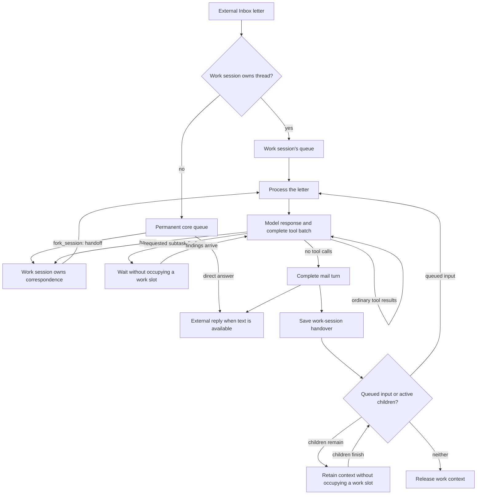

# Architecture

Ivenna runs locally and uses mail for correspondence and work control. Stalwart stores and delivers letters; the kernel coordinates model sessions, tools, replies, and handovers. Working transcripts and child findings live in memory. Mail, autonomous memory, and host artifacts provide continuity beyond a process's lifetime.

This guide describes ownership and execution. The [design intent](design.md) explains the behavior they serve, the [input contract](input.md) defines model observations, and the [usage guide](usage.md) explains correspondence and work control.

## Core, conversations, and turns

The runtime separates the purpose of work from the contexts and execution units used to carry it out:

| Concept | Role and lifetime |
| --- | --- |
| Task | A goal expressed through correspondence; it may remain open across many mail turns |
| Core session | Permanent coordinating context with its own input queue and execution lane |
| Work session | A fork with its own working history, queue, parent, and any children |
| Work conversation | Correspondence in a native mail thread, routed to its responsible session |
| Activation | One session handling queued mail or an assignment, including any wait for requested findings |
| Mail turn | Work on one input letter, which can pass between sessions through handoff |
| Model round | One model response followed by all tools it invoked |

New correspondence enters the core's queue unless a session already owns that thread. The core can answer directly or transfer the work through `fork_session`. Its tool interface exposes handoff; work sessions have the full tool interface and can fork further sessions. Later input follows the thread's responsible session and queues while its current activation continues. Receipt does not interrupt that work; explicit steering remains unimplemented.

A response with no tool calls ends the current activation. For external correspondence, its final text can deliver a result, ask a question, or describe unfinished work. An internal subtask instead supplies findings when requested. Ending a mail turn does not establish that the overall task is complete; later correspondence can continue it.

The external correspondence path is:

Context release leaves mail in its existing folders. A later reply can reconstruct the thread's working understanding from its handover and bounded correspondence, whether its source letters are in Inbox or Archive. The core context continues throughout.

`MAX_PARALLEL_ATTENTION` bounds concurrent work-session execution; the core has a separate serial lane. `MAX_ATTENTION_CONTEXTS` bounds retained contexts, including the core, and sets each session's normal input-queue capacity. Mail that cannot be admitted remains in Inbox. A parent waiting for children retains its context without consuming a work execution slot. The core processes its own requests serially, so its lane remains subject to model and mail-service latency.

## Forks and correspondence ownership

`fork_session` accepts a `task` and an optional `mode` object. The [tool definitions](../packages/agent/src/tools.json) own its parameters.

| Mode | Meaning |
| --- | --- |
| `{"handoff":{}}` | Transfer the current work and response scope; this is the default |
| `{"subtask":{"report_to_parent":false}}` | Start internal work; enable `report_to_parent` to request findings |

A fork copies the caller's complete current working context, including any compaction handover, then receives its own assignment and fresh runtime scope. Subsequent histories grow independently; host files, memory, mail, and world effects remain shared.

In `handoff` mode, the child takes responsibility for the current work and response scope. For correspondence, it also takes queued input and ownership of later follow-ups in that thread. It replies directly to the correspondent. The parent can return to other input without repeating the child's answer or waiting for its completion. Handoff of an internal assignment preserves its internal response scope.

In `subtask` mode, the child receives an internal assignment. By default, the parent continues without receiving the child's result. Enabling `report_to_parent` suspends the parent's activation and retains its original delivery and response audience. After all requested findings arrive, that activation resumes. Results go to the requesting parent and do not pass through the core. Core subtasks remain unimplemented; the core exposes only handoff mode.

For example, the core can transfer a letter with `{"task":"Investigate the request and reply to its sender.","mode":{"handoff":{}}}`. A work session can request supporting findings with `{"task":"Inspect the relevant source files.","mode":{"subtask":{"report_to_parent":true}}}`.

During tool invocation, the registry reserves the child's identity and capacity. After the model output and every corresponding tool result have been committed, it copies that complete context and makes the child ready to run. Handoff ends the parent's activation without another inference to conclude the transfer. A handoff is the only fork allowed in its model round; a work session can request several subtasks in one round.

## Responsibilities

| Component | Responsibility |
| --- | --- |
| [Application](../apps/ivenna) | Load configuration, assemble shared dependencies, and own startup and shutdown |
| [Conversation registry](../packages/agent/src/conversations.zig) | Own sessions, thread routing, queues, contexts, fork publication, and synchronized scheduling state |
| [Kernel](../packages/agent/src/kernel.zig) | Coordinate mailbox I/O, workers, model rounds, fork operations, handover, and context release |
| [Engine](../packages/agent/src/engine.zig) | Execute one model response and its complete tool batch |
| [Context](../packages/agent/src/context.zig) | Own history and copy complete contexts for forks and handover |
| [Input](../packages/agent/src/input.zig) | Own the observation union and payload types; render them as YAML for the model |
| [Compaction](../packages/agent/src/compaction.zig) | Construct and bound summary requests and validate their output |
| [Mail](../packages/agent/src/mail.zig) | Decode the required JMAP operations into typed mailbox results |
| [Provider](../packages/agent/src/provider.zig) | Encode model requests and tool replies and decode model output |
| [Memory](../packages/agent/src/memory.zig) | Resolve write sources and exchange operations with the file workspace over SSH |
| [Host](../packages/agent/src/host.zig) | Route shell operations and select their returned content |

Registry methods serialize changes to queues and authoritative working histories. Workers use independently owned snapshots for inference and commit complete output and tool batches before their model-round arenas end. A worker's borrow keeps its session alive through handoff and completion. The kernel owns the worker task group; shutdown cancels and joins those tasks before the application releases their shared HTTP client and other dependencies.

Mail uses Zig's `std.http` and `std.json` for a narrow JMAP interface. Stalwart handles MIME parsing, body decoding, message construction, native threading, and delivery. Its own storage retains correspondence; Ivenna keeps execution contexts in memory.

## Mail intake and structured input

Unread Inbox letters request attention. The kernel polls through JMAP and routes by native thread ID; notification streaming remains unimplemented. Message identifiers, reply headers, and normalized subjects let the mail service group related letters. Flagged input receives scheduling priority.

The mailbox's ordinary state remains part of this interface. Another client marking a letter read affects its eligibility for intake. Moving an active source out of Inbox withdraws its correspondence work at a complete model/tool boundary. This does not cancel internal subtasks already started from that source. A separate operator account keeps ordinary correspondence apart from deliberate management of Ivenna's Inbox.

Input renders a typed observation union inside a common session envelope. Mail observations carry a body excerpt and an origin record identifying the correspondence and full decoded body on the host. Assignments, findings, handovers, runtime state, source updates, and summary tasks each have their own payload type. The [input contract](input.md) defines these variants and their fields.

Historical inputs retain their original source meaning. Each ordinary model request also receives a fresh runtime snapshot identifying the session, its parent and children, current execution counts, and the response's source and audience. The [input contract](input.md#current-state-and-output-audience) defines these fields.

Snapshots are request-local and do not accumulate in retained history. Reconstructed correspondence, assignments, findings, withdrawal observations, and summary tasks use the same envelope. The [system prompt](../packages/agent/src/system.md) explains their meaning to the model.

Intake prefers decoded plain text and falls back to UTF-8 HTML source. A letter without a supported complete body remains unread and produces a diagnostic; later supported letters can still proceed. Attachment intake is not implemented.

## Turn completion and context release

Engine returns one result for each tool call. Ordinary results feed another model round; a handoff transfers the current work, and a request for subtask findings suspends the current activation. Intermediate assistant text and complete tool exchanges stay in the transcript.

For an external input, the kernel submits available final text as a reply, preserves native reply references, and marks the source answered. External submission and internal mail storage use distinct typed operations. External reply bodies contain the final model text; internal identifiers and housekeeping prose are not appended. The kernel marks the input read after handling it. A response without text ends the turn without an external reply; the overall task can still need further input.

A work session replies directly to its external source without automatically reporting to the core. An internal subtask owns no external correspondence route; requested findings resume the parent's retained delivery. Self-addressed mail is handled as ordinary input with an internal audience. These response scopes are described in the [input contract](input.md#current-state-and-output-audience).

When a work session finishes handling a source letter, the kernel saves a bounded handover. The registry completes that activation and checks the session's queue and children:

1. Queued input can start another activation.
2. Active children keep the parent context retained without occupying an execution slot.
3. When neither remains, the context can be released after its worker returns and the registry rechecks ownership.

The permanent core is never released by this path and does not request a summary after each turn. Internal subtasks finish without marking the source letter read or creating a turn-end handover. Input accepted while a handover is being saved keeps its work session available.

Correspondence handovers contain the bounded model summary and retain the source's normalized `Re:` subject, `In-Reply-To`, and `References` so Stalwart keeps them in the same thread. Compaction of the core stores a standalone `Core handover` letter. `X-Ivenna-Purpose` distinguishes `handover` from `core_handover`; startup selects the latest self-addressed `core_handover` across threads.

If handover generation or storage fails after a result was delivered, the kernel logs the failure and retains the working context. It does not repeat the delivered result merely to release resources.

## Mail retention

Archival and later deletion manage retained mail and mailbox capacity. They are separate from context release. A handover is a self-addressed letter saved in Archive; choosing that folder for the note does not archive the source correspondence.

The normal execution path marks processed input read and leaves its folder membership unchanged. Automatic retention and deletion remain unimplemented. Mail provides an archive helper, while its deletion placeholder returns `ArchiveDeletionUnavailable`. Deployment users can manage mail and artifacts through their existing services and files.

## Bounded model context

`CONTEXT_REQUEST_BYTES` bounds the complete serialized ordinary request, including instructions, tools, YAML input, retained output, tool replies, and image encoding. `LLM_MAX_OUTPUT_TOKENS` separately bounds generated output.

When another request would exceed the byte budget, Compaction builds a `context_compaction` observation with instructions from [compaction.md](../packages/agent/src/compaction.md) and the current state, setting its response audience to internal. The frame retains the actual session identity. Provider sends it with no tools and `tool_choice: none`.

`CONTEXT_COMPACTION_BYTES` bounds that complete request. Compaction requires nonempty assistant text within `HANDOVER_MAX_BYTES` and rejects tool calls. After checking that the replacement fits the ordinary request budget and saving the handover, the kernel installs it as the working context. The current policy retains no earlier raw transcript batches; Context can retain a tail only at complete batch boundaries.

Work sessions use the same summary operation after handling a source letter to support context release and reopening. Source correspondence and artifacts remain available by reference.

Serialized bytes are a measurable local bound. Model-specific token and image accounting remains planned. If a request or summary cannot meet its limit, execution fails explicitly; an unfinished tool exchange cannot be shortened by cutting away arbitrary messages.

## Startup and interruption

Startup rebuilds the core from its latest core handover and observations of at most 32 recent letters, using excerpts of at most 512 bytes and stopping when the request budget needs room for active input. Input for a thread without an active owner enters the core with its handover and up to 32 recent letters, independent of Inbox or Archive membership. These history excerpts also use at most 512 bytes; the normal complete-request check and compaction apply before inference. A subsequent handoff inherits that reconstructed understanding in the core's complete current context. Full bodies remain available through source-file references.

These letters supply evidence for continued work. The previous process's working transcripts, queued execution state, and branch tree are not restored. In-flight model and tool operations do not resume from their interruption point.

An execution failure in tracked correspondence pauses its input and retains the current in-process context. The kernel suppresses repeated automatic attempts at that letter; new related input can provide direction. An internal subtask failure instead returns a failed report when findings were requested, then releases its context when no child remains. After restart, unread mail may be considered again with reconstructed understanding.

A host command, memory change, or mail submission may have taken effect before an interruption was observed. Cancellation does not undo those effects. Inspect affected mail, files, and the observable world before repeating an action with an uncertain outcome.

One kernel owns an Ivenna account's runtime state. Mail operations, host effects, memory writes, and working context do not share a transaction.

## Autonomous memory

Memory is a file workspace shared by all sessions. The Memory component resolves local write sources and exchanges typed JSON operations over SSH with the fixed [memory.nu](../packages/agent/src/memory.nu) handler. The handler owns file operations and capacity enforcement. See [memory rooms](memory.md) for tool behavior and [remote memory setup](running.md#using-remote-memory) for deployment.

The [memory shell](../dev/memory/memory-shell.sh) locks the workspace for each handler invocation, including capacity checks and writes. Separate operations can observe changes made by another session. Direct filesystem changes can bypass this boundary.

Transfers buffer complete files and payloads. Memory copies or decodes returned content into the caller's model-round arena before temporary SSH buffers are released. An incomplete exchange can leave the outcome of a write uncertain.

## Host execution

All sessions execute as the kernel's OS account and share its filesystem and startup environment. Forking a model context leaves these resources shared, so a prior observation may need to be checked again after another session acts.

Host validates and routes requests. [Shell](../packages/agent/src/host/shell.zig) executes a fresh noninteractive `/bin/sh` command; [process.zig](../packages/agent/src/host/process.zig) owns process groups, timeouts, cancellation, and reaping. Complete output remains in host files, while [Reader](../packages/agent/src/host/reader.zig) selects the content returned to the model.

Persistent process sessions, live stdin, PTYs, explicit process control, and background completion scheduling are reserved capabilities with no model-facing operations yet. See [host shell](host.md) for the available tools, output, and interruption behavior.

## Content and provider boundary

[content.zig](../packages/agent/src/content.zig) defines text and image parts and classifies individual byte sources. The owning tool renders unavailable-content diagnostics as text. [image.zig](../packages/agent/src/image.zig) recognizes image signatures. Classification borrows bytes and can interpret a source as an image reference; pixel decoding and URL retrieval belong to the model service.

Memory and Host return content in the model-round arena. Provider encodes the supplied parts for the configured model protocol, matching each tool reply to its call ID. Local image bytes become request data; remote URLs remain references whose contents can change. Image rejection preserves accompanying text and reports the omitted image. Provider's image checks apply alongside the whole-context budget. See [tool content](content.md) for formats and limits.

Provider validates complete function-call envelopes before Engine executes any tool in the response. Unknown tools and invalid arguments become tool errors available to the next model round. Registry copies accepted model output, including reasoning items, and tool results into retained history before the round arena ends.
