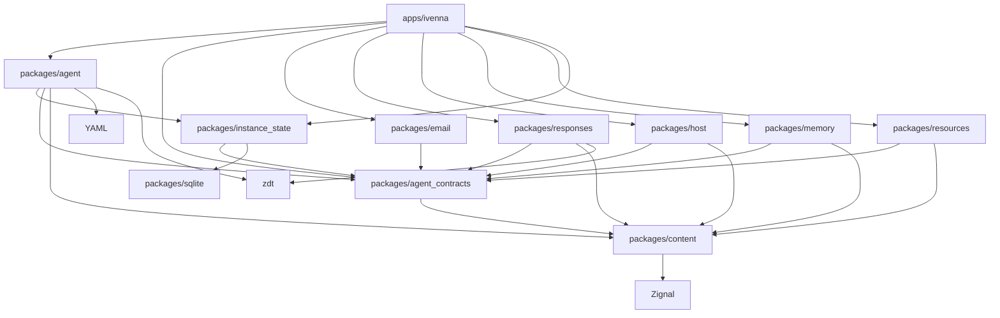

# Architecture

This guide describes how the application assembles Ivenna, how the kernel coordinates work, and how the runtime stores and restores it. For behavioral goals, configuration, and interface contracts, see the [documentation index](README.md).

## Responsibilities

| Unit | Responsibility |
| --- | --- |
| [apps/ivenna](../apps/ivenna) | Provide the CLI, load configuration, assemble the runtime, serve HTTP status and local channels, and manage process startup and shutdown |
| [apps/memory](../apps/memory) | Serve memory operations over SSH and own workspace files, capacity enforcement, and locking |
| [packages/agent](../packages/agent/src/root.zig) | Own sessions, scheduling, retained history, model input, prompts, and the communication and attention tools |
| [packages/agent_contracts](../packages/agent_contracts/src/root.zig) | Define the communication, history storage, and capability contracts shared by execution and concrete implementations |
| [packages/email](../packages/email/src/root.zig) | Own native addressing, message projection, submission, storage, and retention behind the communication and history contracts |
| [packages/responses](../packages/responses/src/root.zig) | Encode, measure, and decode model exchanges; own model HTTP transport, file uploads, and request content limits |
| [packages/host](../packages/host/src/root.zig) | Define host tools and own command handles, process interaction and cleanup, logs, and completion output |
| [packages/memory](../packages/memory/src/root.zig) | Define memory tools and translate their operations and results through the SSH service protocol |
| [packages/resources](../packages/resources/src/root.zig) | Resolve resource references, read host files and directories, retrieve web pages, and present remote images by URL |
| [packages/instance_state](../packages/instance_state/src/root.zig) | Own the local SQLite database and provide subscription operations |
| [packages/sqlite](../packages/sqlite) | Provide the embedded SQLite build and shared bindings |
| [packages/content](../packages/content/src/root.zig) | Define tool-result parts, classify source bytes, interpret image references, and read local file contents within a byte limit |

`ivenna serve` runs the kernel and its [HTTP listener](../apps/ivenna/src/service.zig) in the same process. Host commands receive the executable path and data directory in their [environment](host.md#command-environment). The kernel reaches the memory app over SSH. See [local service setup](../dev/README.md).

The agent and its capability implementations share `agent_contracts`. That module uses Content to represent tool results. The graph follows imports between Ivenna's Zig modules and shows selected library dependencies.

The agent exposes `Kernel`, `Engine`, and `Input`. It keeps session scheduling, deliveries, activations, and retained context internal. `Kernel.Config` and `Kernel.Limits` govern execution. `Engine.Reasoning` sets ordinary reasoning effort by role. Capability packages define service settings and protocols, and the application loads those settings from the environment.

### Shared contracts

The application supplies the agent and host with capability implementations through in-process contracts. The agent encodes retained records and selects them with a checkpoint. Adapters translate their native service protocols.

| Contract | Operations | Implementation |
| --- | --- | --- |
| [Inbox](../packages/agent_contracts/src/inbox.zig) | Poll typed correspondence and callback envelopes with opaque receipts and acknowledge durable admission | Email integration |
| [Callback.Registrar](../packages/agent_contracts/src/callback.zig) | Persist a future observation's source and bind its destination to the invoking session | Agent execution |
| [Callback.Publisher](../packages/agent_contracts/src/callback.zig) | Store one observation under a registered callback ID, preserving the first stored result | Email integration |
| [Communication.Sender](../packages/agent_contracts/src/communication.zig) | Expose registered outgoing correspondent IDs and submit messages by ID | Email integration |
| [Channels](../packages/agent_contracts/src/channels.zig) | Reserve, activate, and close local delivery endpoints and attempt handoffs by channel ID | Application |
| [HistoryStore](../packages/agent_contracts/src/history.zig) | Publish and load checkpoints, allocate storage groups, read and write records, and maintain retained history | Email integration |
| [Model.Port](../packages/agent_contracts/src/model.zig) | Infer, measure encoded requests, and prepare tool results for model input | Responses adapter |
| [Reference.Issuer](../packages/agent_contracts/src/reference.zig) | Allocate a named reference durably before the capability uses it | Agent execution |
| [Tools](../packages/agent_contracts/src/tool.zig) | Register a capability's declarations with its invocation entry point | Host, Memory, and Resources |

`Tools.Invocation` identifies the calling session by its internal ID and model-facing `focus_id`. It can also supply a callback registrar and a command reference issuer for the duration of the call. Host uses both during [command execution](#command-lifecycle).

The callback registrar accepts a name and source and binds the observation to the calling session. It returns a numeric ID for publication through `Callback.Publisher` and a complete reference the capability can present as `callback_id`.

[Reference](../packages/agent_contracts/src/reference.zig) validates names and formats the references allocated by execution. The checkpoint retains the focus and callback sequences and the sequence used for command and channel suffixes. These sequences continue after restart. The subscription store allocates its suffixes in SQLite. Resource lookup uses the complete reference. See [names and references](input.md#names-and-references).

## Service and reception

`ivenna serve` binds `SERVICE_ADDRESS` and the local channel socket before opening the instance database or accessing the mail account. Once the runtime is assembled, the application serves probes and channel readers concurrently with the kernel and host supervisor. The kernel completes startup recovery before opening reception and dispatching ready focuses. See [startup and interruption](#startup-and-interruption).

The HTTP listener handles probes independently of intake and model work. A health probe observes the listener. A readiness probe reads the kernel's reception state, which stays open while an individual focus waits for inference. The deployment's mail service uses readiness to decide whether to accept correspondence. Shutdown can follow a successful check, leaving accepted mail in the account. See the [reception contract](running.md#service-status-and-reception) and [local SMTP example](../dev/README.md#configuring-mail).

Each probe handler owns its connection. The kernel owns intake and session workers, and Host supervises commands independently of the session that launched them. A failed probe or receive request ends its connection. A listener failure or an unrecovered kernel or host error closes reception for this instance. The application cancels and joins concurrent work before releasing shared dependencies.

## Sessions, work, and communication

| Concept | Role and lifetime |
| --- | --- |
| Task | Work to be accomplished; it may continue across activations |
| Core session | Persistent coordinating session with its own history and input queue |
| Activity session | Session forked by the core with inherited context, an assignment, and its own subsequent history and queue |
| `input` event | Correspondence observation with sender IDs, text, and observation time |
| Delivery | An owned observation retained through durable admission and any transport receipt acknowledgement |
| Activation | One worker running a session through model and tool rounds until the activation completes or is interrupted |
| Model round | One model response followed by all tools it invoked |

The [session registry](../packages/agent/src/sessions.zig) serializes queue and history changes. A worker retains its inference output and context while the tool batch executes, then commits the complete round before its model-round arena ends.

The registry stores an internal numeric ID, a stable named `focus_id`, and an `Input.Role` of `core` or `activity` for each session. The role selects the available tools. Activity messages and endings go to the core. Subscription reports go to the focus that registered. Sleeping and interrupted sessions retain their identities and roles through context unloading and restart. Completed activities leave the registry; session IDs increase monotonically and are not reused. The core remains registered.

### Scheduling and capacity

Each ready session can claim its own worker. The registry allows one activation at a time per session, preserving its model/tool order while other sessions advance concurrently. The worker holds its own copy of the session context through each round. Observations that arrive during inference or tool execution can enter working history at the [next admission](#activation-admission).

Separate [limits](running.md#configuration) bound registered sessions, ordinary deliveries buffered per session, and live host commands. The ordinary queue allowance counts correspondence, callbacks, assignments, and focus messages. Mail stays in its source when the destination is full. Startup and activity interruption notices can still enter the queue. The registry reads activity and subscription reports from their durable stores as it prepares model input.

Sleeping activities retain their session slots. Completing an activity releases its slot. Forks and activity resumption are independent of space in the core's ordinary queue. Outstanding callback registrations and unread reports can grow with pending work.

### Message delivery

Incoming correspondence enters the core's queue in intake order, independently of mail threads. The core also reads activity reports during admission. See [activity reports](#activity-reports) and [activation admission](#activation-admission).

The tool decoder reads the single field in `send.to` to select a destination variant. The kernel routes the complete ID to the mail sender, session registry, or channel registry. For a focus destination, the registry checks membership and queue capacity under its lock, then checkpoints the queued message with the calling focus's ID. The kernel renders the outcome as a tool reply. See [tool decoding](../packages/agent/src/tools.zig), [outgoing mail](#outgoing-mail), [local channels](#local-channels), and [sending outcomes](communication.md#sending-a-message).

### Local channels

The session registry owns channel IDs, their opening focuses, and descriptions. The opening round owns the transport reservation through tool execution. At commit, the registry holds its lock while it saves the registration with the round's tool replies. The transport exposes the channel after confirmation. If the round exits without confirmation, it releases its reservation. Closing a channel saves its retirement before the transport ends waiting reads. See [opening a channel](communication.md#opening-a-channel) for save outcomes and [channel lifetimes](communication.md#channel-lifetimes) for what survives restart.

The local transport tracks connections by channel ID. A connection handler registers each request under the transport lock. A send tries to acquire that lock once, then tries nonblocking packet writes in request order until it hands off the message or exhausts the list. Each successful write consumes one request. Closing a channel queues the terminal reply after any matched message and ends its server-side connections, including followers between requests. See the [transport implementation](../apps/ivenna/src/channels.zig) and [send outcomes](communication.md#sending-to-a-channel).

The runtime listens on an abstract Unix `SOCK_SEQPACKET` socket with a name derived from the canonical instance directory and effective UID. Both peers check each other's effective UID. The initial handshake registers a read. A follower requests each subsequent read on the same connection. The listener bounds open sockets and handler tasks with a connection limit. At shutdown the application cancels and joins those tasks before releasing the registry and listener. See the [local socket transport](../apps/ivenna/src/channel_ipc.zig), [registry limit](../apps/ivenna/src/channels.zig), and [receive interface](communication.md#receiving-from-a-channel).

## Activation admission

The email adapter supplies correspondence and callback envelopes with optional opaque receipts. The agent routes correspondence to the core and callbacks to the registered session. A delivery owns its copy of the observation and any receipt needed to acknowledge it. See the [delivery and activation types](../packages/agent/src/work.zig).

At a model-round boundary, the registry puts any pending startup observation first. For the rest of the batch, it cycles through ordinary deliveries, subscription reports, and activity reports, starting at the focus's saved position. Only the core reads activity reports. The registry preserves arrival order within each source and reads reports in pages of 64. `Input.coalesceActivityReports` groups activity facts by focus before measurement.

The kernel measures how many encoded bytes the grouped observations add to the request. It extends the batch across report pages and selects a prefix within the [observation batch target](running.md#context-budgets) and the adapter's limits. The first observation can exceed the batch target if the complete request fits. When the first observation and retained history together exceed an adapter limit, the kernel can [compact history and reassess the request](#bounded-model-context).

Unselected ordinary deliveries return to the front of their queue. Unselected reports remain in their respective stores. The next batch starts one position after the source of the first admitted observation other than startup. If the batch admits no such observation, the position stays the same. A checkpoint without a saved position defaults to ordinary deliveries.

The worker renders the admitted observations in the current turn and appends them to history. The registry saves that history together with the remaining activity outbox, pending callbacks, the next source in the rotation, and the last admitted subscription report sequence. Once the checkpoint is confirmed, the registry acknowledges admitted subscription reports in SQLite and the kernel acknowledges mail receipts before inference.

## Activity forks

Only the core can invoke `open_focus`. Each call reserves an identity and prepares an assignment. When all tool calls in the round have returned, the worker appends the model output and the tool replies to its own context. The registry copies that completed context for each new activity and publishes the core's updated history and all new activities in one checkpoint. The core continues its activation.

Each copy includes retained events, complete native model/tool exchanges, and any existing handover followed by later history. All replies from the calling round are included, even those produced after the fork call. Forking generates no extra summary. Original record focus references remain intact as provenance; historical tool calls are not replayed.

The activity restores this history under its own `Context.scope` and `focus_id`. Its assignment is the first new queued observation. It constructs fresh inference turns from its own queue. Callbacks, wakeups and subscription reports keep their original destinations. New inputs supply the activity's current identity and events, with tools selected for its role under the same system prompt. Inherited assistant output is not collected again as a new report. See [opening a focus](attention.md#opening-a-focus) and [assignment fields](input.md#assignments-and-reports).

## Activity reports

An ordinary activity response contributes one assistant message when it contains `output_text`, including an explicitly empty string. The registry records the source focus and the time it collected the response. If the response calls tools, the registry publishes the message before the first tool runs. The core can therefore receive the activity's stated intention even if execution stops before a tool result is saved. For a response without tool calls, the registry publishes the text at [round completion](#activation-and-session-completion).

The [activity outbox](../packages/agent/src/reports.zig) stores each message and ending as a separate immutable record linked to its predecessor. An ending records when the runtime closed the activity and requests core attention even if the activity produced no text. Messages alone wait for the core's next ordinary input. The checkpoint selects unread records by storage group, head key, unread count, and ending count.

At [admission](#activation-admission), history retains the grouped observations with their original times. The outbox advances by the number of individual records and endings consumed. The remaining records stay available even after their source activity ends. See [working history](running.md#working-history) for the storage cost of unread reports.

## Activation and session completion

Tool replies lead to another round. For a response without tool calls, the registry checks pending work under its lock and commits the response's effects on history, reports, and session membership together.

| State after the response | Result for the focus |
| --- | --- |
| An observation requests further attention | The focus retains the response and continues its activation. |
| The core has no work requesting attention | The core goes idle with the response in its retained history. |
| An activity has no input ready and still has a pending callback or active subscription | The activity sleeps with its updated history until more work arrives. |
| An activity has no input ready, pending callback, or active subscription | The activity ends. One checkpoint drops the session from saved history and selects the outbox records for its final message (if present) and its ending, in that order. |

For a retained focus, the registry takes ownership of the worker's updated context. A sleeping activity can unload that context after checkpoint confirmation. At startup and after a withdrawal, the dispatcher checks sleeping activities. Queued reports make the receiving activity ready. An activity whose last registration was withdrawn can end as soon as it has no more work. The registry frees an ended activity's remaining state when its last worker releases it.

### Interrupted activations

An activation can end when admission cannot fit the next request, the model service rejects it, or the response cannot be used. The registry keeps the focus, its saved working history, and its registrations. It returns unadmitted deliveries and their receipts to the front of the queue. Unadmitted activity and subscription reports remain in their respective stores. If the model rejects a request after admission, its observations are already in history and receipt acknowledgement has finished.

For an interrupted activity, one checkpoint records the unfinished activity and a `focus_interrupted` observation for the core. The worker releases the focus and an activity may unload its context. After failed admission the focus waits for fresh input or a restart. The registry counts arrivals received while the worker was busy and compares the latest subscription report sequence with the sequence it sampled when collecting the batch. If admission succeeded before inference failed, the queued work following that input can resume the focus. See [interrupted reasoning](attention.md#interrupted-reasoning).

## Event sources and callback admission

The registry checkpoints each callback's numeric delivery ID, complete reference, receiving session, and source. It saves a wakeup's schedule in the same checkpoint and confirms the checkpoint before returning a reference or allowing a due wakeup to be published. The kernel publishes wakeups and Host publishes command completions through `Callback.Publisher` using the numeric ID. See [checkpoint recovery](#saving-and-restoration) and [callback source fields](input.md#callback-observations).

`History.Wakeup` stores the delivery ID, original scheduled time, and text to publish. When the publisher confirms the write, the intake loop checkpoints the wakeup without its text. It retains the scheduled time until the receiving focus admits the observation. If a crash precedes that checkpoint, the publisher can recognize the stored result by its ID. See [callback publication](#callback-delivery).

Intake resolves the numeric ID through its registration and supplies the saved reference, source, and any scheduled wakeup time with the observation. Intake defers delivery when the receiving queue is full. `Delivery` keeps the numeric ID for admission and acknowledgement, while the model sees the named reference. `queued_callbacks` holds duplicate copies back until the accepted delivery is durably saved and any receipt is acknowledged. Admission saves the observation and removes its registration in one checkpoint. A later copy of a consumed positive ID below the saved next-ID counter receives acknowledgement without another observation. Other unknown IDs fail execution.

## Instance database

`ivenna serve` initializes `<DATA_DIR>/state.sqlite3`, then opens a subscription connection. Initialization installs the instance schema and sets SQLite's `application_id` to identify its format. Subscription commands open the existing database with that marker. WAL mode lets readers proceed while SQLite serializes writers. See the [schema](../packages/instance_state/src/schema.sql) and [connection setup](../packages/instance_state/src/database.zig).

The database also has an identity unique to the instance. The registry records it in the first mailbox checkpoint before marking the database bound. A checkpoint must match the local database identity on startup, and a bound database requires its checkpoint. See the [backup and transfer procedure](running.md#backups-and-transfers).

### Subscription delivery

The [subscription store](../packages/instance_state/src/subscriptions.zig) serializes publication and withdrawal as SQLite writes. A publication checks the key within the subscription before applying any cursor change. A known key leaves the cursor and queue untouched. For a new key, one transaction saves the key, applies any cursor change, and queues the report with its subscription reference and receiving focus. A cursor conflict rolls back the whole write. Withdrawal deletes the registration and its cursor and keys. Queued reports keep their own copy of the destination. See the [listener protocol](subscriptions.md) for CLI requests and receipts.

The listener's cursor records its position in the source. SQLite assigns report sequence numbers across all subscriptions. The kernel records the last sequence admitted to each focus's history as `subscription_through`. At startup, on each intake pass, and when a worker finishes, the dispatcher checks for work. An idle focus with a report beyond its saved sequence is ready to run. Each batch reads that focus's reports in order up to the latest sequence sampled for the batch. Later arrivals wait for the next input. See [activation admission](#activation-admission).

After the [startup checkpoint](#startup-and-interruption) is published, the registry deletes each focus's reports through the sequence saved in that checkpoint. This completes any acknowledgement interrupted by shutdown.

## Working history and user messages

[Context](../packages/agent/src/context.zig) owns retained events, complete native `Model.Item` exchanges, and handovers. It caches their rendered model input. Model output stays in opaque adapter continuation bytes, including reasoning. Tool replies keep their typed content. See [how history is stored and restored](#persistent-working-history).

Context puts the same embedded [system prompt](../packages/agent/src/system.md) before the selected history and current turn for every focus. The turn identifies the focus and its role. Engine selects tools separately. Request measurements include the prompt's encoded size for ordinary inference and compaction.

[Input](../packages/agent/src/input.zig) renders retained `Record` values and temporary `Turn` values as YAML user messages. The session registry supplies `current` for both ordinary and compaction turns. Retained ZON records preserve numeric times and complete typed values. The [time adapter](../packages/agent/src/time.zig) uses [zdt](https://codeberg.org/FObersteiner/zdt) to format model-facing times as UTC RFC 3339 and parse scheduled wakeup times. See the [input contract](input.md) for fields and omission rules, and [tool results](#tool-results) for native exchange encoding.

## Model requests and tools

[Engine](../packages/agent/src/engine.zig) combines messages, selected tool declarations, and reasoning effort into [Model.Request](../packages/agent_contracts/src/model.zig). [tools.zig](../packages/agent/src/tools.zig) selects agent declarations and parses their arguments using one explicit role rule. Memory and Resources join through `shared_tools`. Activity sessions also receive Host through `activity_tools`. Declarations stay with their owning capabilities; invocation uses the same role selection. Runtime action effects remain in Kernel's calling round, including focus preparation and atomic publication with the completed round.

Kernel calls inference and tool execution separately. The activation remains owned by the same worker through the returned batch. The adapter prepares each reply's content, and Engine returns the replies for commit with the model output.

Sessions share the configured model and output-token limit. Engine selects ordinary reasoning effort by role using the [model settings](running.md#model-requests). The [Responses adapter](../packages/responses/src/provider.zig) encodes these settings and applies the same request checks during measurement and before sending inference. Engine invokes the returned calls in order, while other sessions can run their own tool batches concurrently. Unknown tools and invalid arguments become ordinary tool errors.

### Model transport

`Model.Port.next` checks the adapter's request limits before making one non-streaming HTTP attempt under a monotonic deadline. Inference and file uploads share a request writer. It finishes the HTTP body and flushes the connection, including any buffered TLS records, before waiting for response headers. The adapter checks any declared response length and validates the complete model output before returning tool calls. On timeout or cancellation, it joins the exchange before releasing borrowed data.

| Evidence from the inference endpoint | Adapter outcome and runtime action |
| --- | --- |
| Shared authentication or protocol failure, or exhausted account quota | The error reaches process supervision. HTTP 402 or an explicit `insufficient_quota` diagnostic in a complete, bounded HTTP 429 body establishes quota exhaustion. |
| Timeout, interrupted transfer, HTTP 408, rate limiting (429), or most 5xx responses | Temporary unavailability. A usable `Retry-After` delay sets the earliest retry. An explicit `x-should-retry: false` yields a rejection. |
| Adapter request limit, request-specific refusal, malformed response, or incomplete generation | Rejection. An adapter limit supplies the measured size or count and maximum. A recognized code in a bounded HTTP 400 diagnostic identifies a context-window rejection. Other request-specific refusals report that the service declined the request. |

Engine retries temporary unavailability during ordinary inference and compaction required by an adapter limit. The worker releases the attempt's temporary allocations and waits outside the registry lock. It retries with the same request, including the original observation time. Cancellation interrupts the exchange or the wait. A validated response can supply tool calls for execution. See [when model work stalls](running.md#when-model-work-stalls) for the retry schedule.

A rejected ordinary inference interrupts the activation. The interruption observation describes the reason, such as a context-window limit or an incomplete response. The runtime logs HTTP diagnostics and exact limit measurements. See [how compaction handles rejection](#continuing-with-a-handover).

### Tool results

Capabilities return [Content](../packages/content/src/root.zig) parts owned by the model-round arena. Content supplies byte classification, media limits, and image-reference interpretation. Each capability reads its sources and identifies them in the result. Engine associates results with call IDs and passes the complete tool batch to the Responses adapter before the exchange is committed.

The adapter copies new reply parts before preparing file uploads. When encoding the request, it sends images in the function-call output as `input_image` parts and constructs Base64 data URLs for local image bytes. It encodes an overlong HTTP(S) image URL as a `content_limit` text part alongside the source description and retains the URL in history. Measurement and inference each count the attachments encoded in the complete request. See [model request checks](content.md#model-request-checks).

Each file part holds complete bytes and an optional upload reference. For a file that needs a reference, the adapter sends a generic filename and the purpose `rich_layout_recognition`. A definite HTTP 400 rejection permits one attempt with `user_data` under the same per-file deadline. If the upload fails or its outcome is uncertain, the adapter replaces that file part with a description of what happened. The kernel can commit the round with its other results. See the provider's [Files API](https://api-docs.deepseek.com/guides/files_api/) and the [file result contract](content.md#complete-files).

On success, the adapter retains the service file identifier alongside the original bytes. Measurement and inference use the same encoder and reuse that reference. The function-call output preserves the tool's source description and marks each attachment in its original position. After the batch of tool results, the adapter adds one user-role message per result containing files. That message identifies the originating tool call once, followed by its `input_file` references in order.

At round commit, Context copies the prepared parts into its retained arena. History persistence stores the bytes and references. See [persistent working history](#persistent-working-history) and [file retention at the model service](running.md#uploaded-model-files).

## Bounded model context

### When compaction runs

When the next ordinary request fits the adapter's limits, the kernel can still compact older history. For soft compaction it compares the token threshold with the input token count of the last committed ordinary round, including rounds with tool calls. The checkpoint saves the count with that round and clears any previous count if the model reports none. A fork or replacement handover starts without a count. See [context settings](running.md#context-budgets).

On restart, the registry restores the saved count only if the checkpoint and the current model port both supply the same usage scope. The Responses adapter reads `usage.input_tokens`, which includes cached input. It derives the scope from the configured model name and base URL, trimming trailing slashes from the URL. See the [model port](../packages/agent_contracts/src/model.zig), [Responses adapter](../packages/responses/src/provider.zig), and [DeepSeek Responses usage](https://api-docs.deepseek.com/guides/responses_api/#response-fields).

When no usable token count is available, the kernel measures an encoded ordinary request against the byte threshold. The request includes the system prompt, tools, settings, the turn's focus, role, and observation time, and the retained history before any pending tool exchange.

When an ordinary request exceeds the adapter's body or attachment limits, the kernel can compact history to make it fit. The adapter checks both ordinary and summary requests against those limits. The model service applies its token window after expanding file references. See [model request checks](content.md#model-request-checks).

### History used for a summary

The kernel normally carries forward the complete tool exchange awaiting continuation and the observation records admitted after it. When an adapter limit requires compaction, the kernel includes these records in the summary if an ordinary request with just this portion of history exceeds a limit. During soft compaction the core can also carry forward up to two completed exchanges and their preceding observations. It keeps this additional history when its encoded size fits 256 KiB and it contains no file references. The model service determines how much input a referenced file expands into.

### Sampling state and preparing the request

The session registry reads `current`, activity IDs, pending callbacks, confirmed open channels, and active subscription registrations under its lock. The kernel adds the core's outgoing correspondent IDs from the sender. The sample carries the observation time of its summary turn. See the [sampling implementation](../packages/agent/src/sessions.zig) and [fields supplied to each role](input.md#sampled-state).

`Context.summaryRequest` combines the system prompt, selected history, sampled state, and compaction instructions. The summary request uses `high` reasoning without tools. Observations awaiting admission stay queued. See the [summary instructions](../packages/agent/src/compaction.md) and [handover contract](input.md#handover-generation-and-replacement).

If the summary request exceeds an adapter limit, the runtime replaces attachment parts in that request with short omission notices and measures again if any parts changed. Tool-call IDs and text parts, including source descriptions, stay in the summary request. For example, a tool result for `file:///srv/output/chart.png` keeps that URI in its source text and carries `[Image omitted from this summary input.]` in place of the image.

### Continuing with a handover

The kernel requires nonempty summary text and a response without tool calls. It pairs the summary with the state and time supplied to that inference, then measures the ordinary request with the handover and the records it carries forward. A fitting replacement is committed with any newly admitted observations. The new epoch begins with the handover, followed by carried-forward records and exchanges in order, then the newly admitted observations. The earlier epoch follows the [history retention policy](#history-retention).

For soft compaction, the kernel tries one summary for the current ordinary request and measures the replacement using the observation batch it already selected. If the summary fails or the replacement exceeds an adapter limit, the original request proceeds and the kernel skips further soft compaction in that activation. An adapter limit can still require compaction later.

When an adapter limit requires compaction, the kernel can ask for a revised summary if the first contains no usable text, includes tool calls, or leaves the ordinary request too large. The second attempt takes a fresh state sample and asks the model to correct the previous summary. When the service is temporarily unavailable, Engine retries the same summary request with the same sample. If compaction fails, the worker can continue a tool exchange that fits without the waiting observations. When no continuation fits, the request [interrupts the activation](#interrupted-activations). See [model transport](#model-transport).

## Persistent working history

The agent's [history persistence](../packages/agent/src/history.zig) stores immutable records and a checkpoint selecting each session's current history segment. A fork persists its copied entries in the activity's own storage group. Compaction advances a session's epoch and starts the new history with a handover while preserving identity and role.

| Term | Meaning |
| --- | --- |
| Session | A core or activity session with its own identity and role |
| Segment | An append-only sequence identified by `Scope { session_id, epoch }`; a fork starts the activity's first segment and compaction starts a replacement |
| Storage group | An opaque identifier used by `HistoryStore` to discover related immutable records, such as a session segment or report journal |
| Committed chain | The checkpoint's selected records in one segment, identified by a head key and entry count |

Each entry contains a retained event record, handover, or model/tool exchange. Event records carry the receiving focus and its observations. Handovers carry the producing focus, sample time, generated summary, and sampled state. Inherited records keep their original focus references. Exchanges preserve opaque model output and typed tool replies, including local media bytes, upload references for files, and source URLs for remote images. See the [retained record contract](input.md#retained-records).

Working history and the activity outbox share a [record codec](../packages/agent/src/record_codec.zig) for compact UTF-8 ZON bodies and content keys. The encoder leaves default field values implicit when the schema allows it. An entry record contains the entry and its predecessor's SHA-256 key within that segment, or null for the first entry. Its own key is the SHA-256 of the stored body. The storage group and predecessor keys distinguish occurrences even when their payloads are equal. Unread internal observations are stored together in a separate immutable record in the session's current group.

One checkpoint covers all registered sessions. For each session it records the internal ID, `focus_id`, role, epoch, storage group, committed head, entry count, and an optional key for unread internal observations. See [recovery state](#recovery-state) for the state used to continue execution.

Appending advances the head and count without adding a per-entry reference to the checkpoint. A sleeping session can retain this confirmed selection without materialized context entries. The latest confirmed checkpoint selects the records kept by [history maintenance](#history-retention) and available for subsequent restoration.

### Saving and restoration

`HistoryStore` loads and publishes checkpoints, manages grouped records, and applies retention. History persistence and the activity outbox own their record schemas, chain selection, validation, and retention references. The shared record codec supplies encoding, decoding, and content-key functions. Adapters own native representation, locators, placement, and protocol limits. See the [storage contract](../packages/agent_contracts/src/history.zig).

The registry holds its lock through checkpoint publication at [admission](#activation-admission) and [round completion](#activation-and-session-completion). A completed tool round publishes its new [activities](#activity-forks) and [channel registrations](#local-channels) with its tool replies. Effects can have earlier commit points. For example, the registry saves a host command's callback registration before returning its reference.

Within an epoch, persistence carries forward the confirmed keys and encodes newly appended entries. It confirms the new records before publishing the checkpoint that selects them. Startup publishes a checkpoint even when the restored document is unchanged, because a delayed retirement from the previous run can still target the restored copy. After that publication, saves skip publication when the document's digest matches the confirmed one.

The registry records a checkpoint save error before releasing its lock and propagates it to the kernel for shutdown. The error stops further registry work and retention for all sessions, preserving the records of any checkpoint the mail service may have published. On restart, the registry restores the checkpoint the adapter selects. See [working history limits](running.md#working-history) and [history storage](#history-storage).

Session restoration discovers group metadata, follows each committed predecessor chain, then reads selected bodies in batches. Hashes, checkpoint selections, record kinds, counts, and predecessor metadata must agree. Owners of retained event and handover records must match the complete ID of the restoring focus or the core (`core-1`). A saved channel's opening focus ID has a suffix below the next focus sequence. If the opening focus is still present in the checkpoint, its complete ID must match. Matching physical duplicates can supply one logical occurrence. Missing or inconsistent records fail restoration. When loading older handovers, restoration converts channel and subscription ID lists to sampled records with `null` descriptions and drops retired feed IDs from the sample.

Restoration rebuilds the outbox's unread metadata and materializes the core context. Report bodies are loaded during admission. When an activity is scheduled, the registry materializes its context by reading only that session's history. Delivery objects, receipts, worker ownership, and host process handles are not checkpointed. See [startup](#startup-and-interruption) for reconstruction.

### History retention

Compaction replaces the session's selected segment. Once the replacement checkpoint is confirmed, its earlier epoch is no longer needed for continuation. A completed activity's history becomes unselected when its removal is confirmed in a checkpoint. The core's outbox retains that activity's unread messages and ending until they enter the core's history. Shared autonomous memory follows its own lifecycle. Context unloading preserves the current selection; previous checkpoints are not restoration roots.

Maintenance runs before reception opens. During intake, it runs after a poll once at least 60 seconds have passed since the previous maintenance run finished. The registry serializes maintenance with checkpoint saves. `HistoryStore.Retention` names every `(group, key)` selected by the confirmed checkpoint, including unread observations and outbox reports.

The [email adapter](#mail-retention) keeps selected records in History and retires unselected records to Trash. The mail service owns Trash expiry and space reclamation.

## Startup and interruption

During assembly, the application opens the instance database, discovers the mail account, and checks memory with `inspect_memory_space`. The session registry validates the selected mailbox checkpoint against the instance database and restores its sessions. On first launch it creates the core. See the [durable sources used at startup](#recovery-state).

On each launch the registry queues `startup` for the core with a copy of the sender's registered IDs. Admission retains that list as part of the dated observation. An activity's `was_running` flag records whether it had a running or interrupted activation or a startup observation waiting in its queue. The registry queues startup during restoration for activities with that flag or unread internal observations. Other restored activities get startup when dispatched for new work. Newly opened activities begin with their assignment. See the [startup fields](input.md#startup-and-restart).

The registry publishes a fresh checkpoint before acknowledging restored subscription reports. The kernel rebuilds the live channel registry from every saved registration during assembly. Pending receive requests are tied to connections from the earlier runtime, so programs request fresh reads. See [checkpoint publication](#history-storage) and [local channels](#local-channels).

After startup maintenance, the kernel publishes an interruption observation for each restored host registration before opening reception and dispatching work. The callback publisher preserves any identifiable result already stored for that ID. Unpublished wakeups become eligible when due. Earlier command IDs survive as observation sources. See [callback publication](#callback-delivery) and [command lifetimes](host.md#command-lifetimes).

Unacknowledged correspondence remains eligible and can appear again after a crash between persistence and acknowledgement; callback IDs instead retain durable admission deduplication. Fresh startup observations identify this runtime; earlier records remain evidence of their original observations and outcomes.

Host effects, memory writes, mail submission, subscription changes, acknowledgement, and history publication have separate commit points. Effects may precede their saved results, and repeating uncertain actions can duplicate them. The [availability contract](design.md#runtime-availability) determines when execution can continue.

### Recovery state

| State | Durable source | Details |
| --- | --- | --- |
| Instance identity and database binding | Identity in the mailbox checkpoint and SQLite, binding status in SQLite | [Instance database](#instance-database) |
| Focus identity, role, startup eligibility, and history selection | Mailbox checkpoint | [Startup and interruption](#startup-and-interruption) · [Persistent working history](#persistent-working-history) |
| Working history and pending internal observations | History records selected by the mailbox checkpoint | [Saving and restoration](#saving-and-restoration) |
| Next observation source and last admitted subscription report sequence | Mailbox checkpoint | [Activation admission](#activation-admission) · [Subscription delivery](#subscription-delivery) |
| Input token count and its model scope | Mailbox checkpoint | [When compaction runs](#when-compaction-runs) |
| Unread activity messages and endings | Outbox records selected by the mailbox checkpoint | [Activity reports](#activity-reports) |
| Reference sequences, open channels, callback registrations, and pending wakeups | Mailbox checkpoint | [Reference allocation](#shared-contracts) · [Local channels](#local-channels) · [Callback admission](#event-sources-and-callback-admission) |
| Checkpoint revision and publication markers | Mailbox checkpoint metadata | [History storage](#history-storage) |
| Published callback results | Callback mail | [Callback delivery](#callback-delivery) |
| Unadmitted correspondence | Eligible incoming mail | [Mail intake and acknowledgement](#mail-intake-and-acknowledgement) |
| Subscription registrations, listener cursors, accepted keys, and pending reports | Instance SQLite database | [Instance database](#instance-database) |

## Email boundary

The mail service checks which From addresses a sender may use. On intake, the email adapter maps supported addresses in the configured domain to correspondent IDs. See [mail service setup](running.md#mail-service) and [mail intake and acknowledgement](#mail-intake-and-acknowledgement).

### JMAP requests

The [JMAP client](../packages/email/src/jmap.zig) sets one 60-second monotonic deadline per call, including any retry. Reads and updates that assign fixed folder and keyword values to known Email IDs can reuse connections. If the connection fails, the client can repeat either operation once on a fresh connection. Creates, including submissions, use fresh connections and can retry once only if the connection fails before transmission begins. The client logs the method, phase, and cause of a broken exchange, closes its connection, and joins canceled work.

During [session discovery](running.md#mail-service), the client resolves each `Location` against the current URL. It checks the origin before sending another authenticated GET and closes the redirect connection without waiting for its body. A connection retry resumes at the current URL with the remaining redirects. The session document supplies the `apiUrl` for subsequent JMAP calls.

At startup the adapter locates `Ivenna Callbacks` and `Ivenna History` by their exact top-level names and null roles. It locates Trash by its `trash` role. If a folder is missing, it creates it. If the create outcome is uncertain, the adapter lists folders again and applies the same selection. Startup needs a matching folder to proceed.

### Outgoing mail

At startup the application supplies the registered recipient addresses to the email integration. The transport indexes them by case-sensitive local part. Its sender exposes the keys as correspondent IDs and uses the same index to resolve the address on each send. See the [email transport](../packages/email/src/email_transport.zig) and [outgoing registration](running.md#outgoing-correspondents).

The adapter creates a draft marked `ivenna-outbound` with the resolved address as its sole recipient. It uses the returned draft ID in `EmailSubmission/set`. If draft creation is unconfirmed, the call ends before submission.

When the submission outcome is uncertain, the adapter queries `EmailSubmission` by draft ID and sending identity. This includes a lost response or a `serverUnavailable` method error, which Stalwart can return after queuing delivery. A matching record confirms acceptance. If the lookup fails or finds no match, the outcome remains unknown. The sending identity may lack read access, and the service can discard submission records after sending. [RFC 8621 §7](https://www.rfc-editor.org/rfc/rfc8621.html#section-7)

### Callback delivery

The publisher stores each callback directly through JMAP as a self-addressed `Email` in `Ivenna Callbacks`. Before creating it, the publisher searches the whole account, including Trash, for the keywords `ivenna-callback` and `ivenna-callback-<id>`. It checks the sender and recipient and matches the positive `X-Ivenna-Callback-Id` header to the keyword. An identifiable copy preserves the first result even when its body is unreadable. If creation loses its acknowledgement, the same lookup must find the intended callback or publication fails.

Intake reads callbacks only from `Ivenna Callbacks` and also requires a complete plain-text body. It logs and skips invalid callback records. If an old copy has expired and the publisher creates another, the [admission checkpoint](#event-sources-and-callback-admission) still prevents a consumed ID from producing a second observation.

### Mail intake and acknowledgement

Ordinary intake finds unhandled correspondence outside `Ivenna Callbacks`, `Ivenna History`, Drafts, Junk, and Trash. Drafts and private callback, outbound, or state records are excluded. Read and starred state do not select input. [EmailTransport](../packages/email/src/email_transport.zig) projects supported From IDs, complete text, and observation time according to [communication](communication.md#incoming-email-text).

`Inbox.Poll { messages, callbacks }` supplies independent allowances; zero disables a stream. The registry accounts for tracked receipts and pending callbacks and disables correspondence when the core is full. The adapter reads each oldest eligible prefix, paging past unsupported records, then merges by `receivedAt` without a combined cap. Correspondence backlog cannot consume callback allowance; FIFO applies within each selected stream and session queue, not account-wide across destinations. Rejected input stays stored.

After durable admission, acknowledgement sets `ivenna-handled` and moves the copy to Trash without changing read or answered state. Receipt bookkeeping remains in memory; acknowledgement does not certify task completion.

### History storage

The adapter stores immutable records and checkpoints as self-addressed JMAP `Email` objects. Each has a plain-text ZON body, the `ivenna-state` keyword, and an `X-Ivenna-History-Kind` header with value `record` or `checkpoint`. Ivenna uses the mailbox's message IDs, keywords, and folder membership to identify records and determine which checkpoints in `Ivenna History` are eligible for restoration. The selected checkpoint's body determines which records to restore.

Each record carries its storage group's `ivenna-history-<token>` keyword, its content key in `X-Ivenna-History-Key`, and its predecessor's key, if any, in `X-Ivenna-History-Previous`. A single `Email/set` creates the metadata and body together. If the response to a batch create is lost, the adapter queries the affected groups. It can confirm the batch from metadata alone when every requested record is present with its expected key and predecessor. An incomplete batch leaves the previous checkpoint in effect.

A checkpoint is prepared as an immutable message with `ivenna-prepared` and a numeric `X-Ivenna-History-Revision`. After the server confirms its `Email.id`, the adapter publishes it by setting `ivenna-current` on that ID with a keyword-only update. A lost preparation acknowledgement stops the save before publication. After an unconfirmed publication, the adapter reads the keywords and folder membership of that message to determine whether it became eligible for recovery. See the [email history adapter](../packages/email/src/history.zig) and [JMAP patch semantics](https://www.rfc-editor.org/rfc/rfc8620.html#section-5.3).

For restoration, published messages carrying both `ivenna-prepared` and `ivenna-current` take precedence over legacy checkpoint messages carrying `ivenna-current` alone. This prevents a delayed legacy create from superseding the updated kernel's checkpoint. Startup selects the highest revision in the applicable format. Distinct messages tied at that revision cause `AmbiguousHistoryRevision`.

Each subsequent page of checkpoint candidates uses the preceding page's last `Email.id` as its anchor. A delayed move of a message before the anchor leaves the next page's starting point intact. If the anchor itself leaves the results, the query fails and startup stops. See [JMAP query anchors](https://www.rfc-editor.org/rfc/rfc8620.html#section-5.5).

The fresh startup publication gets a new `Email.id` and a revision above the prepared-format candidates found by the scan. The revision starts at 1 when the scan finds no candidates in the prepared format. An earlier process using the prepared format could request publication only for a message whose ID it already obtained. If that message is still eligible when the update arrives, its revision ranks below the new checkpoint. Delayed Trash moves can only address earlier message IDs.

During [restoration](#saving-and-restoration), the adapter queries the folder by state and group keywords in pages of up to 512 IDs. It validates ownership and group membership and returns record metadata and transient `Email.id` locators. The agent selects the committed chains, then asks for their bodies. Bulk `Email/get` rechecks ownership, group, key, and predecessor and returns complete text. The agent verifies the hashes and decodes the records.

Get and set batches contain at most 32 objects and obey the session's `maxObjectsInGet`, `maxObjectsInSet`, and `maxSizeRequest`. Encoded bodies and protocol fields count toward the request size. Each complete model/tool round occupies one record, including its retained image and file bytes. If even one record exceeds the request limit on its own, saving fails with `HistoryRecordTooLarge` before checkpoint publication.

Preparing the checkpoint takes one `Email/set` create request. If that encoded request exceeds `maxSizeRequest`, the adapter returns `HistoryCheckpointTooLarge` before sending it and preserves the confirmed selection. See [working history limits](running.md#working-history) for recovery after a size rejection.

### Mail retention

Communication copies, admitted callback mail, and unselected history records retire into Trash. The mail service owns expiry and storage reclamation under deployment policy, independently of whether Ivenna is running. The [running guide](running.md#data-and-retention) describes retention and preservation requirements.

#### Communication copies

During initialization and before each poll, the adapter moves acknowledged inputs and outgoing copies to Trash. It recognizes outgoing copies by the outbound keyword and the sender's identity. This includes drafts left by interrupted sends, regardless of submission outcome. Maintenance shares a lock with sending, so it sees a draft only after the send releases it. Each move assigns Trash membership and clears draft state. The adapter checks the service's update acknowledgement for every selected Email ID.

#### Working history

The adapter inventories its state objects in `Ivenna History` against the agent's [retention selection](#history-retention). It checks the confirmed checkpoint and every selected `(group, key)` before moving anything. A missing selection or invalid metadata on an owned object fails maintenance. Trash is outside both inventory and restoration.

The folder keeps the confirmed checkpoint and every physical copy of a selected record. Maintenance moves superseded checkpoints and unselected records to Trash. A delayed publication can still set a keyword on an earlier checkpoint, which remains superseded. Retired records include those from replaced epochs, obsolete observation arrays, and writes that never became part of a committed chain.

## Autonomous memory

[Memory](../packages/memory/src/root.zig) defines memory tool declarations and translates calls into typed JSON requests for [memory.nu](../apps/memory/src/memory.nu). The adapter owns host file sources and SSH transport. The handler represents rooms as directories and memories as files, and owns workspace addresses and capacity. The [memory shell](../apps/memory/memory-shell.sh) locks each request across observation, capacity checks, and publication. Other sessions can act between requests, so a sequence of calls is not a transaction. See [memory rooms](memory.md) for the operation contract and [service setup](running.md#memory-service) for deployment.

### Reads and searches

The handler reads byte ranges from Nushell streams and returns the source header, total length, and selected offset with each range. For a nonzero text offset, the same request includes up to three preceding bytes so the adapter can recognize an offset inside a UTF-8 character. It checks for an image or PDF signature at the start of the entry. A recognized signature or binary bytes in the selected range can require a second read of the complete entry from offset `0`. That response is classified independently because another request may have changed the entry. Partial binary ranges do not become native files.

Room visits enumerate one directory; recursive size requests traverse all its child rooms before pagination. Capacity inspection traverses the entire workspace and remains separate from navigation. Visit and search results are sorted and selected within the encoded reply budget. Name search gathers the matched names before pagination. Content search wraps the query to match each whole line once, avoiding a submatch record for every occurrence. It drains ripgrep's JSON incrementally and retains a bounded page and total count. Each matching line is still read and decoded as a whole before its preview is selected. A fixed shell wrapper appends the exit status to the stream so the handler can distinguish no matches from a failed search after draining it.

### Writes and capacity

Writes prepare complete content in the handler-owned `.ivenna-tmp` directory, then rename it onto the destination. The staging directory shares the workspace filesystem and is excluded from memory observations and logical capacity. Before removing abandoned unpublished files, each request verifies the directory's ownership marker.

Publication replaces one file name, leaving other hard links on their previous content. Capacity counts regular-file lengths for each directory entry, including separate hard-link names. The projected usage is current usage plus the replacement length minus the addressed entry's previous length, checked while holding the workspace lock. All recording modes validate the proposed write before creating missing parent directories and publishing the entry. Entry transfers and revisions have a separate size limit from the workspace's shared capacity.

Unique revisions use Nushell's bounded `split row` to distinguish zero, one, and several matches before constructing a replacement. Literal replacement of all matches counts them from the byte-length reduction after deletion. Regex replacement of all matches retains a `parse` prepass: the selected Nushell version can panic on a backtracking error in `str replace`, whereas `parse` reports it as an operation error. That prepass still materializes its match list.

### Transport and failures

Transfers buffer each request and reply. Returned text, image, and file content is copied into the model-round arena before the SSH buffers are released. The adapter supervises concurrent request writing, response draining, and child completion against one deadline. Timeout and cancellation stop SSH before joining its writer and protected wait.

The handler translates selected-entry filesystem and pattern failures into tool outcomes. The adapter translates host source-file failures before transfer, while transport and protocol errors propagate to runtime supervision. The [memory interface](memory.md#results-and-errors) defines the outcomes, infrastructure failures, and uncertain effects.

## Resource reads

[Resources](../packages/resources/src/root.zig) provides `read_resource` to the core and every activity. Its [locator](../packages/resources/src/locator.zig) selects the reader for a host path or file URI, a web URL, or a snapshot URI. Resources and Host receive the same startup directory from the application and share a [path representation](../packages/agent_contracts/src/local_path.zig) that preserves filename bytes.

Local files and web snapshots share the [text page sizing and UTF-8 boundary rules](../packages/resources/src/window.zig). The [local reader](../packages/resources/src/local.zig) sizes directory pages by entry count and the space their URIs occupy. It reads entry names and types during iteration and looks up metadata on request or when the type is unknown.

For file previews, the local reader uses Content to recognize media. Explicit image and file views use the same [bounded file reader](../packages/content/src/local_file.zig) as memory imports.

For a web URL in the image view, Resources returns an image part carrying the URL to the model service. A page preview goes through the optional [web reader](../packages/resources/src/web.zig), which supplies a title and Markdown. When configured, its service and billing notice appears in the tool description. The [DeepSeek adapter](../packages/resources/src/deepseek.zig) sends an authenticated Fetch request with a 60-second deadline and a 32 MiB response body limit.

One [snapshot store](../packages/resources/src/pages.zig) serves all focuses. Each successful fetch retained in the store gets its own URI, even when two fetches use the same source URL. Reads of that URI come from kernel memory. The store evicts the oldest snapshots first and retains at most 256 pages and 32 MiB of source URLs, title previews, and Markdown combined. See [reading a web page](resources.md#web-pages).

## Host execution

[Host](../packages/host/src/root.zig) owns a shared command registry and the operations that launch, observe, and control its processes. Each job retains its references, control settings, and log handles independently of the model-round arena. [Shell](../packages/host/src/shell.zig) prepares the environment and log files, resolves the working directory, and launches a fresh shell. See the [host interface](host.md) for modes, arguments, and results.

### Command lifecycle

Execution supplies a command reference issuer and a completion registrar for every command invocation. Host reserves live capacity and requests a reference before launching. Execution appends the next suffix to the supplied name and saves the advanced counter before returning the reference. See [reference allocation](#shared-contracts).

`run_host_shell` waits on `std.Io.Condition` until process and input cleanup finish or the call's wait expires. If cleanup has completed, the call returns the final state and bounded output previews, then retires the handle. Otherwise Host persists a completion registration with source `host: { command_id }`, using the command name for its callback prefix, retains the command, and returns the complete command and callback references. Other activities can discover and control a command while its caller waits.

Registration failures propagate under the [availability contract](design.md#runtime-availability). Host stops and joins the command when registration fails. The registration may already be saved when history publication reports a failure.

`Host.run` supervises commands independently of session workers. Jobs are reference-counted so returning from a call does not release state still in use by a task or another caller. Completion releases live capacity; a separate eight-handle cache can retain finished commands for recent output collection. Its size is independent of `MAX_HOST_COMMANDS`. Full logs have independent [deployment retention](running.md#host-output-and-deployment-files).

Retained commands belong to the host runtime, while a pending completion registration keeps its receiving activity available across sleep. Completion publication can outlive the registry's control handle; the supervisor retains the command until publication ends. Shutdown cancels and joins command tasks before releasing their logs, terminals, publisher, or other dependencies. Startup restores [saved working history](#startup-and-interruption) and resolves pending host observations, not host processes or command handles.

### Interaction and synchronization

The Host mutex protects registry state, references, capacity, and input admission. Each command has an operation lock for continuation calls consuming its shared stdout/stderr cursors. Input, signal, and resize actions apply before taking that lock so an observation wait does not delay interaction. One byte-stream input write can be in flight per command. It runs separately from the observation call; completion cancels and joins it before releasing the live slot.

The initial call keeps `handoff_pending` set until it rejects handoff or has saved the registration and prepared its tool result. Supervision waits for that flag to clear before publishing a completion, covering commands that finish during registration. It sets `settled` after process and input cleanup. Failure cleanup waits for that state without waiting for publication, so it can finish while the initial call still owns the handoff decision.

Command lookup checks the complete reference and is shared across activities; inspection records retain the originating `focus_id` as provenance. Inspection pages the current registry within a 32 KiB complete-reply budget, returning `offset`, `next_offset`, and the filtered `total_commands`. Registry changes can alter later pages. Initial observations and completion publication do not take the continuation lock; their [output collection](#output-and-delivery) is independent of the shared cursors.

### Processes and terminals

[process.zig](../packages/host/src/process.zig) owns child supervision through `std.process.Child` and `std.Io.Select`, including deadlines, cancellation, and protected reaping. It selects the process transport from the command's input mode.

[pty.zig](../packages/host/src/pty.zig) supplies the Linux terminal operations absent from `std.Io`. It opens the slave from the master with `TIOCGPTPEER`, resizes it with an ioctl, and uses `std.posix.tcgetpgrp` for foreground-group lookup. Launch uses `setsid --ctty` because `std.process.spawn` exposes process groups without a new-session option. The terminal master carries input and merged stdout/stderr; terminal EOF is a control byte rather than a pipe half-close.

In terminal mode, interrupt targets the foreground group so an interactive shell can continue afterward. Terminal termination and cleanup cover the original session, including background job-control groups. The backend enumerates `/proc`, filters with `getsid`, then binds candidates with pidfds and rechecks their session before signaling. Host cleans up `batch` and `pipe` commands by process group.

Normal completion and timeout report cleanup failures as unavailable outcomes. Error unwinding and cancellation make a final best-effort cleanup before joining. A program can escape into another session; if it retains a terminal slave, output draining stops after a one-second wait. Terminal [deployment requirements](running.md#runtime-requirements) belong to the running guide.

### Output and delivery

Shell keeps private logs for stdout and stderr. Terminal mode merges both streams into the stdout log. Shell divides the preview budget between the streams and uses [Output](../packages/host/src/output.zig) to distinguish text from binary data. For each stream it can return complete text inline or supply that stream's log path. If collection fails, the observation includes both log paths.

Continuation calls consume shared per-stream cursors. They check log growth and wait on the condition so completion can wake them. An initial handoff reads its prefix using independent cursors starting at zero. Synchronous completion and callback publication take independent beginning/end previews. The callback source identifies the command that produced the observation. See [host command results](host.md#output-and-results).

Shell preparation, source reading, and command controls translate their operation failures into tool outcomes. Task scheduling and runtime supervision failures propagate to the application, as do cancellation and allocation errors.
