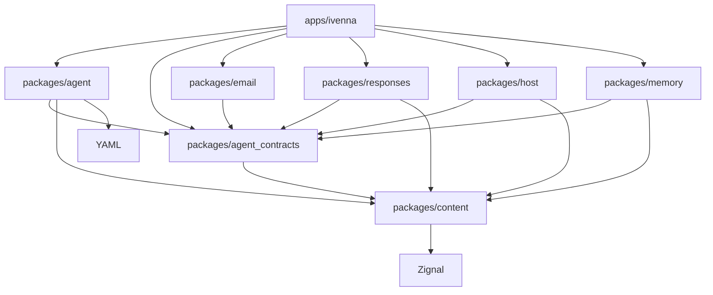

# Architecture

This guide describes Ivenna's current implementation: package responsibilities, execution, and service and storage protocols. The kernel retains working histories across restarts and constructs fresh execution state on startup. The application assembles the runtime and exposes health and reception status.

The [design intent](design.md) explains these choices. The [input contract](input.md) defines model-facing records and current requests, [communication](communication.md) defines outgoing messages, and the [usage guide](usage.md) explains correspondence with Ivenna.

## Responsibilities

| Unit | Responsibility |
| --- | --- |
| [apps/ivenna](../apps/ivenna) | Configure and assemble the runtime, serve HTTP status, and own process startup and shutdown |
| [apps/memory](../apps/memory) | Serve memory operations over SSH and own workspace files, capacity enforcement, and locking |
| [packages/agent](../packages/agent/src/root.zig) | Coordinate sessions, activations, forks, and retained history; own model-input rendering, execution policy, and model-facing resources |
| [packages/agent_contracts](../packages/agent_contracts/src/root.zig) | Define the communication, history storage, and capability contracts shared by execution and concrete implementations |
| [packages/email](../packages/email/src/root.zig) | Implement communication and working-history storage within the mailbox, owning native records, correspondent addressing, message projection, manifest publication, and processing markers |
| [packages/responses](../packages/responses/src/root.zig) | Encode and measure model requests, validate Responses output, and apply model content limits |
| [packages/host](../packages/host/src/root.zig) | Define host tools and own shell execution, process cleanup, logs, and returned output |
| [packages/memory](../packages/memory/src/root.zig) | Define memory tools and translate their operations and results through the SSH service protocol |
| [packages/content](../packages/content/src/root.zig) | Define tool-result text and image content, classify source bytes, and interpret image references |

`apps/ivenna` links the libraries into one process. Its [HTTP listener](../apps/ivenna/src/service.zig) runs alongside the kernel and shares the application's shutdown scope. `apps/memory` is a separate program reached through SSH; its handler and image sources live together, while local service orchestration remains in `dev`.

The execution core and concrete capabilities share `agent_contracts`, which depends only on Content. Content supplies tool-result text and image representation and source classification. YAML rendering belongs to the agent. The build declarations enforce the following module dependencies; each arrow points from a module to one it imports:

At runtime, the application supplies concrete capability implementations to the core through these contracts. Kernel calls the input, sending, and history storage operations; Engine calls the model and registered tools. These calls dispatch to the supplied implementations, whose code runs in the same process.

The agent exposes `Kernel`, `Engine`, and its `Input` message types and renderer. Session scheduling, owned deliveries, activations, and retained context remain core implementation details. `Kernel.Config` and `Kernel.Limits` describe execution policy. Connection settings and protocol parameters belong to their capability packages; the application loads environment values and owns HTTP listener settings.

Shared [communication types](../packages/agent_contracts/src/communication.zig) describe incoming observations and explicit outgoing messages. The shared capability contracts define calls and data exchanged within the process. The agent owns model-input rendering, handovers, source-record encoding, and the active-session manifest; each adapter owns its service protocol encoding:

| Contract | Operations | Implementation |
| --- | --- | --- |
| [Inbox](../packages/agent_contracts/src/inbox.zig) | Poll `Inbox.Incoming` messages with opaque receipts and record consumption | Email integration |
| [Communication.Sender](../packages/agent_contracts/src/communication.zig) | Submit explicit outgoing messages using correspondent IDs | Email integration |
| [HistoryStore](../packages/agent_contracts/src/history.zig) | Load and save the current manifest; read and put immutable source records | Email integration |
| [Model.Port](../packages/agent_contracts/src/model.zig) | Infer, measure the encoded request, and apply model content limits | Responses adapter |
| [Tools](../packages/agent_contracts/src/tool.zig) | Register a capability's declarations with its invocation entry point | Host and Memory |

The email integration implements reception, sending, and history storage over one shared mail client. Private markers distinguish history state and runtime-created outgoing messages from ordinary correspondence and track input consumption. The kernel uses these operations without inspecting mail headers, folders, or native delivery identifiers.

The email adapter supplies `Inbox.Incoming` with a complete `Communication.IncomingMessage` and an opaque consumption receipt. The receipt identifies the native letter within the configured account and stays outside model input. Inside the core, [Work](../packages/agent/src/work.zig) owns the accepted delivery's event and receipts; Sessions tracks receipts to prevent duplicate intake while messages remain visible to polling. A fork's assignment can hold the receipts of several original inputs. The kernel records their consumption through `Inbox` when processing completes. Model-facing input and communication use the shared contracts independently of mail records or thread identifiers.

The application owns service, kernel, and shutdown tasks. The [kernel](../packages/agent/src/kernel.zig) owns intake and execution tasks within that scope. Task failures close reception and cancel and join concurrent work before shared dependencies are released. The [session registry](../packages/agent/src/sessions.zig) serializes queue and history changes; workers infer from owned snapshots and commit complete rounds before their model-round arenas end.

## Service and reception

The application discovers the mail account, checks memory, and initializes the kernel, including history loading and startup activation setup. It then binds `SERVICE_ADDRESS` and starts kernel tasks. The kernel opens reception before dispatching the startup activations; readiness does not wait for their model work to finish.

While the listener is running, `GET /healthz` reports that the HTTP service is responding. `GET /readyz` returns success with `X-Ivenna-Ready: true` only while reception is open; otherwise it returns `503`. Closing is terminal for that kernel instance. The status endpoint reads this lifecycle state; it does not perform fresh dependency checks or reserve processing capacity.

The receiving boundary checks reception status before accepting correspondence. This is a precheck: shutdown can follow a successful check, and an already accepted message can remain in ordinary mail storage. The receiving policy is configured in the deployment's mail infrastructure. The [running guide](running.md#service-status-and-reception) describes the reception contract and HTTP status interface; the [local mail setup](../dev/README.md#configuring-mail) provides an SMTP example.

Reception status belongs to the service boundary. Model reasoning and tools do not manage transport availability, offline queues, or sender retries.

## Sessions, work, and communication

| Concept | Role and lifetime |
| --- | --- |
| Task | Work to be accomplished; it may continue across activations |
| Core session | Permanent coordinating session with saved history and a runtime queue and execution lane |
| Work session | A fork with an independent history, queue, parent, and any children |
| Input | Message observation with `from` IDs, text, and observation time |
| Delivery | An owned event being queued or executed, with zero or more consumption receipts |
| Activation | One session processing a selected group of deliveries through model and tool rounds, until a final response or a fork |
| Model round | One model response followed by all tools it invoked |

Every incoming message enters the core independently, including messages a mail client groups into one thread. Receiving an observation does not imply that Ivenna was addressed or must respond. All correspondents share its FIFO queue; scheduling distinctions by correspondent ID remain undecided. Ivenna interprets each message alongside retained understanding, while Sessions owns execution histories and queues.

The core exposes `send_message` and `fork_session`. Work sessions have the full tool interface and can fork further sessions. `send_message` is available independently of the activation's incoming messages or result destination. For ordinary work, a response without tool calls ends the current activation: its final text is an internal result in the core or a report to a work session's direct parent. The broader task can remain open.

`MAX_PARALLEL_ATTENTION` bounds concurrent work-session execution; the core has a separate serial lane. `MAX_ATTENTION_CONTEXTS` bounds retained contexts, including the core. It also bounds each session's active and queued ordinary deliveries plus reserved child reports. Startup adds one control observation per session outside that ordinary delivery budget. A child assignment carrying several receipts is still one delivery. Input that cannot be admitted stays with its producer; the mail integration leaves it available for later polling. Idle parents retain context while their children work without consuming a work slot. The core still processes its requests serially, so responsiveness also depends on short coordination turns and service latency.

A work activation reserves space for its report in its direct parent's admission budget. The initial reservation is made when preparing a fork; a later activation reserves a new slot before it starts and waits if the parent has no capacity. A completed report consumes that slot and joins the parent's queue, so later input cannot take its place. Runtime `queued_inputs` counts actual queued deliveries, excluding these reservations.

## Activation admission

When a session is ready, Sessions claims the events already in its queue. The kernel selects the longest nonempty FIFO prefix that fits the complete ordinary request, including retained history, the record for the new event group, current state, and tool definitions. Selection starts from the available queue without waiting for more arrivals. The selected group enters retained history as one record and shares one inference. Events arriving during admission or later tool rounds stay queued for a later activation.

When old working history prevents even the first event from fitting, the kernel summarizes that history and selects again. That summary does not process the new events. If the first event cannot fit after compaction, or there is no earlier work to compact, admission fails with `ContextBudgetExhausted`. Events excluded by the budget return to the queue's front, before arrivals received during selection, preserving FIFO order.

## Forks and work ownership

`fork_session` accepts a `task` and passes the whole activation's work to one new work session. A model round can create at most one fork. The [tool definitions](../packages/agent/src/tools.json) own its parameters.

Sessions reserves child identity, context capacity, and parent report space during tool invocation. It publishes the fork only after committing model output and one result for every tool call, so inherited history contains a complete exchange.

A fork copies the caller's complete retained context, including any compaction handover. It receives an assignment, and its model request supplies its current state. Histories then grow independently while the host, memory, and world effects remain shared. The [input contract](input.md#assignments-and-reports) defines assignment and report fields.

Publishing a fork ends the caller's activation and transfers all of its deliveries' consumption receipts to one child assignment. The child handles the assignment in a new activation. Queued deliveries remain with the caller, which returns to its own queue without another inference to conclude the transfer. Later messages still arrive at the core.

A work session's final text returns one combined result for that activation to the session that created it. The report enters the tail of that parent's FIFO queue and can join other events in a later activation. It does not modify history during an ongoing model round. Nested forks return through their direct parents; a child does not inherit an ancestor's reporting destination. Report deliveries have no consumption receipts.

Session identifiers and parent relationships persist with retained contexts. The [startup contract](#startup-and-interruption) describes how those relationships and unread internal work are restored.

## Activation completion and context release

Engine completes each tool batch with one result per call. Sessions copies accepted model output, including reasoning items, and tool results into retained history before the model-round arena ends. A published fork ends the caller's activation; otherwise, tool results feed another round. Intermediate assistant text and complete exchanges remain in history.

An ordinary final response without tool calls completes the selected group. The kernel records consumption for every input receipt, then completes the deliveries in Sessions. Receipts follow successive forks and are consumed once at the final worker; returning reports do not consume them again. A work session's combined final text, including empty text, is copied into one report delivery for its direct parent. Core final text remains internal. Sending occurs only when a `send_message` tool call executes, so an activation can submit several messages or none.

Sessions checks active and queued deliveries, children, and worker ownership before releasing a work context. Children retain an idle parent without occupying a work slot; a worker's borrow keeps its session alive until the worker returns. A queued report owns its text independently of the child's context and model-round arena.

The permanent core stays available between activations. Its context is summarized when it needs compaction.

## Records, context, and current requests

[Input](../packages/agent/src/input.zig) defines and renders retained `Record` messages and temporary `Request` messages. Records contain admitted events or a compaction handover; requests supply current state and instructions. Communication observations use `Event.input`, and startup uses `Event.startup`. Event grouping, assignments, reports, and execution state belong to the core. The [input contract](input.md) owns their serialized payload and field reference; the [system prompt](../packages/agent/src/system.md) explains their meaning to the model.

Sessions fixes the selected delivery group, returns the unselected suffix, and installs the selected history under the registry lock. [Context](../packages/agent/src/context.zig) owns typed admitted event groups, complete model/tool exchanges, and handovers. Model exchanges retain native `Model.Item` values, including opaque adapter continuation bytes and typed tool results. Continuations preserve complete model output, including reasoning, in the producing adapter's format. The agent copies and persists those bytes without interpreting them; they remain specific to the producing adapter. Forks inherit the same earlier source records with their original receiving session identifiers.

Context derives and caches native model messages from the current system prompt, rendered event groups and handovers, and stored model/tool exchanges when restoring or changing its source entries. For each inference, the kernel takes an owned history snapshot and obtains current state from Sessions. `Context.request` appends one temporary request to that cached model-message view without changing the snapshot. The kernel keeps the snapshot alive until the model/tool round returns. Request state and summary instructions stay outside retained history; later rounds use that history or its replacement handover.

## Bounded model context

`CONTEXT_REQUEST_BYTES` bounds the complete ordinary request, including system instructions, retained records and exchanges, current state, tools, and encoded images. The kernel requests measurements through `Model.Port`; the Responses adapter uses the same encoder for sizing and transmission, including protocol fields and encoded content. `LLM_MAX_OUTPUT_TOKENS` separately bounds generated output.

After admission, each tool continuation checks the complete request budget again and can compact the activation's retained history when needed.

Compaction uses the same request assembly with response `summary` and instructions from [compaction.md](../packages/agent/src/compaction.md). It assembles retained history followed by one temporary summary request. The agent supplies no tools for that request; the Responses adapter encodes this as `tool_choice: none`. `CONTEXT_COMPACTION_BYTES` bounds that complete request; `HANDOVER_MAX_BYTES` bounds its nonempty text result.

The kernel builds the replacement's ordinary request with a fresh state snapshot and checks its complete budget before installing the handover record. Compaction updates the session's persisted history path. The handover replaces the entire earlier working view, including its raw transcript tail; immutable source records remain stored separately. Summary instructions preserve relevant session and correspondent IDs, relationships, ongoing work, commitments, and completed effects.

Byte counts are local measurements, not model-token estimates. If a request or summary cannot meet its bound, execution fails explicitly rather than cutting an unfinished exchange.

## Persistent working history

The agent's [history codec](../packages/agent/src/history.zig) stores immutable canonical records as compact UTF-8 ZON bodies. Each record is keyed by the SHA-256 hex digest of that body:

| Source kind | Payload |
| --- | --- |
| `event` | One typed `Input.Event` |
| `exchange` | One complete model-output and tool-result batch as `Model.Item[]` |
| `handover` | A free-form summary |

Exchange records preserve opaque model output, including reasoning, and typed tool replies with text and media. Local image bytes remain in those records; remote images retain their URLs. Context derives model-facing history from these sources; current requests are generated from live state.

A manifest identifies the active history paths. It contains the next session identifier and each retained session's identity, parent relationship, context generation, ordered history path, and unread internal event references. An event-group path entry records the receiving session identifier and event references; other entries reference exchange or handover records. Forks share earlier source references. Compaction replaces an active path with a handover reference; releasing a work context removes it from the next manifest. Source records remain stored independently of those active paths.

The runtime saves after activation admission, accepted complete model/tool batches, compaction, fork publication, and context release. It confirms all newly referenced source records before publishing a complete new manifest. The [email integration](#history-storage) owns their native mailbox storage and current-manifest selection.

Unread internal assignments and reports have no external inbox from which to read them again, so the manifest retains their event references separately from admitted history. External input deliveries, active groups, consumption receipts, worker ownership, and host process handles are outside the manifest. The [startup contract](#startup-and-interruption) describes reconstruction and interruption semantics. Storage and decoding failures end startup or execution rather than silently starting with empty history.

## Startup and interruption

Startup discovers the mail account and checks memory through a read-only `inspect_memory_space` exchange. Both must succeed before the kernel starts. Memory is required throughout operation.

The kernel loads the current manifest and its referenced sources through `HistoryStore`. If no history exists, it creates the core. It rebuilds session identities, parent relationships, and working contexts with the current system prompt. Each session receives a fresh activation containing `startup` with the current observation time. Unread internal assignments and reports are queued after that observation for normal FIFO request-budget admission. Startup activations can run without incoming mail; a newly forked session receives an assignment instead.

Startup creates fresh execution state without restoring prior activations, external input deliveries, receipts, or processes. Restored parent relationships route future reports to the direct parent. Current request state is authoritative about the new runtime; retained records describe earlier observations. Ivenna chooses how to continue from that evidence. Ordinary unhandled mail remains eligible for intake and can appear again even when an earlier observation survives in history. Correspondent IDs retain their destinations within the configured domain.

A host command, memory change, or submission may have taken effect before its complete model/tool batch was saved. Losing a submission response can leave acceptance unknown; repeating it can produce a duplicate. The runtime does not replay historical calls or guarantee exactly-once effects. Uncertain effects may need inspection before further action. Automatic retry and reconnection remain undefined.

The runtime assumes one kernel per Ivenna account. Message submission, mail processing markers, host effects, memory writes, and history storage do not share a transaction.

Communication, memory infrastructure, model execution, compaction, and history storage errors propagate through the kernel's intake and execution tasks. An error returned by either task ends the kernel and its task scope. Defined tool outcomes, including invalid arguments, command failures, and memory-handler domain errors, remain results for the model to interpret.

## Content and provider boundary

[Content](../packages/content/src/root.zig) owns native text and image parts, encoded image metadata in [image.zig](../packages/content/src/image.zig), and classification of individual byte sources. The owning tool renders unavailable-content diagnostics as text. Classification borrows bytes; a separate explicit interpretation can present source text as an image reference. Pixel decoding and URL retrieval belong to the model service.

Memory and Host return content in the model-round arena. [Engine](../packages/agent/src/engine.zig) creates a native tool result with its call ID and content; the [Responses adapter](../packages/responses/src/provider.zig) encodes it for the configured model service. Local image bytes become request data; remote URLs remain references whose contents can change. Image rejection preserves accompanying text and reports the omitted image. The adapter's image checks apply alongside the whole-context budget. See [tool content](content.md) for formats and limits.

The Responses adapter decodes and validates the complete model output before Engine executes any tool in the response. It supplies continuation items, parsed calls, and assistant text to execution and compaction; malformed or unsupported output fails explicitly. Unknown tools and invalid arguments become tool errors available to the next model round. Image limits apply once to the complete tool batch.

Tool declarations live with their owning implementations: [communication and session tools](../packages/agent/src/tools.json), [host tools](../packages/host/src/tools.json), and [memory tools](../packages/memory/src/tools.json). Host and Memory register their declarations through `Tools`. Engine selects the agent's declarations for core coordination and adds declarations from registered capabilities for work sessions; summarization has no tools. The model adapter encodes the selected declarations with its protocol-specific fields.

## Email boundary

[Addressing](../packages/email/src/addressing.zig) derives the internal communication domain from `MAIL_ADDRESS`. It projects a same-domain address's local part into a readable ID and resolves an outgoing ID back into that domain. Domain comparisons ignore case; IDs preserve case. The supported ASCII ID and domain forms are described in [communication](communication.md#current-email-addressing) and [mail setup](running.md#mail-service).

[EmailTransport](../packages/email/src/email_transport.zig) projects received From addresses into the correspondent ID strings in `IncomingMessage.from`. It renders a nonempty subject, a blank line, and the body as complete received text; with an empty subject it uses the body alone. The observation also records the runtime's observation time. Received mail must have at least one From address, and every address must map to a supported same-domain ID.

Filtering leaves completion markers unchanged. The mail client continues through native query pages after filtering so excluded records do not hide later eligible messages or consume the requested result limit.

Each send resolves recipient IDs in the configured domain and submits a standalone email with subject `Ivenna` and the supplied text as its body. Unsupported IDs return the ordinary `invalid_recipient` tool result. IDs retain their destinations across context release and restart with the same domain configuration. Native addresses, delivery records, headers, folders, and processing markers remain within the email integration.

`Mail.Submission` separates `mail_id` from a `sent_copy` outcome of `updated` or `unconfirmed`. Submission acceptance and the following implicit `Email/set` result are distinct under [RFC 8621 §7.5](https://www.rfc-editor.org/rfc/rfc8621.html#section-7.5). EmailTransport reports an unconfirmed sent-copy update diagnostically while preserving submission acceptance. It returns an opaque submission reference to the model. Service acceptance does not establish final recipient delivery.

The boundary prefers decoded plain text and falls back to UTF-8 HTML source. Unsupported or incomplete bodies remain unavailable for intake, with a diagnostic. Supported text enters the message in full and is subject to [whole-request admission](#activation-admission). Intake uses polling; mail attachment intake is unimplemented.

### History storage

The email integration stores source records and manifests as self-addressed plain-text ZON messages in Archive through `Email/set`, without SMTP submission. It creates Archive if the account has no mailbox with that role. Message bodies carry the agent's source-record or manifest encoding; the email envelope supplies native identity and lookup metadata.

State messages carry the private `ivenna-state` keyword and `X-Ivenna-State-Key`. Source record keys are `record:<sha256>`; manifest keys are `history`. Native lookup uses a private `ivenna-key-<digest>` keyword derived from SHA-256 of that native key, then validates the exact key header and self-addressed identity. Immutable puts reuse matching stored bodies and reject conflicting content.

Current manifest candidates also carry `ivenna-current` and a numeric `X-Ivenna-History-Revision`. Loading validates current candidates and selects the highest revision, independently of mail observation timestamps. Distinct candidates at the same highest revision are an error. Saving confirms creation of the complete new manifest before removing current markers from previous heads. An interruption between those steps can leave several heads; the numeric revision identifies the current complete manifest.

### Mail processing markers

The [email integration](../packages/email/src/root.zig) polls through the [mail client](../packages/email/src/mail.zig) for physical input messages without the private `ivenna-handled` keyword. Intake spans ordinary mail folders and is independent of read and starred state. Messages carrying `ivenna-outbound` or `ivenna-state` are excluded, along with drafts and messages in Junk or Trash. The runtime marks its outgoing messages with `ivenna-outbound`. The supported deployment uses a dedicated Ivenna account, with ordinary correspondents sending from other accounts.

Completion sets `ivenna-handled` on the input copy. This records consumption of that physical message; it does not store model or tool progress. Sessions keeps receipt bookkeeping in memory. The completion operation leaves ordinary read, answered, and folder state unchanged.

### Mail retention

Correspondence, immutable history records, and manifests have their own retention lifecycles. Normal completion leaves correspondence in its existing folders. History saves retain superseded manifests and source records after removing old current markers.

Automatic mail retention and deletion remain unimplemented. Operators manage correspondence, history records, and superseded manifests through the mail service. Startup restoration needs the current manifest and every source record it references, including their identifying headers and private keywords. Compaction and context release update active paths while leaving earlier source records and manifests stored. See [data and retention](running.md#data-and-retention) for operational guidance and host-artifact lifetimes.

## Autonomous memory

Memory is a file workspace shared by all sessions. The Memory component resolves host write sources and exchanges typed JSON operations over SSH with the fixed [memory.nu](../apps/memory/src/memory.nu) handler. The handler owns file operations and capacity enforcement. See [memory rooms](memory.md) for tool behavior and [memory service requirements](running.md#memory-service) for deployment.

The handler returns explicitly defined operation errors, such as a missing entry or exhausted capacity, to the model as tool results. SSH failures, invalid protocol replies, and unclassified handler or backend failures propagate to the kernel. Finer error distinctions remain undefined.

The [memory shell](../apps/memory/memory-shell.sh) locks the workspace for each handler invocation, including capacity checks and writes. Separate operations can observe changes made by another session. Direct filesystem changes can bypass this boundary.

Transfers buffer complete files and payloads. Memory copies or decodes returned content into the caller's model-round arena before temporary SSH buffers are released. An incomplete exchange can leave the outcome of a write uncertain.

## Host execution

Work sessions execute as the kernel's OS account and share its filesystem and startup environment. Forking a model context leaves these resources shared, so a prior observation may need to be checked again after another session acts.

Host validates and routes requests. [Shell](../packages/host/src/shell.zig) executes a fresh noninteractive `/bin/sh` command; [process.zig](../packages/host/src/process.zig) owns process groups, timeouts, cancellation, and reaping. Complete output remains in host files, while [Reader](../packages/host/src/reader.zig) selects the content returned to the model.

Host propagates cancellation and allocation failure. Other invocation failures currently return `host_unavailable`, including failure to obtain a command result. Finer classification of these failures remains undefined.

The shell entry reports capabilities that remain planned alongside command execution. Their operations are unimplemented. See [host shell](host.md) for available tools, output, and interruption behavior.
