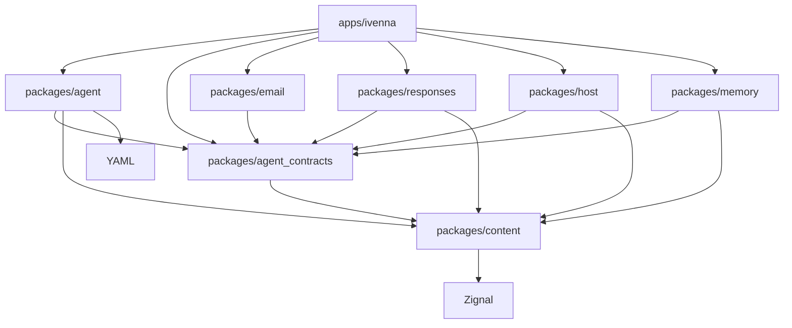

# Architecture

This guide describes Ivenna's current implementation: package responsibilities, execution, and service and storage protocols. The kernel retains working histories across restarts and constructs fresh execution state on startup. The application assembles the runtime and exposes health and reception status.

The [design intent](design.md) sets the behavioral goals and interface principles. The [input contract](input.md) defines runtime-generated user messages, [communication](communication.md) defines message observations and explicit sending, and the [usage guide](usage.md) explains correspondence with Ivenna.

## Responsibilities

| Unit | Responsibility |
| --- | --- |
| [apps/ivenna](../apps/ivenna) | Configure and assemble the runtime, serve HTTP status, and own process startup and shutdown |
| [apps/memory](../apps/memory) | Serve memory operations over SSH and own workspace files, capacity enforcement, and locking |
| [packages/agent](../packages/agent/src/root.zig) | Coordinate sessions, activations, forks, and retained history; own model-input rendering, execution policy, and model-facing resources |
| [packages/agent_contracts](../packages/agent_contracts/src/root.zig) | Define the communication, history storage, and capability contracts shared by execution and concrete implementations |
| [packages/email](../packages/email/src/root.zig) | Own native addressing, message projection, submission, storage, and retention behind the communication and history contracts |
| [packages/responses](../packages/responses/src/root.zig) | Encode and measure model requests, decode Responses output, and apply model content limits |
| [packages/host](../packages/host/src/root.zig) | Define host tools and own synchronous and background shell execution, process cleanup, logs, and completion output |
| [packages/memory](../packages/memory/src/root.zig) | Define memory tools and translate their operations and results through the SSH service protocol |
| [packages/content](../packages/content/src/root.zig) | Define tool-result text and image content, classify source bytes, and interpret image references |

`apps/ivenna` links the libraries into one process. Its [HTTP listener](../apps/ivenna/src/service.zig) runs alongside the kernel and shares the application's shutdown scope. `apps/memory` is a separate program reached through SSH; its handler and image sources live together, while local service orchestration remains in `dev`.

The execution core and concrete capabilities share `agent_contracts`, which depends only on Content. Content supplies tool-result text and image representation and source classification. YAML rendering belongs to the agent. The build declarations enforce the following module dependencies; each arrow points from a module to one it imports:

### Shared contracts

At runtime, the application supplies concrete capability implementations through shared contracts. Kernel calls input, sending, and history storage operations and publishes wakeup or interrupted-host observations. Host publishes command completions through the same callback contract. Engine calls the model and registered tools.

The agent exposes `Kernel`, `Engine`, and its `Input` message types and renderer. Session scheduling, owned deliveries, activations, and retained context remain core implementation details. `Kernel.Config` and `Kernel.Limits` describe execution policy; `Engine.Reasoning` selects ordinary reasoning effort for core and branch roles. Connection settings and protocol encoding belong to their capability packages; the application loads environment values and owns HTTP listener settings.

Shared [communication types](../packages/agent_contracts/src/communication.zig) describe incoming observations and explicit outgoing messages. The shared capability contracts define calls and data exchanged within the process. The agent owns model-input rendering, handovers, history-record encoding, and the checkpoint selecting retained working histories; each adapter owns its service protocol encoding:

| Contract | Operations | Implementation |
| --- | --- | --- |
| [Inbox](../packages/agent_contracts/src/inbox.zig) | Poll typed correspondence and callback envelopes with opaque receipts and acknowledge durable admission | Email integration |
| [Callback.Publisher](../packages/agent_contracts/src/callback.zig) | Store a terminal observation under a registered callback ID | Email integration |
| [Communication.Sender](../packages/agent_contracts/src/communication.zig) | Submit explicit outgoing messages using correspondent IDs | Email integration |
| [HistoryStore](../packages/agent_contracts/src/history.zig) | Load and save the current checkpoint; allocate groups, discover record metadata, read and create records in batches, and maintain the selected history | Email integration |
| [Model.Port](../packages/agent_contracts/src/model.zig) | Infer, measure the encoded request, and apply model content limits | Responses adapter |
| [Tools](../packages/agent_contracts/src/tool.zig) | Register a capability's declarations with its invocation entry point | Host and Memory |

`Communication.SendResult` distinguishes a submitted message from an unsupported recipient. The sending adapter classifies recipient support before submission; execution renders the corresponding tool result. Infrastructure failures propagate through the error channel.

The email integration uses the configured mail account for communication copies and working history. It owns native addressing, folders, markers, and record lifecycles behind the shared contracts. The [email boundary](#email-boundary) describes its storage protocols and operation ownership.

`Tools.Invocation` supplies a session ID and an optional callback registrar valid only during that invocation. The agent's registrar binds source and destination in durable execution state. A capability can retain the returned callback ID for later publication, but cannot retain the registrar or choose an arbitrary receiving session through it. `Callback.Publisher` accepts only the registered ID and result text.

## Service and reception

The application owns service, kernel, host supervision, and shutdown tasks. The [kernel](../packages/agent/src/kernel.zig) owns intake and session execution tasks; Host supervises background commands independently of those sessions. Task failures close reception and cancel and join concurrent work before shared dependencies are released.

The application initializes the mail integration, checks memory, and [restores sessions](#startup-and-interruption) before binding `SERVICE_ADDRESS` and starting kernel tasks. The kernel completes initial history maintenance before opening reception and dispatching startup activations. Readiness does not wait for their model work to finish.

While the listener is running, `GET /healthz` reports that the HTTP service is responding. `GET /readyz` returns success with `X-Ivenna-Ready: true` only while reception is open; otherwise it returns `503`. Closing is terminal for that kernel instance. The status endpoint reads this lifecycle state; it does not perform fresh dependency checks or reserve processing capacity.

The receiving boundary checks reception status before accepting correspondence. This is a precheck: shutdown can follow a successful check, and an already accepted message can remain in the account's mail storage. The receiving policy is configured in the deployment's mail infrastructure. The [running guide](running.md#service-status-and-reception) describes the reception contract and HTTP status interface; the [local mail setup](../dev/README.md#configuring-mail) provides an SMTP example.

Reception status belongs to the service boundary. Model reasoning and tools do not manage transport availability, offline queues, or sender retries.

## Sessions, work, and communication

| Concept | Role and lifetime |
| --- | --- |
| Task | Work to be accomplished; it may continue across activations |
| Core session | Coordinating session with no parent, saved history, and its own runtime queue and execution lane |
| Work session | Session created by a fork, with an independent history, queue, parent, and any children |
| `input` event | Correspondence observation with `from` IDs, text, and observation time |
| Delivery | An owned observation retained through durable admission and any transport receipt acknowledgement |
| Activation | One session continuing work through model and tool rounds, including admitted events or a core state reconsideration, until completion or fork |
| Model round | One model response followed by all tools it invoked |

The [session registry](../packages/agent/src/sessions.zig) serializes queue and history changes; workers infer from owned snapshots and commit complete rounds before their model-round arenas end.

The registry stores each session's `Input.Role`: the core has no parent, and a branch's `parent_session_id` identifies the session that forked it. The registry uses that relationship for reports and report-capacity reservations. Identity and parent relationships remain registered while a session sleeps or its context is unloaded. Current request state and checkpoint records preserve those identities.

### Scheduling and capacity

`MAX_PARALLEL_ATTENTION` bounds concurrent work-session execution; the core has a separate serial lane. Sleeping sessions consume no execution slot. Core responsiveness also depends on short coordination turns and service latency.

At each dispatch, the registry considers work sessions in stable session-ID order, starting after the last successfully claimed work session and wrapping once. The cursor gives eligible sessions rotating opportunities to start an activation and resets on restart. Sessions blocked on report capacity remain waiting; the rotation does not preempt running activations or their model/tool rounds. The core is claimed independently and does not participate in this rotation.

`MAX_SESSIONS` bounds registered session identities, including the core. Reaching it prevents new forks, while registered sessions remain addressable and can accept more work. `MAX_PENDING_EVENTS` separately bounds each session's ordinary deliveries and reserved reports. `MAX_PENDING_CALLBACKS` bounds registrations not yet durably admitted per session; `MAX_BACKGROUND_COMMANDS` bounds concurrently executing background host commands. Startup and nested creation notices are control events outside the ordinary event budget; the session limit bounds the number of creation notices. Correspondence and callback mail remain stored when their destination cannot accept them. Automatic retirement of registered identities is not implemented.

A work activation reserves space for its report in its direct parent's and core's admission budgets, counting the core once when it is the parent. A later activation waits if a required destination has no capacity. Completed reports consume those reservations and join their recipients' queues, so later input cannot take their place.

### Coordination and current state

Every incoming message enters the core independently, including messages a mail client groups into one thread. Receiving an observation does not imply that Ivenna was addressed or must respond. All correspondents share its FIFO queue; scheduling distinctions by correspondent ID remain undecided. Ivenna interprets each message alongside retained understanding, while Sessions owns execution histories and queues.

Core and work sessions expose `send_message`, `fork_session`, `send_session_message`, and the full shared memory interface. `wakeup` is available to both roles and addresses only the caller; only branches expose host tools. Engine uses the same role selection for declarations and invocation. External sending remains independent of incoming messages and report destinations. A branch's final result is reported automatically to its direct parent and the core, with one copy when they coincide. The broader task and the session remain available for later events.

Each inference receives a fresh roster of registered sessions with their identity, parent, execution status, queued-event and pending-callback counts, and last activity. A `session_created` event supplies the core with a nested fork's identity, parent, and assignment; the core's own forks remain recorded in its tool exchanges. Reports and handovers retain the understanding of work, while the roster supplies current execution facts.

Changes in non-core sessions advance an internal attention generation and make the core runnable. This can start or continue an activation with no queued events; the next ordinary turn supplies current state with an empty `purpose.work.events`, without a synthetic event or exposed revision. A core session can therefore be `ready` with `queued_inputs: 0`. Snapshotting, budget measurement, and summarization do not consume the signal. Immediately before submitting an ordinary inference, the registry marks only its captured generation as observed; later changes remain pending. Core-only execution transitions do not advance that generation.

`send_session_message` durably queues a source-attributed observation for the named session. It confirms acceptance, leaving interpretation and subsequent action to the receiver. [Session communication](communication.md#session-communication-and-wakeups) defines the model-facing operations; [callback admission](#event-sources-and-callback-admission) describes registered event sources.

## Activation admission

The email adapter supplies typed correspondence or callback envelopes with optional opaque receipts. The agent sends ordinary correspondence to the core and resolves callback IDs through its durable registration to select the receiving session. [Work](../packages/agent/src/work.zig) owns each accepted event and its receipt until admission is acknowledged. Receipts stay outside model input. In-process assignments, messages, creation notices, and reports have no input receipts.

When a session has queued events, Sessions claims them and the kernel selects the longest nonempty FIFO prefix that fits the complete ordinary request: retained messages, a turn combining current state and candidate events, and tool definitions. Selection starts from the available queue without waiting for more arrivals. For each candidate, `Snapshot.afterAdmission` projects the state after admission: the excluded suffix returns to the global and session queue counts, selected callback registrations disappear, and the session's directory counts reflect both changes. Each projection owns its arrays without changing the registry or other candidates, so measurement reflects the same admission effects and request assembly as execution.

The selected group is durably retained. Ordinary assembly combines it with fresh current state in one work turn, without another copy in the prefix. If a subsequent budget check requires compaction first, that retained group contributes to the handover instead; the replacement work turn can have empty events. Unadmitted queue entries remain outside summary input. After a complete model/tool batch, further queued groups can enter before the next inference. A running inference or tool is allowed to finish.

When old working history prevents even the first event from fitting, the kernel summarizes that history and selects again. That summary does not process the new events. If the first event cannot fit after compaction, or there is no earlier work to compact, admission fails with `ContextBudgetExhausted`. Events excluded by the budget return to the queue's front, before arrivals received during selection, preserving FIFO order.

Before reasoning about each admitted group, the kernel saves its input record and confirms the checkpoint, then calls `Inbox.acknowledge` for each selected receipt. Each successful acknowledgement releases that delivery's receipt and changes its notice to acknowledged. An excluded event keeps its receipt and remains pending. Acknowledgement transfers responsibility for the input to retained history; it does not certify task success. Acknowledged notices remain until a later poll no longer returns those messages.

## Forks and work ownership

`fork_session` accepts a `task` and passes the whole activation's work to one new work session. A model round can create at most one fork. The [tool definitions](../packages/agent/src/tools.json) own its parameters.

Sessions reserves child identity, registered-session capacity, any nested creation-notice space, and report destinations during tool invocation. It publishes the fork only after committing model output and one result for every tool call, so inherited history contains a complete exchange. A branch's fork also queues a `session_created` observation for the core, identifying the new session, its parent, and task. A core fork needs no creation event because that fact is already in its retained tool exchange.

A fork copies the caller's complete retained context, including any compaction handover. It receives an assignment, and its model request supplies its current state. Histories then grow independently while the host, memory, and world effects remain shared. The [input contract](input.md#assignments-and-reports) defines assignment and report fields.

Publishing a fork ends the caller's activation. The child handles its assignment in a new activation, using the complete inherited history. Queued deliveries remain with the caller, which returns to its own queue without another inference to conclude the transfer. Later messages still arrive at the core.

Session identifiers and parent relationships persist independently of whether their contexts are loaded. The [startup contract](#startup-and-interruption) describes how those relationships and unread internal work are restored.

## Activation completion and sleep

Engine completes each tool batch with one result per call. Sessions copies accepted model output, including reasoning items, and tool results into retained history before the model-round arena ends. A published fork ends the caller's activation; otherwise, tool results feed another round. Intermediate assistant text and complete exchanges remain in history.

An ordinary final response without tool calls ends execution when no queued events or pending core attention signal require another inference. That check and completion share the registry lock: an arrival or state change either continues this activation or makes the session runnable afterward. A response superseded by new work stays in history without generating a report. Completion does not certify that the broader task succeeded. A branch's combined final text, including empty text, becomes report deliveries for its direct parent and the core, or one delivery when they coincide. Core final text remains internal. Sending occurs only when a `send_message` tool call executes, so an activation can submit several messages or none.

Reports enter the tails of their recipients' FIFO queues for the next admission, potentially with other queued events. A nested child's result reaches its direct parent and the core without a parent model forwarding it. Reports do not change parent relationships or the destinations of direct session messages and callback sources.

After an activation ends, its session sleeps until queued events or a core attention signal require further work. Its identity, selected history spans, and pending callback registrations remain checkpointed. After confirming the saved history and releasing worker borrows, the runtime can unload the materialized context. Later work restores those committed spans through HistoryStore and wakes the same session. Queued reports own their text independently of the child's loaded context and model-round arena. Background host tasks remain owned by the host's runtime scope while that branch sleeps.

Session identity retirement is a separate, unimplemented policy. Context compaction condenses a session's understanding when its next request requires it.

## Event sources and callback admission

The registry allocates monotonically increasing callback IDs and persists a `PendingCallback` binding each ID to a source kind and receiving session. `wakeup` binds to its caller; a background host invocation obtains a registration for its invoking branch before the command is accepted. Producers retain only the registered ID and publish result text through `Callback.Publisher`. The destination remains fixed across forks, context unloading, and restart. [Callback delivery](#callback-delivery) describes the email adapter behind that contract.

For a wakeup, the registry also saves `History.Wakeup { id, at_unix_ms, text }`. Each intake-loop iteration copies the sources due by the current Unix time, publishes their text, and removes each deadline after confirmed publication. The callback registration remains until admission. A crash between publication and deadline removal can cause another publication attempt; the publisher preserves the stored result. Wakeups whose deadlines passed while the kernel was unavailable follow the same path on restart. Polling, queue capacity, and execution scheduling can delay inference beyond the requested time.

On intake, the registry resolves the callback ID to its source and destination. A full destination queue defers acceptance, leaving the mail available. An in-memory `queued_callbacks` set prevents another transport copy from being accepted or acknowledged while the first is queued or being admitted. Admission removes the pending registration and records the observation in the same checkpoint. The in-memory barrier remains until that checkpoint is confirmed and the selected receipt is acknowledged, then releases with the delivery.

After durable admission, later copies of that ID are acknowledged without another model observation. A missing registration is recognized as consumed only for a positive ID below the checkpointed next-ID counter; an ID outside that range fails execution. Unknown callbacks never become core correspondence. Neither a mailbox payload nor a producer can supply a replacement session or an executable callback method.

## Working history and user messages

[Context](../packages/agent/src/context.zig) owns the retained working history: admitted observations, complete model/tool exchanges, and handovers. It derives and caches LLM messages from those entries and the current system prompt. Model output and tool results retain their native roles and formats. The [persistent history codec](#persistent-working-history) stores the entries and the checkpoint that selects them, allowing Context to restore this message view after unloading or restart.

[Input](../packages/agent/src/input.zig) defines the runtime-generated user messages within that conversation. `Input.Record` represents retained `events` or a `handover`. `Input.Turn` combines fresh `current` facts with one tagged `purpose`: `work` carrying new events, or `summarize` carrying instructions. The [input contract](input.md) defines the YAML fields; the [system prompt](../packages/agent/src/system.md) explains interpretation and response scope.

Model exchanges retain native `Model.Item` values, including opaque adapter continuation bytes and typed tool results. Continuations preserve complete model output, including reasoning, in the producing adapter's format. The agent copies and persists those bytes without interpreting them. Forks inherit the retained entries, preserving the original receiving session identifiers on user records. For each inference, the kernel takes an owned history snapshot and obtains `Input.Current` from Sessions.

For ordinary work, `Context.request` appends a turn with current state and `purpose.work`. When delivering a newly admitted group, `Delivery.latest` takes the final event record out of this request's prefix and places its items in the turn. The retained Context is unchanged: subsequent history contains the observations without transient state. With `Delivery.none`, the whole history remains in the prefix and the work turn's events are empty. `Context.requestWithEvents` measures an admission candidate by borrowing the existing prefix and rendering candidate events with the [projected state after admission](#activation-admission) in one turn.

For handover generation, `Context.summaryRequest` appends a `purpose.summarize` turn to the complete retained message sequence, without extracting its latest event group or adding unadmitted queue entries. The [compaction path](#bounded-model-context) validates the generated handover before replacing that sequence for continued work.

Appending history clones and renders only the new entry, with amortized growth of the entry and message arrays. Forks and inference snapshots still copy their retained contents for independent ownership. Request assembly borrows that snapshot until the inference returns; candidate measurement does not mutate it.

### Runtime state snapshots

Each turn contains the complete finite runtime-state projection, including the roster and the caller's pending callbacks. The registry maintains no per-session delta baseline. Rendering this projection repeats work proportional to the session count plus the caller's pending callback count, and its bytes compete with history and tool definitions for the request budget.

In one `Input.renderTurn` sample with empty work events, one core, 127 dormant branches, and no own callbacks, the YAML turn occupied 30,370 bytes; adding 64 own callback registrations increased it to 35,296 bytes. These are conditional YAML sizes, excluding retained history, tool definitions, and provider JSON encoding. They are neither token estimates nor complete-request sizes. Session and callback capacity therefore need to fit the configured context budget as well as execution needs. The [design choice](design.md#events-and-waiting) keeps snapshots complete so forked, restarted, and compacted contexts need no delta baseline; task meaning and prior conclusions remain in messages, handovers, and memory.

## Model requests and tools

The final runtime user message is an `Input.Turn` containing both `current` and `purpose`. For ordinary work, [Engine](../packages/agent/src/engine.zig) combines the assembled messages with selected tool declarations and explicit reasoning effort to form a complete [Model.Request](../packages/agent_contracts/src/model.zig). A maintenance turn selects `purpose.summarize` and disables tools.

Tool declarations live with their owning implementations: [communication and session tools](../packages/agent/src/tools.json), [host tools](../packages/host/src/tools.json), and [memory tools](../packages/memory/src/tools.json). Host and Memory register their declarations through `Tools`. The application supplies Memory through `Engine.shared_tools` and Host through `Engine.work_tools`. Engine includes its own declarations and shared tools for both roles, adding work tools for branches. Invocation uses the same role selection.

Engine selects ordinary reasoning effort from `Engine.Reasoning` using the current `Input.Role`: core defaults to `low`, branch to `high`. All sessions use the same configured model and output-token limit through a shared provider. The [Responses adapter](../packages/responses/src/provider.zig) encodes the selected declarations and reasoning effort in the service protocol, including `reasoning.effort`. Byte measurement uses the same payload encoder as inference, including while applying tool-result limits.

The Responses adapter decodes the entire output batch before Engine executes any tool in it. It validates the fields needed to extract calls and assistant text, and retains each output item as opaque continuation data. Execution and compaction use those decoded values. An incomplete response fails model execution before any of its tool calls execute. In ordinary work, unknown tools and invalid arguments become tool errors available to the next model round.

### Tool results

[Content](../packages/content/src/root.zig) owns native text and image parts, encoded image metadata in [image.zig](../packages/content/src/image.zig), and classification of individual byte sources. The owning tool renders unavailable-content diagnostics as text. Classification borrows bytes; a separate explicit interpretation can present source text as an image reference. Pixel decoding and URL retrieval belong to the model service.

Memory and Host return content in the model-round arena. Engine creates a native tool result with its call ID and content; the Responses adapter encodes it for the configured model service. Local image bytes become request data; remote URLs remain references whose contents can change. Image rejection preserves accompanying text and reports the omitted image. Image limits apply once to the complete tool batch alongside the whole-context budget. See [tool content](content.md) for formats and limits.

## Bounded model context

`CONTEXT_REQUEST_BYTES` bounds the complete ordinary [model request](#model-requests-and-tools), including system instructions, retained records and exchanges, current state, tools, reasoning settings, and encoded images. `LLM_MAX_OUTPUT_TOKENS` separately bounds generated output, including reasoning tokens.

After admission, each tool continuation checks the complete request budget again and can compact the activation's retained history when needed.

Compaction supplies the retained LLM message sequence followed by a turn with fresh current state and `purpose.summarize.instructions` from [compaction.md](../packages/agent/src/compaction.md). Those messages stay available throughout handover generation. This maintenance inference does not answer events, admit waiting input, or consume the core's attention signal. Its `Model.Request` has no tools and uses `high` reasoning effort; the Responses adapter encodes `tool_choice: none`. `CONTEXT_COMPACTION_BYTES` bounds that complete generation request.

Compaction trims surrounding whitespace from the generated text and requires a nonempty handover within `HANDOVER_MAX_BYTES`. The kernel builds the replacement's ordinary request with a fresh state snapshot and checks its complete budget before installing the handover record.

After validation, compaction installs a new working history containing the system prompt and handover, preserving session identity and parent relationships. The next ordinary turn supplies fresh current state and its work purpose. The replaced messages, including the raw transcript tail, are absent from this continuation request. Retention of their storage records is a separate lifecycle. Summary instructions preserve relevant session and correspondent IDs, relationships, ongoing work, commitments, and completed effects.

Byte counts are local measurements, not model-token estimates. If a request or summary cannot meet its bound, execution fails explicitly rather than cutting an unfinished exchange.

FIFO admission still measures successive event prefixes through whole-request encoding. With `Q` candidate prefixes and a largest encoded request of `B` bytes, this can take `O(Q * B)` work. Trial allocations are reused between candidates, so they occupy space for one candidate rather than all prefixes. The model contract exposes whole-request measurement.

## Persistent working history

The agent's [history codec](../packages/agent/src/history.zig) stores immutable records and a current checkpoint selecting the working histories for continuation. A session's history consists of ordered prefixes of history segments. Forks inherit those prefixes and append in the child's own segment. Compaction begins a replacement segment with a handover while preserving the session's identity and parent relationships.

| Term | Meaning |
| --- | --- |
| Session | A core or work session with its own identity and role |
| Segment | An append-only sequence identified by `Scope { session_id, epoch }`; a fork starts its own segment, and compaction advances its session's epoch |
| Storage group | An opaque identifier used by `HistoryStore` to discover a segment's records |
| Span | A checkpoint's selected prefix of a segment, identified by its group, head key, and entry count |

Each entry retains its segment identity and either a complete admitted `Input.Record` or a complete model-output and tool-result batch as `Model.Item[]`. Inherited event groups keep their original receiving session identifier and event order. Exchanges preserve opaque model output, including reasoning, and typed tool replies with text and media. Local image bytes remain in the records; remote images retain their URLs. Inference snapshots copy segment identities along with entries.

Records use compact UTF-8 ZON bodies. An entry record contains the entry and its predecessor's SHA-256 key within that segment, or null for the first entry. Its own key is the SHA-256 of the complete encoded body. Segment identity and predecessor keys distinguish occurrences even when their payloads are equal. Unread internal observations are stored together in a separate immutable observation-array record in the session's current group.

The checkpoint contains the next session and callback identifiers, pending callback registrations and their bound destinations, wakeup deadlines, and each registered session's ID, role, last activity, interrupted-execution state, epoch, current group, and ordered spans. Assignments and results remain in history records rather than separate task or result caches. An optional key selects the unread observation array in the current group; its text stays outside the checkpoint. Appending advances a span's head and count without adding a per-entry reference. A sleeping session can retain confirmed spans without materialized context entries. The latest confirmed checkpoint selects the records kept by [history maintenance](#history-retention) and available for subsequent restoration.

### Saving and restoration

`HistoryStore` provides grouped record operations, checkpoint loading and publication, and maintenance against a retention selection. The agent's codec owns segment identity, record encoding, content keys, committed paths, and retention selection, and validates the checkpoint and selected history. The adapter owns native group representation, locators, placement, and request limits. It decodes reference metadata and returns one complete body per requested reference in input order. Native locators do not appear in the checkpoint.

The runtime saves after event admission, accepted complete model/tool batches, compaction, fork publication, activation completion, and changes to unread internal input or callback registrations. A save encodes and hashes materialized records to compare each segment against its cached prefix, then creates new occurrences and changed unread-observation records in batches. Cold sessions retain their already confirmed spans without reloading or rewriting their history bodies. Each batch holds up to 32 records and about 1 MiB of encoded bodies, allowing a single larger record. All required creates must be confirmed before publishing the checkpoint. An interrupted or unconfirmed create can leave records outside the selected paths; neither exactly-once creation nor archive-wide deduplication is guaranteed.

Checkpoint sessions serialize in ascending ID order. If the encoded checkpoint matches the last successfully loaded or saved checkpoint, the codec skips publication. A publication error may occur after the new checkpoint has reached storage, so it invalidates that comparison digest while retaining the confirmed record cache. The [email integration](#history-storage) owns publication and current-checkpoint selection in the mail account.

Restoring a context discovers metadata for its checkpoint groups. The codec follows predecessor keys in memory from each committed head, checks its count, and selects the required records before reading their bodies in batches. It verifies body hashes, predecessor metadata, segment identity, and record kind, then decodes each selected record once to assemble that context. Duplicate physical records with the same key and matching predecessor metadata can supply one logical occurrence; the selected body's hash is still checked. Missing or inconsistent committed records fail restoration. Records outside the selected paths remain uncommitted or historical material.

Initial checkpoint loading currently reads and decodes every selected history before the registry discards sleeping branches' temporary entries. This creates startup I/O and transient memory use proportional to all selected history. After startup, a cold branch restores only its own committed spans when needed. Loading only the contexts needed at startup is not implemented.

Delivery and activation objects, input receipts, worker ownership, and host process handles are outside the checkpoint. The [startup contract](#startup-and-interruption) describes reconstruction and interruption semantics. Storage and decoding failures end startup or execution rather than silently starting with empty history. History search and model tools for retrieving earlier records are unimplemented.

### History retention

A session appends to its current segment. Compaction seals that segment and starts another; forks can continue to reference a sealed segment's inherited prefix. Unloading a context leaves its session and spans in the checkpoint, so its records remain selected. Compaction can remove continuation references to earlier records; automatic session-identity retirement is unimplemented. Earlier checkpoints are not restoration roots.

The intake loop runs maintenance before opening reception. After that, it checks between polls whether at least 60 seconds have elapsed since the previous maintenance pass. The registry holds its lock while saving the current contexts and reconciling storage, so maintenance uses a confirmed checkpoint and cannot overlap record creation or publication.

The codec derives `HistoryStore.Retention` from the last successfully loaded or saved checkpoint. `active_groups` names each retained session's current writable group. `records` names every selected `(group, key)`, including inherited prefixes and unread internal observations. The adapter uses this complete selection to place records and retire unselected material, without interpreting session identities or checkpoint bodies. Unchanged saves can skip checkpoint publication while still allowing maintenance.

The [email integration](#mail-retention) maps writable, sealed, and unselected records to its history, archive, and Trash folders. The mail service controls how long retired objects remain in Trash and when their storage is reclaimed.

### Processing cost

With expected hash-map lookup costs, local save work follows the entry bytes in materialized sessions plus checkpoint metadata, with an additional sort of the bounded registered-session list. Snapshot comparison encodes and hashes loaded entries, including shared inherited prefixes; cold sessions reuse confirmed spans. Temporary record encoding space holds a bounded batch plus the largest record. The in-memory group and key cache covers the last confirmed checkpoint.

Checkpoint size follows retained sessions and their segment spans rather than accumulated model rounds. A fork adds a segment while reusing its inherited spans; compaction replaces a session's spans with its new handover segment.

Group discovery can return metadata for uncommitted records and for a parent's later suffix beyond a child's inherited prefix. The codec reads bodies only for the selected committed records. All group identities are available before retrieval, so predecessor traversal needs no storage request per link. Native filtering and pagination costs depend on the backend and accumulated records; the [email storage section](#history-storage) describes the current access path.

## Startup and interruption

Startup discovers the mail account and checks memory through a read-only `inspect_memory_space` exchange. Both must succeed before the kernel starts. Memory is required throughout operation.

The kernel loads the current checkpoint through `HistoryStore`. If no history exists, it creates the core. It rebuilds registered identities, parent relationships, unread internal observations, and callback registrations. Initial history validation still reads all selected records; branch entries are then discarded until needed. Contexts selected for execution restore their committed histories with the current system prompt, while sleeping branches have no materialized working context.

The core queues a `startup` observation immediately. Sessions whose execution was interrupted or which have unread internal observations also receive startup before that work. Other branches stay asleep; their first real event in the new runtime causes a startup observation to precede it. Normal FIFO request-budget admission can select startup and unread work together. Pending wakeups survive restart and publish callback mail when due. Stored host callbacks remain eligible for admission; a registered host activity lacking a stored result produces an interrupted observation with an unknown outcome instead of rerunning the command. Work activations reserve their parent and core report destinations before starting. A newly forked session begins with an assignment instead. Before reception opens, the mail integration has retired leftover communication copies and the kernel has run [history maintenance](#history-retention).

Startup creates fresh execution state without restoring prior activations, input delivery objects, receipts, or processes. Restored parent relationships route future branch reports to the parent and core. Current request state describes the new runtime; retained records describe earlier observations. Ivenna chooses how to continue from that evidence. Ordinary unacknowledged mail remains eligible for intake. A crash between history publication and acknowledgement can leave correspondence eligible even when its observation already survives in history. Callback IDs are reconciled against durable admission rather than treated as new correspondence. Correspondent IDs retain their destinations within the configured domain.

A host command, memory change, or submission may have taken effect before its complete model/tool batch was saved. Losing a submission response can leave acceptance unknown; repeating it can produce a duplicate. The runtime does not replay historical calls or guarantee exactly-once effects. Uncertain effects may need inspection before further action. Automatic retry and reconnection remain undefined.

The runtime assumes one kernel per Ivenna account. Message submission, input acknowledgement, host effects, memory writes, and history storage do not share a transaction.

Infrastructure failures in communication and memory, along with model execution, compaction, and history storage or maintenance errors, propagate through the kernel's tasks. A task error ends the kernel and its task scope. Defined tool outcomes, including invalid arguments, command failures, and memory-handler domain errors, remain results for the model to interpret.

## Email boundary

[Addressing](../packages/email/src/addressing.zig) derives the correspondent domain from `MAIL_ADDRESS`. It projects a same-domain address's local part into a readable ID and resolves an outgoing ID back into that domain. Domain comparisons ignore case; IDs preserve case. The supported ASCII ID and domain forms are described in [communication](communication.md#current-email-addressing).

Each send resolves recipient IDs in the configured domain and submits a standalone email with subject `Ivenna` and the supplied text as its body. Unsupported IDs return the ordinary `invalid_recipient` tool result. IDs retain their destinations across context unloading and restart with the same domain configuration. Native addresses, delivery records, headers, folders, and private markers remain within the email integration.

The adapter creates each outgoing copy in Drafts with `ivenna-outbound`. Confirmed submission uses `onSuccessUpdateEmail` to remove draft state and move the copy to Trash. Both submission and that implicit update must be confirmed before the adapter returns its opaque submission reference. Under [RFC 8621 §7.5](https://www.rfc-editor.org/rfc/rfc8621.html#section-7.5), retiring the Email after successful submission does not cancel delivery. Service acceptance does not establish final recipient delivery.

### Callback delivery

The email adapter creates `Ivenna Callbacks` in the same account and writes self-addressed `Email` objects directly with JMAP `Email/set`. These objects carry the broad `ivenna-callback` marker, an exact per-ID keyword `ivenna-callback-<id>`, and `X-Ivenna-Callback-Id`. Native lookup uses keyword membership, not header search. No SMTP submission, alias, or extra account is involved. Callback creation is independent of the correspondence reception gate, and a confirmed object stays in storage while the kernel is offline.

Callback intake queries only the dedicated folder and rechecks that membership while decoding. It also checks the private marker, self From and To addresses, positive callback ID, exactly one matching per-ID keyword, and complete text body. The keyword index and ID header must agree. Invalid private callbacks produce a diagnostic and are skipped rather than entering core correspondence. The adapter returns a typed callback envelope; the agent owns [destination resolution and admission](#event-sources-and-callback-admission). Outside the dedicated folder, correspondence bearing a similar header without the private marker remains ordinary correspondence.

Before publication, the adapter queries the broad marker and exact per-ID keyword across the account, without the intake folder restriction. It validates callback identity, including the returned object's header and index, before preserving its first stored result, including a matching copy in Trash. An unavailable body does not permit replacing that stored result. Duplicate lookup depends on retained mail; the deployment's Trash expiry remains in force. Acknowledgement retires an admitted callback copy through the same handled-marker and Trash update used for correspondence.

Scheduled wakeups and background host completions use this same mailbox path. A stored callback can survive shutdown independently of its producer process. See [host execution](#host-execution) for task ownership and interruption.

### Mail intake and acknowledgement

The [email integration](../packages/email/src/root.zig) polls through the [mail client](../packages/email/src/mail.zig) for physical input messages without the private `ivenna-handled` acknowledgement keyword. Ordinary intake spans correspondence folders and is independent of read and starred state. `Ivenna Callbacks`, `Ivenna History`, `Ivenna Archive`, Drafts, Junk, and Trash are excluded from correspondence, along with drafts and messages carrying `ivenna-callback`, `ivenna-outbound`, or `ivenna-state`. Callback intake uses its own marker and dedicated folder. The runtime marks its outgoing messages with `ivenna-outbound`; correspondents send from separate accounts.

`Inbox.Poll { messages, callbacks }` gives correspondence and callbacks independent intake allowances; zero disables that stream. The registry sets `messages` to zero when the core has no admission capacity while keeping the callback allowance independent. Allowances account for tracked receipts, and the callback allowance also covers pending registrations. These choices belong to execution rather than model scheduling.

The mail client reads each stream's oldest eligible prefix, continuing through native query pages when invalid addresses or unsupported bodies are skipped. It merges the selected records by `receivedAt` without applying a combined result limit, so an older correspondence backlog cannot consume the callback allowance. FIFO describes each stream's selected prefix and each session's accepted event queue. These prefixes do not establish one account-wide mail order across unrelated destinations. Rejected admission leaves the mail available for later polling.

[EmailTransport](../packages/email/src/email_transport.zig) projects From addresses into correspondent IDs and constructs each `IncomingMessage` from the subject, body, and runtime observation time. The [communication guide](communication.md#incoming-email-text) defines the text projection and supported bodies. The resulting observation is subject to [whole-request admission](#activation-admission).

Acknowledgement sets `ivenna-handled` and moves the input copy to Trash after the kernel confirms durable admission. Read and answered state are unchanged. The marker describes transfer into retained history, independently of the task's remaining work. Sessions keeps receipt bookkeeping only in memory.

### History storage

The email integration creates history records and checkpoints as JMAP Email objects in the top-level `Ivenna History` folder through `Email/set`. Selected records from sealed segments move to the top-level `Ivenna Archive` folder. The adapter discovers both folders by name, a null `parentId`, and a null `role`, and creates them when missing. It also discovers or creates the mailbox with role `trash`. Each object has a plain-text ZON body carrying the agent's encoding and a self-addressed envelope supplying native identity metadata. Creating these records does not submit correspondence.

All history objects carry the private `ivenna-state` keyword and an `X-Ivenna-History-Kind` header of `record` or `checkpoint`. The adapter allocates a fresh opaque group token and maps it to an exact keyword of the form `ivenna-history-<token>`. Records carry that group keyword, their `X-Ivenna-History-Key`, and an optional `X-Ivenna-History-Previous`. These headers expose record keys and predecessor metadata for retrieval; searches use native keyword membership rather than header or full-text indexing.

To discover records, the adapter queries `Ivenna History` and `Ivenna Archive` with the state marker and requested group keywords. It fetches record metadata in bulk, validates ownership and group membership, and returns opaque native locators to the agent. After the codec selects committed paths, the adapter reads those locators through bulk `Email/get`, validating group, key, predecessor, self-addressed identity, and complete text bodies. Trash is outside continuation reads. The agent then verifies hashes and decodes payloads. Native `Email.id` values serve as transient locators, not checkpoint identities.

Record creation uses bulk `Email/set` and confirms every requested create before returning success. Get and set batches obey the JMAP session's positive `maxObjectsInGet`, `maxObjectsInSet`, and `maxSizeRequest` limits, with at most 32 objects per batch. Native request sizes include encoded bodies and protocol fields. Group discovery requests pages of up to 512 IDs independently of get limits, then splits metadata and body reads into bounded native batches.

In the supplied Stalwart 1.0.2, [folder and keyword matching](https://github.com/stalwartlabs/stalwart/blob/v1.0.2/crates/email/src/cache/email.rs) can scan the account's message cache. Grouping limits which metadata and bodies reach the agent; it does not guarantee lookup work proportional only to the selected history.

Current checkpoint candidates carry both `ivenna-state` and `ivenna-current` and a numeric `X-Ivenna-History-Revision`. Discovery queries `Ivenna History` and those keywords, then validates returned metadata. Malformed kind or revision metadata on an owned current candidate fails loading. Loading selects the highest revision, independently of mail observation timestamps. Distinct candidates at the same highest revision are an error. Saving confirms creation of the complete new checkpoint; maintenance later removes the current marker from older checkpoints and moves them to Trash. Several candidates can remain between maintenance passes or after interruption, and the numeric revision identifies the current checkpoint.

A failed batch returns an error even when some objects may already have been created. Native group membership identifies candidate records; the checkpoint's committed heads and predecessor keys select the effective history. Mail threads describe correspondence and do not supply Ivenna's segment, fork, or compaction relationships.

### Mail retention

Communication copies, admitted callback mail, and unselected history records retire into Trash. The mail service owns expiry and storage reclamation under deployment policy, independently of whether Ivenna is running. The [running guide](running.md#data-and-retention) describes retention and preservation requirements.

#### Communication copies

The kernel's acknowledgement retires an input copy after durable admission. The sending operation retires its outgoing copy after confirmed submission. During initialization and before each poll, the email integration also retires acknowledged inputs and outgoing copies left by interrupted sends. It identifies outgoing copies by the runtime's marker and sender identity. These copies retire once no sending operation holds them, even if submission acceptance is unknown. Maintenance does not resubmit messages.

The integration holds its own lock through sending, intake, acknowledgement, and communication maintenance, so a draft needed by an in-progress send remains live. Pending input stays available for admission. Existing Trash is excluded from communication maintenance.

#### Working history

The email adapter maps the codec's [retention selection](#history-retention) to native folder membership. It inventories state objects in `Ivenna History` and `Ivenna Archive` before moving any of them. Ownership requires the runtime's state marker and self-addressed identity metadata. Owned objects must belong to exactly one folder. Maintenance uses bounded requests and classifies each physical object as follows:

| Object | Location and use |
| --- | --- |
| Latest checkpoint, or selected record in a current writable group | `Ivenna History`; current groups can receive new records |
| Selected record in a sealed group | `Ivenna Archive`; it remains available for inherited context and restoration |
| Unselected record or older checkpoint | Trash; further retention belongs to the mail service |

The adapter retains every physical copy matching a selected `(group, key)`. Unselected records include obsolete observation arrays and uncommitted writes outside the selected paths. They may move directly from `Ivenna History` to Trash. An archived record moves to Trash when it loses its last continuation reference; Archive has no age or capacity policy. The folders organize records by their use in continuation, rather than collecting a complete transcript for each ended session. Record bodies retain session and epoch identities for manual inspection.

Missing selected records, selected records from current writable groups found in Archive, and invalid metadata on owned objects are storage errors detected before folder updates. Trash is excluded from both inventory and continuation reads.

Restoration requires the latest checkpoint and all committed records with their bodies, group membership, keys, and validation metadata intact.

## Autonomous memory

Memory is a file workspace shared by all sessions. The Memory component resolves host write sources and exchanges typed JSON operations over SSH with the fixed [memory.nu](../apps/memory/src/memory.nu) handler. The handler owns file operations and capacity enforcement. See [memory rooms](memory.md) for tool behavior and [memory service requirements](running.md#memory-service) for deployment.

The handler returns explicitly defined operation errors, such as a missing entry or exhausted capacity, to the model as tool results. SSH failures, invalid protocol replies, and unclassified handler or backend failures propagate to the kernel. Finer error distinctions remain undefined.

The [memory shell](../apps/memory/memory-shell.sh) locks the workspace for each handler invocation, including capacity checks and writes. Separate operations can observe changes made by another session. Direct filesystem changes can bypass this boundary.

Transfers buffer complete files and payloads. Memory copies or decodes returned content into the caller's model-round arena before temporary SSH buffers are released. An incomplete exchange can leave the outcome of a write uncertain.

## Host execution

Work sessions execute as the kernel's OS account and share its filesystem and startup environment. Forking a model context leaves these resources shared, so a prior observation may need to be checked again after another session acts.

Host validates and routes requests. [Shell](../packages/host/src/shell.zig) executes a fresh noninteractive `/bin/sh` command; [process.zig](../packages/host/src/process.zig) owns process groups, timeouts, cancellation, and reaping. Complete output remains in host files, while [Reader](../packages/host/src/reader.zig) selects the content returned to the model.

Synchronous execution remains the default. `background: true` reserves a host execution slot and a source registration before returning its activity ID. `Host.run` supervises these tasks in the application's runtime scope rather than a session activation's worker scope. The task retains its callback ID, command arguments, and execution resources; it does not retain the invocation's registrar or model-round arena. It can complete after its originating activation ends and its session context is unloaded. Shutdown cancels and joins the host tasks before their publisher and shared dependencies are released.

Completion publishes JSON result text and output-file descriptions through `Callback.Publisher`; it does not supply native media parts. Image output retains its description and path with an `asynchronous_media_unavailable` omission notice. Callback publication failure and background allocation failure propagate through host supervision. Restart does not recreate host tasks: stored completion mail can be admitted, while unfinished registrations supply an interrupted result with unknown effects. Shell-script events during execution and cross-kernel persistent processes are not implemented.

Host propagates cancellation and allocation failure. Other invocation failures currently return `host_unavailable`, including failure to obtain a command result. Finer classification of these failures remains undefined.

See [host shell](host.md) for available tools, output, and interruption behavior.

## Implementation references

These references inform context, scheduling, and handoff mechanisms within Ivenna's [design intent](design.md).

[OpenAI Agents SDK handoffs](https://developers.openai.com/api/docs/guides/agents/orchestration#use-handoffs-for-delegated-ownership) provide a reference for transferring responsibility. [Codex thread forks](https://learn.chatgpt.com/docs/app-server#start-or-resume-a-thread) provide a reference for continuing stored history in a separate context. Ivenna uses context inheritance and explicit work ownership within one body.

[pi's sessions and context](https://github.com/earendil-works/pi/blob/main/packages/coding-agent/docs/sessions.md) distinguish stored history from the active branch supplied to a model request. Its [agent interface](https://github.com/earendil-works/pi/blob/main/packages/agent/README.md) provides a reference for queued follow-up input.
