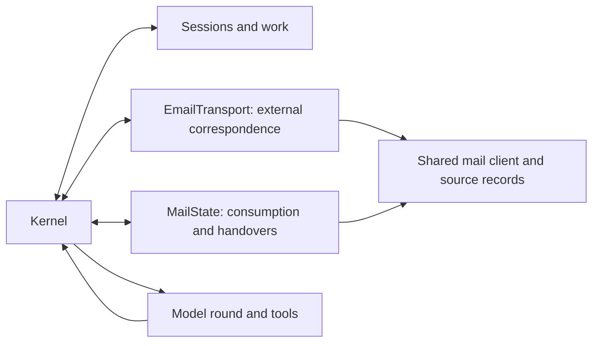

# Architecture

Ivenna coordinates model sessions, tools, and typed work. The kernel retains execution histories in process memory. External correspondence and work state use separate mail components: EmailTransport receives and submits correspondence, while MailState tracks input consumption and stores keyed handovers. Both use the shared mail client and source records.

The [design intent](design.md) explains these choices, the [input contract](input.md) defines model observations, and the [usage guide](usage.md) explains correspondence and continuity.

## Responsibilities

| Component | Responsibility |
| --- | --- |
| [Application](../apps/ivenna) | Load configuration, assemble shared and domain components, and own startup and shutdown |
| [Work](../packages/agent/src/work.zig) | Own inputs, assignments, deliveries, reply targets, and source state |
| [Sessions](../packages/agent/src/sessions.zig) | Own contexts, queues, opaque routes, fork publication, and synchronized scheduling |
| [Kernel](../packages/agent/src/kernel.zig) | Coordinate execution, email, internal state, and worker scopes |
| [Email transport](../packages/agent/src/email_transport.zig) | Project external correspondence into input material and submit replies |
| [Mail state](../packages/agent/src/mail_state.zig) | Track physical input consumption and store handovers by state key |
| [Mail sources](../packages/agent/src/mail_sources.zig) | Own shared source records, opaque receipts, caching, and immutable source artifacts |
| [Mail client](../packages/agent/src/mail.zig) | Decode the required JMAP operations into typed results |
| [Input](../packages/agent/src/input.zig) | Own native observation types and render them as YAML |
| [Engine](../packages/agent/src/engine.zig) | Execute one model response and its complete tool batch |
| [Context](../packages/agent/src/context.zig) | Own histories and copy complete contexts for forks and handovers |
| [Compaction](../packages/agent/src/compaction.zig) | Construct and bound summary requests and validate output |
| [Provider](../packages/agent/src/provider.zig) | Encode model requests and tool replies and decode output |
| [Memory](../packages/agent/src/memory.zig) | Exchange operations with the shared file workspace over SSH |
| [Host](../packages/agent/src/host.zig) | Route shell operations and select returned content |

The kernel combines projected input and its reply target with the source state supplied by the mail integration. Work owns the resulting delivery; Sessions uses its opaque input and route keys. Input defines model observations independently of these execution bindings.

The kernel owns intake and execution tasks in one cancellation scope. Any task failure ends that scope and joins all tasks before shared dependencies are released. Sessions serializes queue and history changes; workers infer from owned snapshots and commit complete rounds before their model-round arenas end.

## Sessions, work, and communication

| Concept | Role and lifetime |
| --- | --- |
| Task | Work to be accomplished; it may continue across activations |
| Core session | Permanent coordinating context with its own queue and execution lane |
| Work session | A fork with an independent history, queue, parent, and any children |
| Input | Content with optional source information and context |
| Delivery | An owned input or assignment being queued or executed, with any reply target and source state |
| Activation | One session handling a delivery, including any wait for requested findings |
| Model round | One model response followed by all tools it invoked |

Inputs carry content, optional provenance, and supporting context. Sessions own execution histories and queues; a producer can supply an opaque route for continuing work. New work enters the core unless that route identifies an existing owner. Follow-ups queue while an activation continues. Ivenna interprets their content when processing them.

The core can answer directly or hand work to another session through `fork_session`. Its tool interface exposes handoff; work sessions have the full tool interface and can fork further sessions. A response without tool calls ends the current activation. Its response destination determines whether text is a reply, requested findings, or an internal result; the broader task can remain open.

`MAX_PARALLEL_ATTENTION` bounds concurrent work-session execution; the core has a separate serial lane. `MAX_ATTENTION_CONTEXTS` bounds retained contexts, including the core, and each session's active and queued deliveries. Input that cannot be admitted stays with its producer; the mail integration leaves it available for later polling. Waiting parents retain context without consuming a work slot. The core still processes its requests serially, so responsiveness also depends on short coordination turns and service latency.

## Forks and work ownership

`fork_session` accepts a `task` and an optional `mode` object. The [tool definitions](../packages/agent/src/tools.json) own its parameters.

| Mode | Meaning |
| --- | --- |
| `{"handoff":{}}` | Transfer the current work and its responsibilities; this is the default |
| `{"subtask":{"report_to_parent":false}}` | Start internal work; enable `report_to_parent` to request findings |

A fork copies the caller's complete current context, including any compaction handover. It receives an assignment and fresh runtime state. Histories then grow independently while the host, memory, and world effects remain shared. The [input contract](input.md#assignments-and-handovers) defines assignment and provenance fields.

Work gives each delivery two independent optional bindings:

| Binding | Responsibility |
| --- | --- |
| `ReplyTarget` | Bind the result to a private delivery receipt and a model-visible audience |
| `SourceState` | Keep the private receipt, input bookkeeping key, optional route, and optional persistent state key |

Either binding can be present on its own. A plain native input can have neither. Model response state projects the audience or reporting destination; receipt and source-state values stay in Work. Input provenance remains separate from both bindings.

A handoff transfers the active delivery's responsibilities, including queued follow-ups for its route when present. The child can answer directly; the parent returns to its queue without another inference to conclude the transfer. An internal handoff preserves its internal destination.

A subtask does not acquire the parent's reply target or source state. By default, its parent continues without receiving findings. Enabling `report_to_parent` suspends the parent's activation until all requested findings arrive, then resumes its retained work. Results go to that parent without passing through the core. Core subtasks remain unavailable; the core exposes only handoff mode.

Sessions reserves child identity and capacity during tool invocation. It publishes a fork only after committing model output and one result for every tool call, so inherited history contains a complete exchange. A handoff is the only fork allowed in its model round; a work session can request several subtasks in one round.

## Structured observations and response destinations

Input renders typed observations inside a common session envelope. The [input contract](input.md) owns their payload and field reference; the [system prompt](../packages/agent/src/system.md) explains their meaning to the model.

An ordinary request appends a fresh runtime observation to its inference snapshot. It describes the current session, execution counts, and result destination, and is discarded with that request view. Retained observations supply history; they do not override this current state. Compaction supplies current state inside its dedicated summary request.

## Content and provider boundary

[content.zig](../packages/agent/src/content.zig) defines text and image parts and classifies individual byte sources. The owning tool renders unavailable-content diagnostics as text. [image.zig](../packages/agent/src/image.zig) recognizes image signatures. Classification borrows bytes; a separate explicit interpretation can present source text as an image reference. Pixel decoding and URL retrieval belong to the model service.

Memory and Host return content in the model-round arena. Provider encodes the supplied parts for the configured model protocol, matching each tool reply to its call ID. Local image bytes become request data; remote URLs remain references whose contents can change. Image rejection preserves accompanying text and reports the omitted image. Provider's image checks apply alongside the whole-context budget. See [tool content](content.md) for formats and limits.

Provider decodes and validates the complete model output before Engine executes any tool in the response. It supplies parsed calls and final text to execution and compaction; malformed or unsupported output fails explicitly. Unknown tools and invalid arguments become tool errors available to the next model round. Image limits apply once to the complete tool batch. Sessions copies accepted model output, including reasoning items, and tool results into retained history before the round arena ends.

## Turn completion and context release

Engine completes each tool batch with one result per call. Tool results feed another round; handoff transfers work, and requested findings suspend the activation. Intermediate assistant text and complete exchanges remain in history.

A final response without tool calls ends the activation. If text and a reply target exist, the kernel submits the reply through EmailTransport. If source state exists, it then asks MailState to mark that input copy as handled. Requested findings return to the waiting parent; other internal completion produces no external reply.

Before completing a work-session activation with a state key, the kernel generates a handover and saves it through MailState. Sessions then completes the activation and checks queued input, children, and worker ownership before releasing context. Input accepted during summary storage keeps the session available. Children retain an idle parent without occupying a work slot; a worker's borrow keeps its session alive until the worker returns.

The permanent core stays available between activations. Its context is summarized when it needs compaction.

## Bounded model context

`CONTEXT_REQUEST_BYTES` bounds the complete ordinary request, including instructions, tools, native observations, retained output, tool replies, and encoded images. `LLM_MAX_OUTPUT_TOKENS` separately bounds generated output.

Compaction builds a `context_compaction` observation from [compaction.md](../packages/agent/src/compaction.md) and current state with response `summary`. The frame retains session identity. Provider disables tools with `tool_choice: none`. `CONTEXT_COMPACTION_BYTES` bounds that complete request; `HANDOVER_MAX_BYTES` bounds its nonempty text result.

The kernel checks that the replacement fits the ordinary budget, saves it when a persistent state key exists, and installs the native handover in working context. Work without a key uses the same in-memory replacement. The handover replaces the entire earlier working view; no raw transcript tail is retained.

Byte counts are local measurements, not model-token estimates. Model-specific accounting remains planned. If a request or summary cannot meet its bound, execution fails explicitly rather than cutting an unfinished exchange.

## Email boundary and source materials

EmailTransport renders a nonempty subject, a blank line, and the body as input text; with an empty subject it uses the body alone. It supplies From descriptions as author provenance. Reply-To selects both the model-visible reply audience and actual recipients, falling back to From when absent. The adapter retains native reply headers and delivery identifiers for submission and source inspection.

`Mail.Submission` separates `mail_id` from a `sent_copy` outcome of `updated` or `unconfirmed`. Submission acceptance and the following implicit `Email/set` result are distinct under [RFC 8621 §7.5](https://www.rfc-editor.org/rfc/rfc8621.html#section-7.5). EmailTransport reports an unconfirmed sent-copy update diagnostically while preserving submission acceptance. Reply text contains only the intended answer. Service acceptance does not establish final recipient delivery.

Material within the excerpt budget is supplied inline. Longer material includes an excerpt and a reference to the complete projection. The boundary captures source artifacts for both representations.

EmailTransport derives source references from an available Message-ID, trimming surrounding whitespace and angle brackets before hashing; its fallback includes the service, account, and native letter identifier. Routes group correspondence by service, account, and native thread. MailSources derives physical receipts from the service endpoint, account, and native letter. MailState uses that receipt as the input bookkeeping key. Copies sharing a Message-ID can therefore share provenance while retaining independent consumption and delivery effects.

Shared source-cache cleanup checks receipts still retained by work. It does not delete mail or artifacts. Under `<DATA_DIR>/sources/`, projected content uses `receipt-<receipt-hash>-<content-hash>.txt` and decoded details use `receipt-<receipt-hash>.json`. Both hashes use SHA-256; the content hash covers the projected bytes. The text resource contains the same full material represented inline or excerpted in input, and its hash distinguishes different projections of one receipt. Each file is published once through an atomic link, so later reads and polling do not truncate or rewrite it. The details file preserves the first captured snapshot of selected `Mail.Letter` fields, including its body, rather than original MIME or current mailbox state.

The boundary prefers decoded plain text and falls back to UTF-8 HTML source. Unsupported or incomplete bodies remain unavailable for intake, with a diagnostic. Mail attachment intake and notification streaming remain unimplemented.

## Internal mail state

MailState polls for physical input messages without the private `ivenna-handled` keyword. Intake spans ordinary mail folders and is independent of read and starred state. Runtime-created outgoing messages carry the private `ivenna-outbound` keyword; they are excluded along with drafts, Junk, Trash, and recognized state records. The supported deployment uses a dedicated Ivenna account, with ordinary correspondents sending from other accounts.

Completion sets `ivenna-handled` on the input copy. This records consumption of that physical message; it does not store model or tool progress. Sessions keeps its input-key bookkeeping in memory. The completion operation leaves ordinary read, answered, and folder state unchanged. The kernel associates input with an opaque work route and persistent state key through `SourceState`.

Handovers are internal state records with their own mail identity. MailState creates self-addressed letters in Archive with subject `Ivenna state: <key>`, header `X-Ivenna-State-Key`, and the private `ivenna-state` keyword. The mail client stores them through `Email/set`; creation confirmation completes storage. These records remain local to the mailbox, separate from external reply chains.

State lookup narrows candidates by header and keyword, then checks the exact key and private keyword. The sole From address and at least one To address must match Ivenna, ignoring case. Recognized state records are excluded from ordinary input and email history. Loading the latest matching record returns its summary and resource reference as a native handover; a read failure propagates to the kernel.

The core uses the fixed key `core`. For communication work, the kernel assigns `conversation/<route-ref>` to `SourceState.state_key`. This key selects continuity storage independently of input provenance and reply destination.

Work without a persistent state key can compact in memory, but has no cross-restart handover lookup contract. Durable identities and lifetimes for independent internal work remain undecided; source references do not supply them.

## Mail retention

External correspondence and internal state records have their own retention lifecycles. Normal completion records consumption with a private keyword; handover storage creates a separate record in Archive. Source correspondence stays in its existing folders.

Automatic retention and deletion remain unimplemented. Operators manage retained records and source artifacts through their services and files; context release and cache cleanup do not delete either.

## Startup and interruption

Startup discovers the mail account and checks memory through a read-only `inspect_memory_space` exchange. Both must succeed before the kernel starts. Memory is required throughout operation.

MailState supplies the latest handover for the fixed core key. The email boundary supplies recent external material as evidence, and communication work can recall a keyed handover through the kernel's route association. Startup and reconstruction respect excerpt and complete-request budgets. A later fork inherits that reconstructed context rather than a restored execution checkpoint.

Communication, memory infrastructure, model execution, and handover generation or storage errors propagate through the kernel's intake and execution tasks. An error returned by either task ends the kernel and its task scope. Defined tool outcomes, including invalid arguments, command failures, and memory-handler domain errors, remain results for the model to interpret.

Restart reconstructs understanding from keyed handovers and external material. Transcripts, delivery queues, source caches, and the branch tree have process lifetimes. Automatic retry, reconnection, and execution resumption remain undefined.

A host command, memory change, or submission may have taken effect before interruption was observed. Losing a submission response can leave acceptance unknown; repeating it can produce a duplicate. Inspect uncertain effects before restarting or repeating work.

One kernel owns an Ivenna account's execution state. External submission, internal state changes, host effects, memory writes, and working context do not share a transaction.

## Autonomous memory

Memory is a file workspace shared by all sessions. The Memory component resolves local write sources and exchanges typed JSON operations over SSH with the fixed [memory.nu](../packages/agent/src/memory.nu) handler. The handler owns file operations and capacity enforcement. See [memory rooms](memory.md) for tool behavior and [remote memory setup](running.md#using-remote-memory) for deployment.

The handler returns explicitly defined operation errors, such as a missing entry or exhausted capacity, to the model as tool results. SSH failures, invalid protocol replies, and unclassified handler or backend failures propagate to the kernel. Finer error distinctions remain undefined.

The [memory shell](../dev/memory/memory-shell.sh) locks the workspace for each handler invocation, including capacity checks and writes. Separate operations can observe changes made by another session. Direct filesystem changes can bypass this boundary.

Transfers buffer complete files and payloads. Memory copies or decodes returned content into the caller's model-round arena before temporary SSH buffers are released. An incomplete exchange can leave the outcome of a write uncertain.

## Host execution

Work sessions execute as the kernel's OS account and share its filesystem and startup environment. Forking a model context leaves these resources shared, so a prior observation may need to be checked again after another session acts.

Host validates and routes requests. [Shell](../packages/agent/src/host/shell.zig) executes a fresh noninteractive `/bin/sh` command; [process.zig](../packages/agent/src/host/process.zig) owns process groups, timeouts, cancellation, and reaping. Complete output remains in host files, while [Reader](../packages/agent/src/host/reader.zig) selects the content returned to the model.

Host propagates cancellation and allocation failure. Other invocation failures currently return `host_unavailable`, including failure to obtain a command result. Finer classification of these failures remains undefined.

The shell entry reports capabilities that remain planned alongside command execution. Their operations are unimplemented. See [host shell](host.md) for available tools, output, and interruption behavior.
