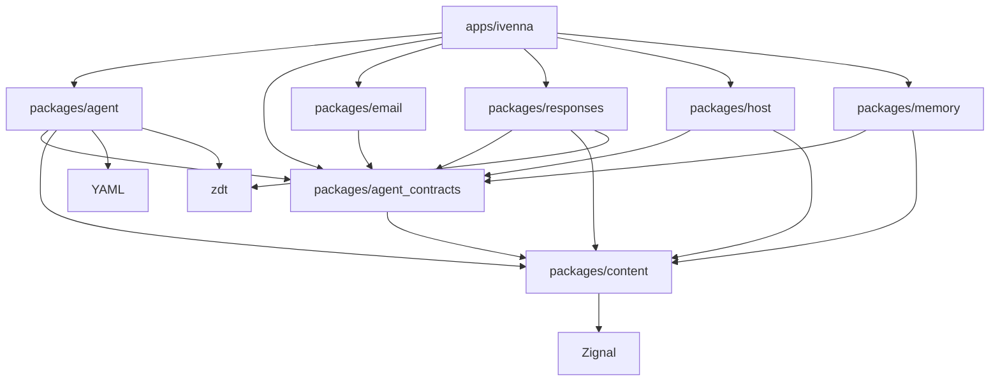

# Architecture

This guide describes Ivenna's current implementation: package responsibilities, execution, and service and storage protocols. The kernel retains working histories across restarts and constructs fresh execution state on startup. The application assembles the runtime and exposes health and reception status.

The [design intent](design.md) sets the behavioral goals and interface principles. The [input contract](input.md) defines runtime-generated user messages, [communication](communication.md) defines correspondence and explicit sending, and [attention](attention.md) defines focus coordination and observation lifetimes. The [usage guide](usage.md) explains correspondence with Ivenna.

## Responsibilities

| Unit | Responsibility |
| --- | --- |
| [apps/ivenna](../apps/ivenna) | Configure and assemble the runtime, serve HTTP status, and own process startup and shutdown |
| [apps/memory](../apps/memory) | Serve memory operations over SSH and own workspace files, capacity enforcement, and locking |
| [packages/agent](../packages/agent/src/root.zig) | Coordinate focuses, sessions, activations, and retained history; own model-input rendering, execution policy, session prompts, and expression and attention actions |
| [packages/agent_contracts](../packages/agent_contracts/src/root.zig) | Define the communication, history storage, and capability contracts shared by execution and concrete implementations |
| [packages/email](../packages/email/src/root.zig) | Own native addressing, message projection, submission, storage, and retention behind the communication and history contracts |
| [packages/responses](../packages/responses/src/root.zig) | Encode, measure, and decode model exchanges; own model HTTP transport, file uploads, and request content limits |
| [packages/host](../packages/host/src/root.zig) | Define host tools and own command handles, incremental interaction, process cleanup, logs, and completion output |
| [packages/memory](../packages/memory/src/root.zig) | Define memory tools and translate their operations and results through the SSH service protocol |
| [packages/content](../packages/content/src/root.zig) | Define tool-result text, image, and file content, classify source bytes, and interpret image references |

`apps/ivenna` links the libraries into one process. Its [HTTP listener](../apps/ivenna/src/service.zig) runs alongside the kernel and shares the application's shutdown scope. `apps/memory` is a separate program reached through SSH; its handler and image sources live together, while local service orchestration remains in `dev`.

The agent and concrete capabilities share `agent_contracts`, which depends only on Content. Content supplies tool-result text, image, and file representation and source classification. YAML rendering belongs to the agent. The build declarations enforce the following module dependencies; each arrow points from a module to one it imports:

The agent exposes `Kernel`, `Engine`, and its `Input` message types and renderer. Session scheduling, owned deliveries, activations, and retained context remain internal to the agent. `Kernel.Config` and `Kernel.Limits` describe execution policy; `Engine.Reasoning` selects ordinary reasoning effort for core and activity roles. Connection settings and protocol encoding belong to their capability packages; the application loads environment values and owns HTTP listener settings.

### Shared contracts

At runtime, the application supplies concrete capability implementations through shared contracts. Kernel calls input, sending, and history storage operations and publishes scheduled wakeups. Engine calls the model and registered tools. Host owns command lifetimes, returns observations through tool calls, and publishes registered completion observations.

Shared [communication types](../packages/agent_contracts/src/communication.zig) describe incoming observations and explicit outgoing messages. The shared capability contracts define calls and data exchanged within the process. The agent owns model-input rendering, handovers, history-record encoding, and the checkpoint selecting retained working histories; each adapter owns its service protocol encoding:

| Contract | Operations | Implementation |
| --- | --- | --- |
| [Inbox](../packages/agent_contracts/src/inbox.zig) | Poll typed correspondence and callback envelopes with opaque receipts and acknowledge durable admission | Email integration |
| [Callback.Registrar](../packages/agent_contracts/src/callback.zig) | Persist a future observation's source and bind its destination to the invoking session | Agent execution |
| [Callback.Publisher](../packages/agent_contracts/src/callback.zig) | Store one observation under a registered callback ID, preserving the first stored result | Email integration |
| [Communication.Sender](../packages/agent_contracts/src/communication.zig) | Submit explicit outgoing messages using correspondent IDs | Email integration |
| [HistoryStore](../packages/agent_contracts/src/history.zig) | Load and save the current checkpoint; allocate groups, discover record metadata, read and create records in batches, and maintain the selected history | Email integration |
| [Model.Port](../packages/agent_contracts/src/model.zig) | Infer, measure encoded requests, and prepare tool results for model input | Responses adapter |
| [Reference.Issuer](../packages/agent_contracts/src/reference.zig) | Allocate a named reference durably before the capability uses it | Agent execution |
| [Tools](../packages/agent_contracts/src/tool.zig) | Register a capability's declarations with its invocation entry point | Host and Memory |

`Communication.SendResult` distinguishes a submitted message from an unsupported recipient. The sending adapter classifies recipient support before submission; execution renders the corresponding tool result. Infrastructure failures propagate through the error channel.

`Tools.Invocation` carries the internal calling session ID and its model-facing `focus_id`, together with a callback registrar and a command-reference issuer borrowed for that invocation. Host requests its durably allocated command reference through `command_reference` before launch.

The callback registrar accepts a name and source and returns `Callback.Registration`: an internal numeric delivery ID and a complete reference allocated for the caller. A capability retains the numeric ID for publication through `Callback.Publisher` and presents the reference as `callback_id`; it does not retain the registrar or choose another receiving session.

[Reference](../packages/agent_contracts/src/reference.zig) validates names of at most 32 Unicode code points and formats `<name>-<number>` references for Agent and Host. Execution owns the numeric sequences and retains their progress in the checkpoint. Capabilities control the lifetime of their referenced resources. Lookup checks the complete reference; its numeric suffix alone does not establish identity.

The email integration uses the configured mail account for correspondence, callbacks, and working history. It owns native addressing, folders, markers, and record lifecycles behind the shared contracts. The [email boundary](#email-boundary) describes its storage protocols and operation ownership.

## Service and reception

The application owns service, kernel, host supervision, and shutdown tasks. The [kernel](../packages/agent/src/kernel.zig) owns intake and session execution tasks; Host supervises commands independently of those sessions. Task failures close reception and cancel and join concurrent work before shared dependencies are released.

The application initializes the mail integration, checks memory, and [restores sessions](#startup-and-interruption) before binding `SERVICE_ADDRESS` and starting kernel tasks. The kernel completes initial history maintenance before opening reception and dispatching startup activations. Readiness does not wait for their model work to finish.

While the listener is running, `GET /healthz` reports that the HTTP service is responding. `GET /readyz` returns success with `X-Ivenna-Ready: true` only while reception is open; otherwise it returns `503`. Closing is terminal for that kernel instance. The status endpoint reads this lifecycle state; it does not perform fresh dependency checks or reserve processing capacity.

The receiving boundary checks reception status before accepting correspondence. This is a precheck: shutdown can follow a successful check, and an already accepted message can remain in the account's mail storage. The receiving policy is configured in the deployment's mail infrastructure. The [running guide](running.md#service-status-and-reception) describes the reception contract and HTTP status interface; the [local mail setup](../dev/README.md#configuring-mail) provides an SMTP example.

Reception status belongs to the service boundary. Model reasoning and tools do not manage transport availability, offline queues, or sender retries.

## Sessions, work, and communication

| Concept | Role and lifetime |
| --- | --- |
| Task | Work to be accomplished; it may continue across activations |
| Core session | Coordinating session with saved history, its own runtime queue, and a serial worker |
| Activity session | Session forked by the core with inherited context, an assignment, and its own subsequent history and queue |
| `input` event | Correspondence observation with `from` IDs, text, and observation time |
| Delivery | An owned observation retained through durable admission and any transport receipt acknowledgement |
| Activation | One session continuing work through model and tool rounds, including admitted observations, until completion |
| Model round | One model response followed by all tools it invoked |

The [session registry](../packages/agent/src/sessions.zig) serializes queue and history changes. A worker retains its inference output and context while the tool batch executes, then commits the complete round before its model-round arena ends.

The registry stores each session's internal numeric ID, stable named `focus_id`, and `Input.Role` enum, `core` or `activity`. The role determines tool availability and automatic report delivery. Sleeping sessions retain their identities and roles through context unloading and restart. Completed activities leave the registry; session IDs increase monotonically and are not reused. The core remains registered.

### Scheduling and capacity

Each ready session can claim its own worker. The registry allows one activation at a time per session, preserving its model/tool order, while other sessions advance concurrently. A tool batch keeps its activation and context alive. New observations can queue during a round and enter working history at the next admission boundary. After finalization, a worker retains its session borrow until saving finishes.

Separate [limits](running.md#configuration) bound registered identities, ordinary accepted events buffered per session, and live host commands. The event allowance excludes startup observations and all activity-report facts, including endings. Existing sessions remain addressable at the identity limit; activity completion releases a registered-session slot. Forks and activity resumption do not depend on space in the core's ordinary event queue.

Correspondence and callback mail stay in their durable sources when their destination's buffer cannot accept them. Callback registrations and unread activity facts have no separate count limit; their storage and request costs grow with pending work.

### Coordination

Correspondence enters the core's FIFO queue independently of mail threads. Both roles expose external communication and shared memory. The core exposes `open_focus`, `send_focus_message`, and `schedule_attention`; activities expose host tools. [Agent actions](../packages/agent/src/tools.zig) own typed arguments, recognition, and a single role rule used by declaration selection and invocation. Engine records the inference's role and uses it again for execution; Kernel receives parsed actions and owns their effects. Inherited tool calls do not establish current availability. Saved wakeup registrations retain their destinations during restoration and delivery.

`send_focus_message` uses the registry's durable session-message queue with a target chosen by the core. The registry records the calling core's complete reference as `from_focus`. Messages consume ordinary event capacity and can make a sleeping recipient ready. They do not register an awaited reply. Activity expressions remain in their separate outbox and accompany the core's ordinary inputs without activating it.

Unknown focus selections remain ordinary tool errors. Unread assistant messages do not make the core ready; an activity's ending does. Ordinary tool replies can continue an already active core session.

## Activation admission

The email adapter supplies typed correspondence or callbacks with optional opaque receipts. The agent routes correspondence to the core and callbacks through their registration. [Work](../packages/agent/src/work.zig) owns each accepted observation through durable admission and receipt acknowledgement. In-process events have no transport receipts.

The kernel builds a candidate from pending deliveries and the oldest unread activity facts. Outbox I/O is paged, but admission can extend one fitting candidate across several pages without invoking the model between them. Before measurement, `Input.coalesceActivityReports` groups activity information by source session, orders groups by first appearance, appends each session's messages in recorded order, and combines its ending information. Ordinary events and several activity groups can share the same request. The encoded grouped payload determines which raw delivery prefix fits; a page or session boundary does not end selection. After an overflow, the selector measures the loaded delivery prefixes and selects the largest one whose complete request fits the budget.

The entire unselected suffix, including loaded activity deliveries, returns to the pending queue's front ahead of concurrent arrivals. Later candidates retain that prefix and load additional facts only beyond it. Ordinary arrivals and the activity journal do not share a global arrival order, and model grouping does not preserve cross-session interleaving. If old history prevents the first event from fitting, [compaction](#bounded-model-context) summarizes that history and selection retries. A first event that still cannot fit after the allowed summary attempts fails with `ContextBudgetExhausted` and remains pending.

The selected group and checkpoint are saved before receipts are acknowledged and deliveries released. Ordinary assembly presents the group with current identity and time; a later budget check can instead carry it through a handover. Unadmitted events stay outside summary input. After committing a model/tool round, the kernel selects the next fitting delivery prefix before ordinary inference, so admitted observations accompany the saved tool replies. Acknowledgement transfers responsibility to working history independently of task completion.

## Activity forks

Only the core can invoke `open_focus`. Each call reserves a new identity and prepares an assignment. At round commit, the registry appends complete model output and one reply per tool call to a candidate core context. It independently clones that context for each prepared activity, then publishes the completed core context and all new activities together. Publication leaves the core's activation running. A round can fork several activities, subject to identity capacity.

Each copy includes retained events, complete native model/tool exchanges, and any existing handover followed by later history. All replies from the calling round are included, even those produced after the fork call. Forking generates no extra summary. Original record focus references remain intact as provenance; historical tool calls are not replayed.

The activity restores this history under its own `Context.scope` and `focus_id`. Its assignment is the first new queued observation. Temporary inference turns and queued observations are not inherited; callback registrations and wakeup schedules keep their original destinations. New inputs supply the activity's current identity and events, with tools selected for its role under the same system prompt. Inherited assistant output is not collected again as a new report. See [opening a focus](attention.md#opening-a-focus) and [assignment fields](input.md#assignments-and-reports).

## Activity reports

After an ordinary activity inference returns successfully, Kernel persists its non-null `Response.text` as an assistant fact in the activity journal before invoking tools. The source focus reference and the time the runtime collected the complete response accompany the text. This collection copies new text once; it excludes reasoning, tool replies, compaction responses, and inherited exchanges. The complete native model/tool round is committed separately after execution. A restart can therefore preserve a reported expression even when its source round was interrupted before commit; that expression does not establish tool effects.

The registry appends single assistant and ending facts to one ordered durable outbox owned by [reports.zig](../packages/agent/src/reports.zig). Its `Entry` represents an internal fact independently of the model-facing `Input.ActivityReport`. An ending carries the time the runtime established session completion. Bodies are separate immutable history records linked by predecessor keys. Its checkpoint selects the unread suffix through a storage group, head key, unread count, and ending count. The runtime retains the selected record metadata and loads bodies in internal pages of 64 facts. Assistant text does not schedule the core. An ending both records the source session's completion and supplies a reason for core work, including when no assistant text was produced.

At [admission](#activation-admission), the selected facts enter the core's retained history with their original message and ending times. The same checkpoint advances the outbox by the raw fact and ending counts, independently of the number of displayed groups. Unselected facts remain in the journal, including those whose source activity has already left the registry. Measurement and compaction neither consume unread facts nor produce new activity expressions.

I/O pages limit the number of facts requested in each read, while the encoded request budget bounds the grouped observations selected for an inference. Staging can span pages and retain an unselected suffix between core activations. Passive staged text does not make the core ready. Neither messages nor endings consume the ordinary event allowance. Metadata grows with unread references, and storage retains all unread text rather than replacing it with the latest expression. The [running guide](running.md#working-history) describes the resulting storage and memory considerations.

## Activation and session completion

The registry retains each complete model/tool exchange before its arena ends. Tool replies lead to another round. Without tool calls, the registry checks queued incoming events and callback registrations under the same lock used for finalization. Incoming events can continue the activation; passive assistant reports alone do not require another core round.

When an activity activation completes, pending callback registrations keep the activity dormant and available for resumption. With none remaining, the registry appends an ending fact and removes the activity. The kernel saves a checkpoint covering both changes. The ending response's assistant text has already followed the ordinary report path and is not copied into the ending. The core sleeps between activations without being removed, and its final text remains internal. External sending occurs only through `send_message`; an ending does not certify task success.

After the checkpoint is confirmed and worker borrows end, a sleeping activity can unload its context and later restore its selected history. A completed activity's in-memory state can instead be released. Unread report records remain selected independently of the source activity's context; retained host commands remain in the host runtime's scope.

## Event sources and callback admission

The registry persists monotonically increasing numeric callback delivery IDs, named references, receiving sessions, and `Callback.Source`: either `wakeup` or `host: { command_id }` with the complete command reference. A tool-supplied name and the numeric delivery sequence form the model-facing `callback_id`. An invocation's registrar binds the destination without exposing session routing to Host. Scheduled attention saves its registration and deadline together; a yielded host command saves its registration before returning its callback reference. Both publish through `Callback.Publisher` using the internal numeric delivery ID. Forking and context unloading do not copy or retarget registrations.

A wakeup also stores `History.Wakeup { id, at_unix_ms, text }`. Agent argument parsing converts the RFC 3339 `schedule_attention.at` into Unix milliseconds before registration. The intake loop durably publishes a due wakeup's text before removing that entry; its callback registration remains until admission. After a crash, the loop can republish text from a retained entry through the [first-result-preserving publisher](#callback-delivery). Polling, queue capacity, and scheduling can delay inference beyond the deadline.

Intake resolves the numeric delivery ID through its registration, adds the saved callback reference and source to the model observation, and defers a full destination. The owned `Delivery` keeps the numeric ID separately for admission and acknowledgement; it is not part of the rendered observation. `queued_callbacks` blocks duplicate acceptance and acknowledgement until the accepted delivery is durably saved and any receipt acknowledged. Admission saves the observation and registration removal in one checkpoint. Later copies of a consumed positive ID below the saved next-ID counter are acknowledged without another observation. Other unknown IDs fail execution.

## Working history and user messages

[Context](../packages/agent/src/context.zig) owns retained events, complete native `Model.Item` exchanges, and handovers. It caches their LLM message view. Model output remains opaque adapter continuation bytes, including reasoning; tool replies keep their typed content. [History persistence](#persistent-working-history) stores entries and selects them for restoration.

Context prepends the embedded [system.md](../packages/agent/src/system.md) as one system message before selected history and the current turn. Its text is identical for core and activity sessions; the turn identifies the current focus and role, and Engine selects tools separately. Ordinary requests, admission candidates, and compaction include this prompt independently of retained entries and measure its encoded cost.

[Input](../packages/agent/src/input.zig) renders retained `Record` values and temporary `Turn` values as YAML user messages. `Registry.current` supplies the current focus's identity, role, and time for each ordinary turn. Presentation methods format internal Unix milliseconds as UTC RFC 3339 `observed_at` and `ended_at` strings; retained ZON records preserve numeric times and complete typed values. The [input contract](input.md) defines the fields and omission semantics of these agent-generated messages. The model adapter separately encodes native exchanges and [tool content](#tool-results). The private [time adapter](../packages/agent/src/time.zig) uses [zdt](https://codeberg.org/FObersteiner/zdt) to format observation times and parse attention deadlines.

For ordinary work, `Context.Delivery.latest` moves the newest event record from the history prefix into the turn's `events`, leaving retained Context unchanged. `Context.Delivery.none` keeps the full history prefix and omits new events. Admission candidates use the same shape without changing retained history. [Compaction](#bounded-model-context) uses the complete retained prefix and adds sampled state for recollection.

Appending clones each entry into the Context's arena and updates its cached model-message view. The registry supplies an independent Context copy for each request, and the worker retains that copy through the complete model/tool round.

## Model requests and tools

[Engine](../packages/agent/src/engine.zig) combines messages, selected tool declarations, and reasoning effort into [Model.Request](../packages/agent_contracts/src/model.zig). [tools.zig](../packages/agent/src/tools.zig) selects agent declarations and parses their arguments using one explicit role rule. Memory joins through `shared_tools` and, for activity sessions, Host through `activity_tools`. Declarations stay with their owning capabilities; invocation uses the same role selection. Runtime action effects remain in Kernel's calling round, including focus preparation and atomic publication with the completed round.

Kernel calls inference and tool execution separately. The activation remains owned by the same worker through the returned batch. Engine retains the prepared request through tool execution so the provider can apply content limits to the complete result batch.

Sessions share the configured model and output-token limit; Engine selects ordinary reasoning effort by role using the [model settings](running.md#model-requests). The [Responses adapter](../packages/responses/src/provider.zig) encodes these settings and uses the same payload encoder for measurement and inference. Engine invokes the returned calls in order, while other sessions can run their own tool batches concurrently. Unknown tools and invalid arguments become ordinary tool errors.

### Model transport

The adapter serializes each ordinary or compaction inference once and sends it with `stream: false`. It owns HTTP retries under the configured [attempt limit and total time limit](running.md#model-requests). One monotonic deadline covers connection, request writing, response reading, and retry waits.

The adapter's bounded retry policy covers HTTP server errors, request timeouts, and rate limits. Retryable network failures, including interrupted response transfers, share the same limits. Retry waits use exponential backoff with jitter. A valid `Retry-After` value in seconds or IMF-fixdate format supplies the delay instead. Other HTTP errors fail on receipt of their status, without waiting for a diagnostic body. Cancellation propagates without retry.

Each attempt owns its temporary response bytes. Failed or rejected exchanges close their unfinished connections. On timeout or cancellation, the adapter cancels and joins the exchange before the caller can release request data. Fixed-length response bodies must reach their declared length. The adapter validates every output item before returning text or tool calls. A fully received invalid response or unfinished generation fails without another HTTP attempt.

The adapter distinguishes absent assistant text from empty text by whether message content contains an `output_text` part. An activity response with absent text records no assistant fact; explicitly empty text is retained as a timestamped message with empty text in the model report.

### Tool results

Capabilities return [Content](../packages/content/src/root.zig) parts owned by the model-round arena. Content supplies byte classification and image-reference interpretation; Host and Memory own source reading, limits, and provenance. Engine associates results with call IDs and passes the complete tool batch to the Responses adapter before the exchange is committed.

The adapter copies the new reply parts and applies the [model request checks](content.md#model-request-checks) against the complete request, preserving retained history and operation descriptions. It omits files beyond the count limit before uploading them. Each file part holds complete bytes and an optional opaque upload reference.

For a file without a reference, the adapter uploads through the [Files API](https://api-docs.deepseek.com/guides/files_api/) with a generic filename. It first uses `rich_layout_recognition`; an HTTP `400` rejection permits one attempt with `user_data`. Both attempts share one per-file deadline. Client-error statuses are handled from the response head. A final rejection replaces that file part with a `file_upload_failed` text part; transport and model-service failures propagate to runtime supervision without replaying an uncertain upload.

On success, the adapter retains the service file identifier as an opaque reference alongside the original bytes. Measurement and inference use the same encoder and reuse prepared references. The function-call result carries the file description and other content parts. After the complete tool-result batch, the adapter appends user-message items with `input_file` references and their originating call IDs.

At round commit, Context copies the prepared parts into its retained arena; [history persistence](#persistent-working-history) stores their bytes and references. Uploaded files have a separate [model-service retention lifecycle](running.md#uploaded-model-files).

## Bounded model context

`CONTEXT_REQUEST_BYTES` bounds the complete encoded ordinary request, including history, handover state, new events, tools, reasoning settings, inline images, and file references. The kernel checks before each ordinary inference. `LLM_MAX_OUTPUT_TOKENS` independently bounds output, including reasoning.

The model service expands file references after receiving the encoded request. The [running guide](running.md#context-budgets) explains the consequences for context sizing.

For each compaction attempt, `Registry.compactionSnapshot` copies current identity, time, and `Input.State` under one lock. The state contains existing activity references for the core and pending callback references and sources for the receiving focus. `Context.summaryRequest` combines that sample with the common system prompt, complete retained history, and instructions from [compaction.md](../packages/agent/src/compaction.md). Earlier handovers keep their stored state in this history. The summary inference uses no tools and `high` reasoning, bounded by `CONTEXT_COMPACTION_BYTES`; waiting events and unread activity reports remain outside the request.

The generated summary must contain nonempty text after trimming and no tool calls. The runtime pairs it with the same state and observation time supplied to that inference to form the handover. Before installation, the kernel measures the complete replacement ordinary request or admission candidate against `CONTEXT_REQUEST_BYTES`; the handover has no separate byte limit. Successful replacement leaves the handover record as working history. The next request adds the same system prompt and an ordinary turn with any newly admitted events; earlier message storage follows [retention](#history-retention).

Compaction permits one further summary inference if the first summary is missing or blank, includes tool calls, or leaves the replacement request over budget. The retry samples state anew, retains the original history, and carries brief factual feedback in `summarize.instructions`. Rejected output never becomes working history. A summary request already above `CONTEXT_COMPACTION_BYTES` fails before model invocation. Failures returned by the model adapter, cancellation, and storage failures propagate without another summary inference.

Exhausted summary attempts and requests that cannot meet their bounds fail explicitly, preserving the selected history and unadmitted deliveries. Admission measures complete candidate requests with a reusable trial arena; byte counts are not token estimates.

An activity's inherited history is included in its encoded requests under these same budgets. Forking itself generates no summary; ordinary budget checks can still require compaction before further inference.

## Persistent working history

The agent's [history persistence](../packages/agent/src/history.zig) stores immutable records and a checkpoint selecting each session's current history segment. A fork persists its copied entries in the activity's own storage group. Compaction advances a session's epoch and replaces its selected history with a handover while preserving identity and role.

| Term | Meaning |
| --- | --- |
| Session | A core or activity session with its own identity and role |
| Segment | An append-only sequence identified by `Scope { session_id, epoch }`; a fork starts the activity's first segment and compaction starts a replacement |
| Storage group | An opaque identifier used by `HistoryStore` to discover related immutable records, such as a session segment or report journal |
| Committed chain | The checkpoint's selected records in one segment, identified by a head key and entry count |

Each entry contains a retained `Input.Record` or an exchange of `Model.Item[]`. Exchanges preserve opaque model output, including reasoning, and typed tool replies with text and media. Event records carry their receiving `focus_id` and observations. Handovers carry their producing `focus_id`, sample time, generated `summary`, and sampled `state`, including empty collections in storage. Local image and file bytes remain in the records; files also retain opaque upload references, while remote images retain their URLs. Inherited records keep their original focus references.

Working history and the activity outbox share a [record codec](../packages/agent/src/record_codec.zig) for compact UTF-8 ZON bodies and content keys. An entry record contains the entry and its predecessor's SHA-256 key within that segment, or null for the first entry. Its own key is the SHA-256 of the complete encoded body. The storage group and predecessor keys distinguish occurrences even when their payloads are equal. Unread internal observations are stored together in a separate immutable observation-array record in the session's current group.

The checkpoint contains the next numeric session, callback, and command identifiers, pending callback registrations with their complete references, sources, and bound destinations, scheduled wakeups with their deadlines and text, and the [activity outbox's unread selection](#activity-reports). For each registered session it records the internal ID, `focus_id`, role, interrupted-execution state, epoch, current group, committed head, and entry count. An optional key selects the unread observation array in that group. Retained model/tool exchanges and admitted observations remain in the selected records.

Appending advances the head and count without adding a per-entry reference to the checkpoint. A sleeping session can retain this confirmed selection without materialized context entries. The latest confirmed checkpoint selects the records kept by [history maintenance](#history-retention) and available for subsequent restoration.

### Saving and restoration

`HistoryStore` exposes checkpoint publication, grouped records, and retention maintenance. History persistence and the activity outbox own their record schemas, chain selection, validation, and retention references. The shared record codec supplies encoding, decoding, and content-key functions; adapters own native representation, locators, placement, and protocol limits.

Saves follow assistant report collection, admission, complete rounds, compaction, forks, completion, command-number allocation, and unread-input or source changes. Materialized records are encoded and hashed against the cached committed chain; cold sessions reuse their confirmed selection. Required creates must succeed before checkpoint publication. Unconfirmed writes remain outside selected paths. Unchanged checkpoints skip publication; a publication error invalidates that comparison digest because storage may already have accepted it.

Session restoration discovers group metadata, follows each committed predecessor chain, then reads selected bodies in batches. Hashes, checkpoint selections, record kinds, counts, and predecessor metadata must agree. Complete focus references identifying the owner of retained event and handover records must identify either the restoring focus or the core (`core-1`). Matching physical duplicates can supply one logical occurrence. Missing or inconsistent committed records fail restoration.

Startup reads and validates all selected session history. It rebuilds the outbox's unread metadata from its checkpoint and loads report bodies in admission windows. It materializes the core context and discards temporary activity entries; activity contexts are materialized when scheduled. Later cold restores read only that session's history. Delivery objects, receipts, worker ownership, and host process handles are not checkpointed. See [startup](#startup-and-interruption) for reconstruction.

### History retention

Compaction replaces the session's selected segment. Once the replacement checkpoint is confirmed, its earlier epoch is no longer needed for continuation. A completed activity's history becomes unselected when its removal is confirmed in a checkpoint. Its unread reports remain selected in the outbox until core admission; admitted reports remain in the core's history. Shared autonomous memory follows its own lifecycle. Context unloading preserves the current selection; previous checkpoints are not restoration roots.

Maintenance runs before reception opens and then at intervals of at least 60 seconds between polls. The registry locks saving and reconciliation together. From the confirmed checkpoint, `HistoryStore.Retention` names every selected `(group, key)`, including unread observations and outbox reports.

The [email adapter](#mail-retention) keeps selected records in History and retires unselected records to Trash. The mail service owns Trash expiry and space reclamation.

## Startup and interruption

Startup discovers mail, checks memory with `inspect_memory_space`, and loads the checkpoint or creates the core. It rebuilds identities, roles, unread internal work, activity outbox references, callbacks, and wakeups. Requests receive the common system prompt independently of restored history. Communication-copy and history maintenance complete before reception opens.

The core and sessions with interrupted activations or unread incoming events queue startup immediately. Other activity sessions prepend startup when a real event first arrives; newly created sessions begin with an assignment. Unread assistant reports retain their passive status and accompany the core's next ordinary input; unread endings still request its activation.

Before dispatch, Kernel publishes an interruption observation for each restored host registration through the first-result-preserving publisher. An identifiable stored result for that ID takes precedence. Wakeups publish when due. Processes and historical tool calls are not replayed, and source command IDs from the earlier runtime are not restored handles.

Unacknowledged correspondence remains eligible and can appear again after a crash between persistence and acknowledgement; callback IDs instead retain durable admission deduplication. Fresh startup observations identify this runtime; earlier records remain evidence of their original observations and outcomes.

Use one kernel per account. Host effects, memory writes, mail submission, acknowledgement, and history publication share no transaction: effects may precede their saved results, and repeating uncertain actions can duplicate them. An incomplete model/tool round is outside confirmed working history. Infrastructure, execution, compaction, and storage failures end the runtime and join concurrent work; defined tool outcomes remain observations.

## Email boundary

The [mail service](running.md#mail-service) owns sender checks; the email adapter relies on that guarantee when projecting message From addresses into correspondent IDs.

The mail adapter bounds each HTTP exchange by one 60-second monotonic deadline, including connection, request writing, and response reading. On timeout or cancellation, it cancels and joins the exchange; cleanup closes unfinished connections. JMAP requests are not automatically retried: mailbox mutation, submission, or history publication may have succeeded before its acknowledgement was lost, and the resulting infrastructure failure propagates to runtime supervision.

[Addressing](../packages/email/src/addressing.zig) derives the correspondent domain from `MAIL_ADDRESS`. It projects a same-domain address's local part into a readable ID and resolves an outgoing ID back into that domain. Domain comparisons ignore case; IDs preserve case. The supported ASCII ID and domain forms are described in [communication](communication.md#current-email-addressing).

Each send resolves recipient IDs in the configured domain and submits a standalone email with subject `Ivenna` and the supplied text as its body. Unsupported IDs return the ordinary `invalid_recipient` tool result. IDs retain their destinations across context unloading and restart with the same domain configuration. Native addresses, delivery records, headers, folders, and private markers remain within the email integration.

The adapter creates each outgoing copy in Drafts with `ivenna-outbound`. Confirmed submission uses `onSuccessUpdateEmail` to remove draft state and move the copy to Trash. Both submission and that implicit update must be confirmed before the adapter returns its opaque submission reference. Under [RFC 8621 §7.5](https://www.rfc-editor.org/rfc/rfc8621.html#section-7.5), retiring the Email after successful submission does not cancel delivery. Service acceptance does not establish final recipient delivery.

### Callback delivery

The adapter writes self-addressed JMAP `Email` objects in `Ivenna Callbacks`, independent of SMTP reception. Identity uses `ivenna-callback`, exact `ivenna-callback-<id>`, and `X-Ivenna-Callback-Id`. Intake requires this folder, self From/To, a positive matching header and keyword ID, and complete text. Invalid private records are diagnosed and skipped, never projected as correspondence.

Publication searches the marker and exact keyword across the account, including Trash, and validates identity before reusing a stored result. Body unavailability does not permit replacement. If no identifiable copy remains, publication may create another; [durable admission deduplication](#event-sources-and-callback-admission) still protects consumed IDs. Acknowledgement retires admitted copies like correspondence.

### Mail intake and acknowledgement

Ordinary intake finds unhandled correspondence outside `Ivenna Callbacks`, `Ivenna History`, Drafts, Junk, and Trash. Drafts and private callback, outbound, or state records are excluded. Read and starred state do not select input. [EmailTransport](../packages/email/src/email_transport.zig) projects supported From IDs, complete text, and observation time according to [communication](communication.md#incoming-email-text).

`Inbox.Poll { messages, callbacks }` supplies independent allowances; zero disables a stream. The registry accounts for tracked receipts and pending callbacks and disables correspondence when the core is full. The adapter reads each oldest eligible prefix, paging past unsupported records, then merges by `receivedAt` without a combined cap. Correspondence backlog cannot consume callback allowance; FIFO applies within each selected stream and session queue, not account-wide across destinations. Rejected input stays stored.

After durable admission, acknowledgement sets `ivenna-handled` and moves the copy to Trash without changing read or answered state. Receipt bookkeeping remains in memory; acknowledgement does not certify task completion.

### History storage

The email integration creates history records and checkpoints as JMAP Email objects in the top-level `Ivenna History` folder through `Email/set`. The adapter discovers the folder by name, a null `parentId`, and a null `role`, and creates it when missing. It also discovers or creates the mailbox with role `trash`. Each object has a plain-text ZON body carrying the agent's encoding and a self-addressed envelope supplying native identity metadata. Creating these records does not submit correspondence.

All history objects carry the private `ivenna-state` keyword and an `X-Ivenna-History-Kind` header of `record` or `checkpoint`. The adapter allocates a fresh opaque group token and maps it to an exact keyword of the form `ivenna-history-<token>`. Records carry that group keyword, their `X-Ivenna-History-Key`, and an optional `X-Ivenna-History-Previous`. These headers expose record keys and predecessor metadata for retrieval; searches use native keyword membership rather than header or full-text indexing.

To discover records, the adapter queries `Ivenna History` with the state marker and requested group keywords, in pages of up to 512 IDs. It fetches record metadata in bulk, validates ownership and group membership, and returns opaque native locators to the agent. After the agent selects committed paths, the adapter reads those locators through bulk `Email/get`, validating group, key, predecessor, self-addressed identity, and complete text bodies. Trash is outside continuation reads. The agent then verifies hashes and decodes payloads. Native `Email.id` values serve as transient locators, not checkpoint identities.

Record creation uses bulk `Email/set` and confirms every requested create before returning success. Get and set batches obey the JMAP session's positive `maxObjectsInGet`, `maxObjectsInSet`, and `maxSizeRequest` limits, with at most 32 objects per batch. Native request sizes include encoded bodies and protocol fields. A complete model/tool round occupies one ZON entry record, including its native file bytes. The adapter splits batches between records; an individual record whose JMAP request cannot fit fails with `HistoryRecordTooLarge` before checkpoint publication.

Current checkpoint candidates carry both `ivenna-state` and `ivenna-current` and a numeric `X-Ivenna-History-Revision`. Discovery queries `Ivenna History` and those keywords, then validates returned metadata. Malformed kind or revision metadata on an owned current candidate fails loading. Loading selects the highest revision, independently of mail observation timestamps. Distinct candidates at the same highest revision are an error. Saving confirms creation of the complete new checkpoint; maintenance later removes the current marker from older checkpoints and moves them to Trash. Several candidates can remain between maintenance passes or after interruption, and the numeric revision identifies the current checkpoint.

A failed batch returns an error even when some objects may already have been created. Native group membership identifies candidate records; the checkpoint's committed heads and predecessor keys select the effective history. Mail threads describe correspondence and do not select session histories or compaction epochs.

### Mail retention

Communication copies, admitted callback mail, and unselected history records retire into Trash. The mail service owns expiry and storage reclamation under deployment policy, independently of whether Ivenna is running. The [running guide](running.md#data-and-retention) describes retention and preservation requirements.

#### Communication copies

The kernel's acknowledgement retires an input copy after durable admission. The sending operation retires its outgoing copy after confirmed submission. During initialization and before each poll, the email integration also retires acknowledged inputs and outgoing copies left by interrupted sends. It identifies outgoing copies by the runtime's marker and sender identity. These copies retire once no sending operation holds them, even if submission acceptance is unknown. Maintenance does not resubmit messages.

The integration holds its own lock through sending, intake, acknowledgement, and communication maintenance, so a draft needed by an in-progress send remains live. Pending input stays available for admission. Existing Trash is excluded from communication maintenance.

#### Working history

The email adapter maps the agent's [retention selection](#history-retention) to native folder membership. It inventories state objects in `Ivenna History` before moving any of them. Ownership requires the runtime's state marker and self-addressed identity metadata. Maintenance uses bounded requests and classifies each physical object as follows:

| Object | Location and use |
| --- | --- |
| Latest checkpoint or selected record | `Ivenna History`; available for continuation |
| Unselected record or older checkpoint | Trash; further retention belongs to the mail service |

The adapter retains every physical copy matching a selected `(group, key)`. Unselected records include replaced epochs, obsolete observation arrays, and uncommitted writes outside the selected paths. The folder holds the state needed for continuation rather than a complete transcript for each ended activation. The checkpoint records session and epoch ownership; retained observation records identify their receiving session.

Missing selected records and invalid metadata on owned objects are storage errors detected before folder updates. Trash is excluded from both inventory and continuation reads.

Restoration requires the latest checkpoint and all committed records with their bodies, group membership, keys, and validation metadata intact.

## Autonomous memory

[Memory](../packages/memory/src/root.zig) defines memory tool declarations and translates calls into typed JSON requests for [memory.nu](../apps/memory/src/memory.nu). The adapter owns host file sources and SSH transport. The handler represents rooms as directories and memories as files, and owns workspace addresses and capacity. The [memory shell](../apps/memory/memory-shell.sh) locks each request across observation, capacity checks, and publication. Other sessions can act between requests, so a sequence of calls is not a transaction. See [memory rooms](memory.md) for the operation contract and [service setup](running.md#memory-service) for deployment.

### Reads and searches

The handler reads byte ranges from Nushell streams and returns the source header, total length, and selected offset with each range. The adapter validates the response against its request and uses the shared [content](../packages/content/src/root.zig) text-prefix classifier to align text pages to UTF-8 boundaries. An image or PDF header, or binary content in the selected range, can require a second read of the complete entry from offset `0`, independently of the text page budget. That response is classified independently because another request may have changed the entry. Partial binary ranges do not become native files.

Room visits enumerate one directory; recursive size requests traverse all its child rooms before pagination. Capacity inspection traverses the entire workspace and remains separate from navigation. Visit and search results are sorted and selected within the encoded reply budget. Name search gathers the matched names before pagination. Content search wraps the query to match each whole line once, avoiding a submatch record for every occurrence. It drains ripgrep's JSON incrementally and retains a bounded page and total count. Each matching line is still read and decoded as a whole before its preview is selected. A fixed shell wrapper appends the exit status to the stream so the handler can distinguish no matches from a failed search after draining it.

### Writes and capacity

Writes prepare complete content in the handler-owned `.ivenna-tmp` directory, then rename it onto the destination. The staging directory shares the workspace filesystem and is excluded from memory observations and logical capacity. Before removing abandoned unpublished files, each request verifies the directory's ownership marker.

Publication replaces one file name, leaving other hard links on their previous content. Capacity counts regular-file lengths for each directory entry, including separate hard-link names. The projected usage is current usage plus the replacement length minus the addressed entry's previous length, checked while holding the workspace lock. All recording modes validate the proposed write before creating missing parent directories and publishing the entry. Entry transfers and revisions have a separate size limit from the workspace's shared capacity.

Unique revisions use Nushell's bounded `split row` to distinguish zero, one, and several matches before constructing a replacement. Literal replacement of all matches counts them from the byte-length reduction after deletion. Regex replacement of all matches retains a `parse` prepass: the selected Nushell version can panic on a backtracking error in `str replace`, whereas `parse` reports it as an operation error. That prepass still materializes its match list.

### Transport and failures

Transfers buffer each request and reply. Returned text, image, and file content is copied into the model-round arena before the SSH buffers are released. The adapter supervises concurrent request writing, response draining, and child completion against one deadline. Timeout and cancellation stop SSH before joining its writer and protected wait.

The handler translates selected-entry filesystem and pattern failures into tool outcomes. The adapter translates host source-file failures before transfer, while transport and protocol errors propagate to runtime supervision. The [memory interface](memory.md#results-and-errors) defines the outcomes, infrastructure failures, and uncertain effects.

## Host execution

[Host](../packages/host/src/root.zig) owns a shared command registry and the operations that launch, observe, and control its processes. Each command retains its arguments and startup configuration independently of the model-round arena. [Shell](../packages/host/src/shell.zig) prepares the environment and log files, resolves the working directory, and launches a fresh shell. See the [host interface](host.md) for modes, arguments, and results.

### Command lifecycle

Host reserves live capacity and requests a command reference from execution through its invocation context. Execution appends the next command number to the supplied name and saves the advanced counter in the checkpoint before returning the reference. Host then launches the command. Startup resumes the saved sequence.

`run_host_shell` waits on `std.Io.Condition` until process and input cleanup finish or the call's wait expires. If cleanup has completed, the call returns a complete-source result and retires the handle. Otherwise Host persists a completion registration with source `host: { command_id }`, using the command name for its callback prefix, retains the command, and returns the complete command and callback references. Other activities can discover and control a command while its caller waits.

If the invocation has no registrar, Host stops and joins the command and returns `handoff_unavailable` with its observed result. Registration failures propagate under the [availability contract](design.md#runtime-availability); a failed history publication may still have saved the registration.

`Host.run` supervises commands independently of session workers. Jobs are reference-counted so returning from a call does not release state still in use by a task or another caller. Completion releases live capacity; a separate eight-handle cache can retain finished commands for recent output collection. Its size is independent of `MAX_HOST_COMMANDS`. Full logs have independent [deployment retention](running.md#host-output-and-deployment-files).

Retained commands belong to the host runtime, while a pending completion registration keeps its receiving activity available across sleep. Completion publication can outlive the registry's control handle; the supervisor retains the command until publication ends. Shutdown cancels and joins command tasks before releasing their logs, terminals, publisher, or other dependencies. Startup restores [saved working history](#startup-and-interruption) and resolves pending host observations, not host processes or command handles.

### Interaction and synchronization

The Host mutex protects registry state, references, capacity, and input admission. Each command has an operation lock for continuation calls consuming its shared stdout/stderr cursors. Input, signal, and resize actions apply before taking that lock so an observation wait does not delay interaction. One input write can be in flight per command. It runs separately from the observation call; completion cancels and joins it before releasing the live slot.

The initial call keeps `handoff_pending` set until it rejects handoff or has saved the registration and prepared its tool result. Supervision waits for that flag to clear before publishing a completion, covering commands that finish during registration. It sets `settled` after process and input cleanup. Failure cleanup waits for that state without waiting for publication, so it can finish while the initial call still owns the handoff decision.

Command lookup checks the complete reference and is shared across activities; inspection records retain the originating `focus_id` as provenance. Inspection pages the current registry within a 32 KiB complete-reply budget, returning `offset`, `next_offset`, and the filtered `total_commands`. Registry changes can alter later pages. Initial observations and completion publication do not take the continuation lock; their [output collection](#output-and-delivery) is independent of the shared cursors.

### Processes and terminals

[process.zig](../packages/host/src/process.zig) owns child supervision through `std.process.Child` and `std.Io.Select`, including deadlines, cancellation, and protected reaping. It selects the process transport from the command's input mode.

[pty.zig](../packages/host/src/pty.zig) supplies the Linux terminal operations absent from `std.Io`. It opens the slave from the master with `TIOCGPTPEER`, resizes it with an ioctl, and uses `std.posix.tcgetpgrp` for foreground-group lookup. Launch uses `setsid --ctty` because `std.process.spawn` exposes process groups without a new-session option. The terminal master carries input and merged stdout/stderr; terminal EOF is a control byte rather than a pipe half-close.

In terminal mode, interrupt targets the foreground group so an interactive shell can continue afterward. Terminal termination and cleanup cover the original session, including background job-control groups. The backend enumerates `/proc`, filters with `getsid`, then binds candidates with pidfds and rechecks their session before signaling. Batch and pipe cleanup uses the command's process group.

Normal completion and timeout report cleanup failures as unavailable outcomes. Error unwinding and cancellation make a final best-effort cleanup before joining. A program can escape into another session; if it retains a terminal slave, output draining stops after a one-second wait. Terminal [deployment requirements](running.md#runtime-requirements) belong to the running guide.

### Output and delivery

Commands write to private log files. [Reader](../packages/host/src/reader.zig) owns complete-source classification and native media; stderr uses text-only reading. [output.zig](../packages/host/src/output.zig) selects byte ranges and previews. The tool decoder validates the combined encoded budget, and internal readers use its stream allocations. Both host and memory readers use the text-prefix classifier in Content.

Continuation calls consume shared per-stream cursors. They periodically check log-file growth and wait on the condition so completion can wake them immediately. After completion, an image or PDF header or an observed binary range triggers complete-source reading independently of the text cursor. The command's shared media flag is set only after returning native media or a complete-source diagnostic. A text-only observation leaves the allowance available so a later continuation can identify binary content and return the complete file once.

An initial handoff uses local zeroed cursors and a local media flag to collect its prefix. It neither waits for another continuation's observation deadline nor consumes shared output or media positions. If the command has already finished, the initial result can include native media without consuming the continuation allowance. Synchronous completion and callback publication instead read independent complete-source previews.

Host renders completion output as JSON text with the observed result and log paths. The registered callback source supplies command provenance in the receiving observation. In a callback, native media is represented by its description and an omission marker, leaving any unconsumed continuation media available while the handle remains retained. The [host contract](host.md#output-and-results) defines result fields; the shared [content contract](content.md) defines formats and media limits.

Shell preparation, source reading, and command controls translate their operation failures into tool outcomes. Task scheduling and runtime supervision failures propagate to the application, as do cancellation and allocation errors.
