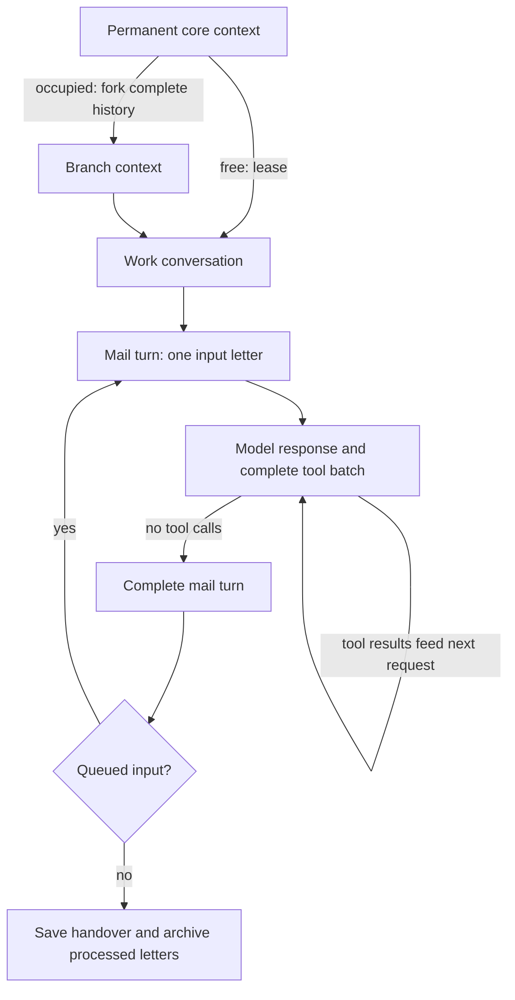

# Architecture

Ivenna runs locally and uses mail for correspondence and work control. Stalwart stores and delivers letters; the kernel prepares model input, runs model and tool work, and records replies, reports, and handovers. Working transcripts live in memory. The mailbox, autonomous memory, and host artifacts provide continuity beyond a process's lifetime.

## Core, conversations, and turns

The runtime separates the purpose of work from the contexts and execution units used to carry it out:

| Concept | Role and lifetime |
| --- | --- |
| Task | A goal expressed through correspondence; it may remain open across many mail turns |
| Core session | One working perspective retained for the kernel's lifetime |
| Work conversation | The active owner of a mail thread's queued turns and use of a session |
| Branch session | A separate working history owned by one work conversation |
| Mail turn | Processing one input letter through one or more model rounds |
| Model round | One model response followed by all tools it invoked |

A new thread uses the core context when it is free. While the core is occupied, independent work forks a branch from its most recent complete history. A complete boundary contains a model response and every corresponding tool result. Later input in the same thread queues in its existing conversation.

A response with no tool calls ends the current mail turn. The response may deliver a result, ask a question, or describe unfinished work. Ending that turn does not establish that the overall task is complete. New related mail supplies another turn.

The successful execution path is:

Archival retires the conversation and releases its branch context or lease on the core. The core context continues. A reply to archived work reconstructs a dedicated branch from that thread's handover and bounded history, even when the core is free.

`MAX_PARALLEL_ATTENTION` bounds concurrent execution. `MAX_ATTENTION_CONTEXTS` bounds retained contexts, including the core. Input that cannot be admitted remains in Inbox until capacity is available.

## Responsibilities

| Component | Responsibility |
| --- | --- |
| [Application](../apps/ivenna) | Load configuration, assemble shared dependencies, and own startup and shutdown |
| [Conversation registry](../packages/agent/src/conversations.zig) | Own the core, conversations, queues, contexts, and synchronized scheduling state |
| [Kernel](../packages/agent/src/kernel.zig) | Coordinate mailbox I/O, workers, model rounds, reports, handover, and archival |
| [Engine](../packages/agent/src/engine.zig) | Execute one model response and its complete tool batch |
| [Context](../packages/agent/src/context.zig) | Own history and copy complete contexts for forks and handover |
| [Input](../packages/agent/src/input.zig) | Render structured YAML observations for the model |
| [Compaction](../packages/agent/src/compaction.zig) | Construct and bound summary requests and validate their output |
| [Mail](../packages/agent/src/mail.zig) | Decode the required JMAP operations into typed mailbox results |
| [Provider](../packages/agent/src/provider.zig) | Encode model requests and tool replies and decode model output |
| [Memory](../packages/agent/src/memory.zig) | Resolve write sources and exchange operations with the file workspace over SSH |
| [Host](../packages/agent/src/host.zig) | Route shell operations and select their returned content |

Registry methods serialize changes to queues and authoritative working histories. Workers obtain independently owned snapshots for inference and copy complete output and tool batches back through the registry before their model-round arenas end. The kernel owns the worker task group; shutdown cancels and joins those tasks before the application releases their shared HTTP client and other dependencies.

Mail uses Zig's `std.http` and `std.json` for a narrow JMAP interface. Stalwart handles MIME parsing, body decoding, message construction, native threading, and delivery. Its own storage retains correspondence; Ivenna keeps execution contexts in memory.

The local deployment's Compose files define Stalwart and its persistent volume. The official CLI applies a native provisioning plan. See [local mail setup](running.md#configuring-local-mail) for the deployment flow.

## Mail intake and structured input

Unread Inbox letters request attention. The kernel polls through JMAP and routes by native thread ID. Message identifiers, reply headers, and normalized subjects let the mail service group related letters. Flagged input receives scheduling priority.

The mailbox's ordinary state remains part of this interface. Another client marking a letter read affects its eligibility for intake. Moving an active source out of Inbox withdraws further work at a complete model/tool boundary. A separate operator account keeps ordinary reading and replying apart from deliberate management of Ivenna's Inbox.

Each letter becomes a YAML user message carrying its body excerpt, source identifiers, sender and recipients, subject, observation time, and conversation context. The kernel materializes the full body at `<DATA_DIR>/mail/<sha256-of-mail-id>.txt` and supplies its path in `source.body_file`. Host tools can inspect omitted text.

Historical inputs retain their original source meaning. Each ordinary model request also receives a fresh, request-local runtime snapshot:

| Field | Observation |
| --- | --- |
| `session_id` | Current session's runtime identity |
| `runtime.active_sessions` | Retained contexts, including the core |
| `runtime.running_sessions` | Sessions currently executing work |
| `runtime.active_conversations` | Registered work conversations |
| `runtime.queued_turns` | Input turns waiting in their queues |
| `conversation.parent_generation` | Core generation inherited by a branch, when applicable |
| `conversation.role` | Core or branch role |
| `conversation.thread_id` | Current native mail thread |

Snapshots are refreshed for later rounds of the same mail turn and do not accumulate in retained history. Reconstructed correspondence, withdrawal observations, and summary tasks follow the same YAML input contract. The [system prompt](../packages/agent/src/system.md), [tool definitions](../packages/agent/src/tools.json), and input renderer together define the model-facing interface.

Intake prefers decoded plain text and falls back to UTF-8 HTML source. A letter without a supported complete body remains unread and produces a diagnostic; later supported letters can still proceed. Attachment intake is not implemented.

## Mail-turn completion, reports, and archiving

Engine returns one result for each tool call. The kernel retains the complete batch and starts another model round so the model can use those results. Intermediate assistant text and tool exchanges stay in the transcript. A response without tool calls ends the current turn.

For an external input, the kernel submits available final text as a reply, preserves native reply references, and marks the source answered. It marks the input read after handling it. A response without text ends the turn without an external reply; the overall task can still need further input.

A branch also produces a self-addressed report carrying its final text, or a notice that no text was produced, together with the work subject and source and session identifiers. The kernel saves the report directly in Inbox through JMAP. Intake routes it to the core, which can incorporate it at a complete model/tool boundary. A queued report can require another model round before the current core mail turn is finalized. Processing a self-report does not automatically send another reply to self.

When a turn ends and no input remains queued, the kernel:

1. Generates a bounded handover and saves it directly in Archive.
2. Moves the conversation's processed Inbox letters to Archive, preserving other membership such as Sent.
3. Rechecks the queue and retires the conversation if no new input has arrived.

These operations use explicit processed IDs. An incoming letter accepted during archive I/O remains available and keeps the conversation active.

Handover notes retain the source's normalized `Re:` subject, `In-Reply-To`, and `References` so Stalwart keeps them in the same thread. `X-Ivenna-Purpose` distinguishes `handover` from `core_handover`. Both support thread restoration; startup selects the latest self-addressed `core_handover` across threads.

If report saving or archival fails after a result was delivered, the kernel logs the failure and retains the conversation's context. It does not automatically repeat the delivered result. These housekeeping failures have no automatic retry queue; later input can continue the conversation.

Archive membership preserves correspondence after its active resources are released. Coordinated deletion of that mail and its local artifacts remains a placeholder whose API returns `ArchiveDeletionUnavailable`. Deployment users can manage mail and artifact retention independently.

## Bounded model context

`CONTEXT_REQUEST_BYTES` bounds the complete serialized ordinary request, including instructions, tools, YAML input, retained output, tool replies, and image encoding. `LLM_MAX_OUTPUT_TOKENS` separately bounds generated output.

When another request would exceed the byte budget, Compaction builds a summary task from [compaction.md](../packages/agent/src/compaction.md). The task follows the input contract with `purpose: context_compaction`, the actual session identity, conversation context, and current runtime observations. Provider sends it with no tools and `tool_choice: none`.

`CONTEXT_COMPACTION_BYTES` bounds that complete request. Compaction requires nonempty assistant text within `HANDOVER_MAX_BYTES` and rejects tool calls. After checking that the replacement fits the ordinary request budget and saving the handover, the kernel installs it as the working context. The current policy retains no earlier raw transcript batches; Context can retain a tail only at complete batch boundaries.

Archival uses the same summary operation to record commitments, evidence, source references, completed effects, uncertainty, and remaining work before releasing a conversation. Source bodies and artifacts remain available by reference.

Serialized bytes are a measurable local bound. Model-specific token and image accounting remains planned. If a request or summary cannot meet its limit, execution fails explicitly; an unfinished tool exchange cannot be shortened by cutting away arbitrary messages.

## Startup and interruption

Startup rebuilds the core from its latest core handover and bounded observations of recent correspondence. Reopening an archived thread uses its latest handover and recent native history. Each observation set considers at most 32 letters with body excerpts of at most 512 bytes and stops when the request budget needs room for active input. Full bodies remain available through source-file references.

These letters supply evidence for continued work. Working transcripts, queued execution state, and suspended model/tool rounds belong to the previous process and are not restored exactly.

An execution failure pauses its input and retains the current in-process context. The kernel suppresses repeated automatic attempts at that letter; new related input can provide direction. After restart, unread work may be considered again with the reconstructed context.

A host command, memory change, or mail submission may have taken effect before an interruption was observed. Cancellation does not undo those effects. Inspect affected mail, files, and the observable world before repeating an action with an uncertain outcome.

One kernel owns an Ivenna account's runtime state. Mail operations, host effects, memory writes, and working context do not share a transaction.

## Autonomous memory

Memory is a file workspace shared by all sessions. The Memory component resolves local write sources and exchanges typed JSON operations over SSH with the fixed [memory.nu](../packages/agent/src/memory.nu) handler. The handler owns file operations and capacity enforcement. See [memory rooms](memory.md) for tool behavior and [remote memory setup](running.md#using-remote-memory) for deployment.

The [memory shell](../dev/memory/memory-shell.sh) locks the workspace for each handler invocation, including capacity checks and writes. Separate operations can observe changes made by another session. Direct filesystem changes can bypass this boundary.

Transfers buffer complete files and payloads. Memory copies or decodes returned content into the caller's model-round arena before temporary SSH buffers are released. An incomplete exchange can leave the outcome of a write uncertain.

## Host execution

All sessions execute as the kernel's OS account and share its filesystem and startup environment. Forking a model context leaves these resources shared, so a prior observation may need to be checked again after another session acts.

Host validates and routes requests. [Shell](../packages/agent/src/host/shell.zig) executes a fresh noninteractive `/bin/sh` command; [process.zig](../packages/agent/src/host/process.zig) owns process groups, timeouts, cancellation, and reaping. Complete output remains in host files, while [Reader](../packages/agent/src/host/reader.zig) selects the content returned to the model.

Persistent process sessions, live stdin, PTYs, explicit process control, and background completion scheduling are reserved capabilities with no model-facing operations yet. See [host shell](host.md) for the available tools, output, and interruption behavior.

## Content and provider boundary

[content.zig](../packages/agent/src/content.zig) defines shared content types and classifies bytes as text, a recognized image, or an unavailable-content diagnostic. [image.zig](../packages/agent/src/image.zig) recognizes signatures. Classification borrows the bytes and does not decode pixels or fetch URLs.

Memory and Host return content in the model-round arena. Provider encodes it for the configured model protocol, matching each tool reply to its call ID. Local image bytes become request data; remote URLs remain references whose contents can change. Provider's image checks apply alongside the whole-context budget. See [tool content](content.md) for formats and limits.

Provider validates complete function-call envelopes before Engine executes any tool in the response. Unknown tools and invalid arguments become tool errors available to the next model round. Registry copies accepted model output, including reasoning items, and tool results into retained history before the round arena ends.

## Implementation notes

The remaining placeholders are notification streaming, model-specific context estimation, mail attachment intake, and coordinated archive deletion with artifact cleanup. The host's reserved process controls are described in [host execution](#host-execution). Existing host and memory image handling is available independently of mail attachment intake.
