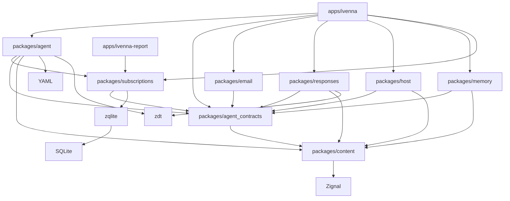

# Architecture

This guide describes Ivenna's current implementation: package responsibilities, execution, and service and storage protocols. The kernel retains working histories across restarts and constructs fresh execution state on startup. The application assembles the runtime and exposes health and reception status.

The [design intent](design.md) sets the behavioral goals and interface principles. The [input contract](input.md) defines runtime-generated user messages, [communication](communication.md) defines correspondence and explicit sending, and [attention](attention.md) defines focus coordination and observation lifetimes. The [usage guide](usage.md) explains correspondence with Ivenna.

## Responsibilities

| Unit | Responsibility |
| --- | --- |
| [apps/ivenna](../apps/ivenna) | Configure and assemble the runtime, serve HTTP status, and own process startup and shutdown |
| [apps/ivenna-report](../apps/ivenna-report) | Provide the [command-line interface for subscription listeners](subscriptions.md) |
| [apps/memory](../apps/memory) | Serve memory operations over SSH and own workspace files, capacity enforcement, and locking |
| [packages/agent](../packages/agent/src/root.zig) | Coordinate focuses, sessions, activations, and retained history; own model-input rendering, execution policy, session prompts, and expression and attention actions |
| [packages/agent_contracts](../packages/agent_contracts/src/root.zig) | Define the communication, history storage, and capability contracts shared by execution and concrete implementations |
| [packages/email](../packages/email/src/root.zig) | Own native addressing, message projection, submission, storage, and retention behind the communication and history contracts |
| [packages/responses](../packages/responses/src/root.zig) | Encode, measure, and decode model exchanges; own model HTTP transport, file uploads, and request content limits |
| [packages/host](../packages/host/src/root.zig) | Define host tools and own command handles, incremental interaction, process cleanup, logs, and completion output |
| [packages/memory](../packages/memory/src/root.zig) | Define memory tools and translate their operations and results through the SSH service protocol |
| [packages/subscriptions](../packages/subscriptions/src/root.zig) | Store registrations, listener progress, report keys and pending observations in SQLite |
| [packages/content](../packages/content/src/root.zig) | Define tool-result text, image, and file content, classify source bytes, and interpret image references |

The kernel and its [HTTP listener](../apps/ivenna/src/service.zig) run in the same process and shut down together. On Linux the kernel uses `/proc/self/exe` to locate `ivenna-report` beside it and supplies that path to host commands. The separate reporter process opens the subscription store on behalf of local listeners. The kernel reaches the memory app over SSH. Its handler and image sources live in `apps/memory`, and local service orchestration lives in `dev`.

The agent and concrete capabilities share `agent_contracts`, which depends only on Content. Content supplies tool-result text, image, and file representation and source classification. YAML rendering belongs to the agent. The build declarations enforce the following module dependencies; each arrow points from a module to one it imports:

The agent exposes `Kernel`, `Engine`, and its `Input` message types and renderer. Session scheduling, owned deliveries, activations, and retained context remain internal to the agent. `Kernel.Config` and `Kernel.Limits` describe execution policy; `Engine.Reasoning` selects ordinary reasoning effort for core and activity roles. Connection settings and protocol encoding belong to their capability packages; the application loads environment values and owns HTTP listener settings.

### Shared contracts

At runtime, the application supplies concrete capability implementations through shared contracts. Kernel calls input, sending, and history storage operations and publishes scheduled wakeups. Engine calls the model and registered tools. Host owns command lifetimes, returns observations through tool calls, and publishes registered completion observations.

Shared [communication types](../packages/agent_contracts/src/communication.zig) describe incoming observations and explicit outgoing messages. The shared capability contracts define calls and data exchanged within the process. The agent owns model-input rendering, handovers, history-record encoding, and the checkpoint selecting retained working histories; each adapter owns its service protocol encoding:

| Contract | Operations | Implementation |
| --- | --- | --- |
| [Inbox](../packages/agent_contracts/src/inbox.zig) | Poll typed correspondence and callback envelopes with opaque receipts and acknowledge durable admission | Email integration |
| [Callback.Registrar](../packages/agent_contracts/src/callback.zig) | Persist a future observation's source and bind its destination to the invoking session | Agent execution |
| [Callback.Publisher](../packages/agent_contracts/src/callback.zig) | Store one observation under a registered callback ID, preserving the first stored result | Email integration |
| [Communication.Sender](../packages/agent_contracts/src/communication.zig) | Submit explicit outgoing messages using correspondent IDs | Email integration |
| [HistoryStore](../packages/agent_contracts/src/history.zig) | Load and save the current checkpoint; allocate groups, discover record metadata, read and create records in batches, and maintain the selected history | Email integration |
| [Model.Port](../packages/agent_contracts/src/model.zig) | Infer, measure encoded requests, and prepare tool results for model input | Responses adapter |
| [Reference.Issuer](../packages/agent_contracts/src/reference.zig) | Allocate a named reference durably before the capability uses it | Agent execution |
| [Tools](../packages/agent_contracts/src/tool.zig) | Register a capability's declarations with its invocation entry point | Host and Memory |

The sending adapter resolves recipients and reports what it knows about submission through `Communication.SendResult`. Kernel renders those [sending outcomes](communication.md#sending-a-message) as tool replies. Errors that prevent the adapter from providing a defined outcome propagate to runtime supervision.

`Tools.Invocation` carries the internal calling session ID and its model-facing `focus_id`, together with a callback registrar and a command-reference issuer borrowed for that invocation. Host requests its durably allocated command reference through `command_reference` before launch.

The callback registrar accepts a name and source and returns `Callback.Registration`: an internal numeric delivery ID and a complete reference allocated for the caller. A capability retains the numeric ID for publication through `Callback.Publisher` and presents the reference as `callback_id`; it does not retain the registrar or choose another receiving session.

[Reference](../packages/agent_contracts/src/reference.zig) validates names of at most 32 Unicode code points and formats `<name>-<number>` references for Agent and Host. Execution retains focus, callback, and command sequences in the checkpoint. SQLite allocates the numeric suffix for each subscription reference. Capabilities control the lifetime of their referenced resources. Lookup checks the complete reference; its numeric suffix alone does not establish identity.

The email integration uses the configured mail account for correspondence, callbacks, and working history. It owns native addressing, folders, markers, and record lifecycles behind the shared contracts. The [email boundary](#email-boundary) describes its storage protocols and operation ownership.

## Service and reception

The application reserves `SERVICE_ADDRESS` before it accesses the mail account. If the address is already in use, startup stops there. After mail initialization, the memory check, and session restoration, the application starts serving probes and running the kernel and host supervisor. The kernel reconciles restored host registrations and completes initial history maintenance before opening reception. It then dispatches startup activations. [Startup and interruption](#startup-and-interruption) describes how work resumes.

The listener handles probes independently of intake and model work. A health probe observes the listener. A readiness probe reads the kernel's reception state, which stays open while an individual focus waits for inference. The deployment's mail service uses readiness to decide whether to accept correspondence. Shutdown can follow a successful check, leaving accepted mail in the account. See the [reception contract](running.md#service-status-and-reception) and [local SMTP example](../dev/README.md#configuring-mail).

Each probe handler owns its connection, the kernel owns intake and session workers, and Host supervises commands independently of the session that launched them. A failed probe ends its connection. An HTTP listener failure or an unrecovered kernel or host error closes reception for this instance. The application cancels and joins concurrent work before releasing shared dependencies.

## Sessions, work, and communication

| Concept | Role and lifetime |
| --- | --- |
| Task | Work to be accomplished; it may continue across activations |
| Core session | Persistent coordinating session with its own history and input queue |
| Activity session | Session forked by the core with inherited context, an assignment, and its own subsequent history and queue |
| `input` event | Correspondence observation with `from` IDs, text, and observation time |
| Delivery | An owned observation retained through durable admission and any transport receipt acknowledgement |
| Activation | One worker running a session through model and tool rounds until the activation completes or is interrupted |
| Model round | One model response followed by all tools it invoked |

The [session registry](../packages/agent/src/sessions.zig) serializes queue and history changes. A worker retains its inference output and context while the tool batch executes, then commits the complete round before its model-round arena ends.

The registry stores an internal numeric ID, a stable named `focus_id`, and an `Input.Role` of `core` or `activity` for each session. The role selects the available tools. Activity messages and endings go to the core. Subscription reports go to the focus that registered. Sleeping and interrupted sessions retain their identities and roles through context unloading and restart. Completed activities leave the registry; session IDs increase monotonically and are not reused. The core remains registered.

### Scheduling and capacity

Each ready session can claim its own worker. The registry allows one activation at a time per session, preserving its model/tool order while other sessions advance concurrently. The worker holds its own copy of the session context through each round. Observations that arrive during inference or tool execution can enter working history at the [next admission](#activation-admission).

Separate [limits](running.md#configuration) bound registered sessions, ordinary deliveries buffered per session, and live host commands. The ordinary queue allowance counts correspondence, callbacks, assignments, and focus messages. Mail stays in its source when the destination is full. Startup and activity interruption notices can still enter the queue. The registry reads activity and subscription reports from their durable stores as it prepares model input.

Sleeping activities retain their session slots. Completing an activity releases its slot. Forks and activity resumption are independent of space in the core's ordinary queue. Outstanding callback registrations and unread reports can grow with pending work.

### Coordination

Correspondence enters the core's FIFO queue independently of mail threads. Each focus can use the tools selected for its current role, including when its inherited history contains calls made by the core. See [model requests and tools](#model-requests-and-tools) for selection and [attention](attention.md) for the actions available to each focus.

`send_focus_message` uses the registry's durable session-message queue with a target chosen by the core. The registry records the calling core's complete reference as `from_focus`. Messages consume ordinary event capacity and can make a sleeping or interrupted recipient ready. They do not register an awaited reply. Activity expressions remain in their separate outbox and accompany the core's ordinary inputs without activating it.

Unknown focus selections remain ordinary tool errors. Activity endings and interruptions request the core's attention. An ordinary tool reply can continue an already active core session.

## Activation admission

The email adapter supplies correspondence and callback envelopes with optional opaque receipts. The agent routes correspondence to the core and callbacks to the registered session. A delivery owns its copy of the observation and any receipt needed to acknowledge it. See the [delivery and activation types](../packages/agent/src/work.zig).

At a model-round boundary, the registry gathers ordinary deliveries from the session queue and subscription reports for that focus. For the core it also reads unread activity messages and endings. A pending startup observation comes first. The registry rotates which source gets first place after startup and preserves arrival order within each source. It reads reports in pages of 64, adding pages while the candidate input fits. `Input.coalesceActivityReports` groups activity facts by focus before measurement, so the kernel can select the longest prefix that fits the complete encoded request.

Selection and ordinary inference use the same retained history, focus identity, observation time, and grouped events. The registry returns unselected ordinary deliveries to the front of their queue. Unselected reports remain in their respective stores. If no prefix fits, the kernel can compact the history and try again. An input that still cannot fit interrupts the activation and stays queued. See [bounded model context](#bounded-model-context).

The worker renders the selected observations in the current turn, then appends them to history for later rounds. One checkpoint commits the updated history, including any replacement handover, together with the remaining activity outbox, pending callbacks, and each focus's last admitted subscription sequence. Once the checkpoint is confirmed, the registry acknowledges those subscription reports in SQLite and the kernel acknowledges any mail receipts before inference.

## Activity forks

Only the core can invoke `open_focus`. Each call reserves an identity and prepares an assignment. When all tool calls in the round have returned, the worker appends the model output and the tool replies to its own context. The registry copies that completed context for each new activity and publishes the core's updated history and all new activities in one checkpoint. The core continues its activation.

Each copy includes retained events, complete native model/tool exchanges, and any existing handover followed by later history. All replies from the calling round are included, even those produced after the fork call. Forking generates no extra summary. Original record focus references remain intact as provenance; historical tool calls are not replayed.

The activity restores this history under its own `Context.scope` and `focus_id`. Its assignment is the first new queued observation. It constructs fresh inference turns from its own queue. Callbacks, wakeups and subscription reports keep their original destinations. New inputs supply the activity's current identity and events, with tools selected for its role under the same system prompt. Inherited assistant output is not collected again as a new report. See [opening a focus](attention.md#opening-a-focus) and [assignment fields](input.md#assignments-and-reports).

## Activity reports

An ordinary activity response contributes one assistant message when it contains `output_text`, including an explicitly empty string. The registry records the source focus and the time it collected the response. If the response calls tools, the registry publishes the message before the first tool runs. The core can therefore receive the activity's stated intention even if execution stops before a tool result is saved. For a response without tool calls, the registry publishes the text at [round completion](#activation-and-session-completion).

The [activity outbox](../packages/agent/src/reports.zig) stores each message and ending as a separate immutable record linked to its predecessor. An ending records when the runtime closed the activity and requests core attention even if the activity produced no text. Messages alone wait for the core's next ordinary input. The checkpoint selects unread records by storage group, head key, unread count, and ending count.

At [admission](#activation-admission), history retains the grouped observations with their original times. The outbox advances by the number of individual records and endings consumed. The remaining records stay available even after their source activity ends. See [working history](running.md#working-history) for the storage cost of unread reports.

## Activation and session completion

Tool replies lead to another round. For a response without tool calls, the registry checks pending work under its lock and commits the response's effects on history, reports, and session membership together.

| State after the response | Result for the focus |
| --- | --- |
| An observation requests further attention | The focus retains the response and continues its activation. |
| The core has no work requesting attention | The core goes idle with the response in its retained history. |
| An activity has no input ready and still has a pending callback or active subscription | The activity sleeps with its updated history until more work arrives. |
| An activity has no input ready, pending callback, or active subscription | The activity ends. One checkpoint drops the session from saved history and selects the outbox records for its final message (if present) and its ending, in that order. |

For a retained focus, the registry takes ownership of the worker's updated context. A sleeping activity can unload that context after checkpoint confirmation. At startup and after a withdrawal, the dispatcher checks sleeping activities. Queued reports make the receiving activity ready. An activity whose last registration was withdrawn can end as soon as it has no more work. The registry frees an ended activity's remaining state when its last worker releases it.

### Interrupted activations

A rejected request, an unusable response, or an input that cannot fit the context budget ends the current activation. The registry keeps the focus, its selected history, and its registrations. It returns unadmitted ordinary deliveries and their receipts to the front of the queue. Unadmitted activity and subscription reports remain in their respective stores. For an activity it also queues a runtime-authored `focus_interrupted` observation for the core. A single checkpoint records the interruption notice and the unfinished activity. The worker releases the focus. An interrupted activity can unload its context until more work arrives. See [interrupted reasoning](attention.md#interrupted-reasoning) for the core's view.

If admission failed, the focus waits for fresh input or a restart. An observation that requests attention can qualify even if it arrived while the worker was busy. For subscriptions the registry compares the latest report sequence with the one sampled when it collected the batch. If the input entered history before inference failed, work following that input can resume the focus, including reports left out by the request budget.

## Event sources and callback admission

The registry persists monotonically increasing numeric callback delivery IDs, named references, receiving sessions, and `Callback.Source`: either `wakeup` or `host: { command_id }` with the complete command reference. A tool-supplied name and the numeric delivery sequence form the model-facing `callback_id`. An invocation's registrar binds the destination without exposing session routing to Host. Scheduled attention saves its registration and deadline together; a yielded host command saves its registration before returning its callback reference. Both publish through `Callback.Publisher` using the internal numeric delivery ID. Forking and context unloading do not copy or retarget registrations.

A wakeup also stores `History.Wakeup { id, at_unix_ms, text }`. Agent argument parsing converts the RFC 3339 `schedule_attention.at` into Unix milliseconds before registration. The intake loop durably publishes a due wakeup's text before removing that entry. Its callback registration remains until admission. If a crash leaves the wakeup entry in place, the [callback publisher](#callback-delivery) recognizes an existing result by its registered ID. Polling, queue capacity, and scheduling can delay inference beyond the deadline.

Intake resolves the numeric delivery ID through its registration, adds the saved callback reference and source to the model observation, and defers a full destination. The owned `Delivery` keeps the numeric ID separately for admission and acknowledgement; it is not part of the rendered observation. `queued_callbacks` blocks duplicate acceptance and acknowledgement until the accepted delivery is durably saved and any receipt acknowledged. Admission saves the observation and registration removal in one checkpoint. Later copies of a consumed positive ID below the saved next-ID counter are acknowledged without another observation. Other unknown IDs fail execution.

## Subscription delivery

The kernel creates the subscription catalog in `DATA_DIR` on first use. When a listener queries or updates a subscription, `ivenna-report` opens its own connection to that catalog. This lets an independent listener publish while the kernel is stopped. See the [store implementation](../packages/subscriptions/src/root.zig) and its [SQLite build](../packages/subscriptions/build.zig).

Publication and withdrawal serialize as SQLite writes. Publication copies the subscription reference and receiving focus into the report and commits it with the retry key and any cursor advance. A cursor conflict rolls back the write, leaving the key available. Retrying a committed key has no further effect while the subscription is active. Withdrawal deletes the registration, cursor, and retry keys. Previously accepted reports retain their destination. See the [catalog schema](../packages/subscriptions/src/schema.sql).

SQLite assigns an increasing sequence to every report across all subscriptions. The kernel dispatches at startup, on each intake pass, and when a worker finishes. An idle focus is ready when its latest report sequence exceeds the last one admitted to its history. To prepare an input, it reads only that focus's reports in sequence order, starting after the last admitted report and ending at the latest sequence sampled for this batch. Reports published later can enter the following input. See [activation admission](#activation-admission).

The first mailbox checkpoint records the identity of an unbound catalog before the kernel marks the catalog bound. On restart the saved identity must match. The registry then deletes each focus's reports through the sequence confirmed in its history, completing any acknowledgement interrupted by shutdown. See [backups and transfers](running.md#backups-and-transfers).

## Working history and user messages

[Context](../packages/agent/src/context.zig) owns retained events, complete native `Model.Item` exchanges, and handovers. It caches their LLM message view. Model output remains opaque adapter continuation bytes, including reasoning; tool replies keep their typed content. [History persistence](#persistent-working-history) stores entries and selects them for restoration.

Context prepends the embedded [system.md](../packages/agent/src/system.md) as one system message before selected history and the current turn. Its text is identical for core and activity sessions; the turn identifies the current focus and role, and Engine selects tools separately. Ordinary requests, admission candidates, and compaction include this prompt independently of retained entries and measure its encoded cost.

[Input](../packages/agent/src/input.zig) renders retained `Record` values and temporary `Turn` values as YAML user messages. `Registry.current` supplies the current focus's identity, role, and time for each ordinary turn. Presentation methods format internal Unix milliseconds as UTC RFC 3339 `observed_at` and `ended_at` strings; retained ZON records preserve numeric times and complete typed values. The [input contract](input.md) defines the fields and omission semantics of these agent-generated messages. The model adapter separately encodes native exchanges and [tool content](#tool-results). The private [time adapter](../packages/agent/src/time.zig) uses [zdt](https://codeberg.org/FObersteiner/zdt) to format observation times and parse attention deadlines.

An ordinary request presents the selected events in its current turn after the complete retained prefix. A continuation without newly selected events omits the turn's `events` field. [Compaction](#bounded-model-context) uses the complete retained prefix and adds sampled state for recollection.

## Model requests and tools

[Engine](../packages/agent/src/engine.zig) combines messages, selected tool declarations, and reasoning effort into [Model.Request](../packages/agent_contracts/src/model.zig). [tools.zig](../packages/agent/src/tools.zig) selects agent declarations and parses their arguments using one explicit role rule. Memory joins through `shared_tools` and, for activity sessions, Host through `activity_tools`. Declarations stay with their owning capabilities; invocation uses the same role selection. Runtime action effects remain in Kernel's calling round, including focus preparation and atomic publication with the completed round.

Kernel calls inference and tool execution separately. The activation remains owned by the same worker through the returned batch. Engine retains the prepared request through tool execution so the provider can apply content limits to the complete result batch.

Sessions share the configured model and output-token limit; Engine selects ordinary reasoning effort by role using the [model settings](running.md#model-requests). The [Responses adapter](../packages/responses/src/provider.zig) encodes these settings and uses the same payload encoder for measurement and inference. Engine invokes the returned calls in order, while other sessions can run their own tool batches concurrently. Unknown tools and invalid arguments become ordinary tool errors.

### Model transport

Each call to `Model.Port.next` makes one non-streaming HTTP attempt under a monotonic deadline. Inference and file uploads share a request writer. It finishes the HTTP body and flushes the connection, including any buffered TLS records, before waiting for response headers. The adapter checks any declared response length and validates the complete model output before returning tool calls. On timeout or cancellation, it joins the exchange before releasing borrowed data.

| Evidence from the inference endpoint | Adapter outcome and runtime action |
| --- | --- |
| Shared authentication or protocol failure, or exhausted account quota | The error reaches process supervision. HTTP 402 or an explicit `insufficient_quota` diagnostic in a complete, bounded HTTP 429 body establishes quota exhaustion. |
| Timeout, interrupted transfer, HTTP 408, rate limiting (429), or most 5xx responses | Temporary unavailability. Engine waits and repeats the inference. A schedulable `Retry-After` delay sets the earliest retry. An explicit `x-should-retry: false` on these statuses rejects the inference. |
| Request-specific refusal, including HTTP 403 or 404, malformed response, or a generation the service reports as incomplete | Rejection. The kernel [interrupts this activation](#interrupted-activations). |

Engine owns the retry schedule for ordinary and summary inference. The worker keeps the request, tools, and original observation time, releases the attempt's temporary allocations, and sleeps without holding the registry lock. Cancellation interrupts either the exchange or the wait. Tools execute once the inference returns a validated response. See [when model work stalls](running.md#when-model-work-stalls) for the schedule and its operational effects.

### Tool results

Capabilities return [Content](../packages/content/src/root.zig) parts owned by the model-round arena. Content supplies byte classification and image-reference interpretation; Host and Memory own source reading, limits, and provenance. Engine associates results with call IDs and passes the complete tool batch to the Responses adapter before the exchange is committed.

The adapter copies the new reply parts and applies the [model request checks](content.md#model-request-checks) against the complete request, preserving retained history and operation descriptions. It omits files beyond the count limit before uploading them. Each file part holds complete bytes and an optional opaque upload reference.

For a file without a reference, the adapter sends a generic filename and the purpose `rich_layout_recognition`. A definite HTTP 400 rejection permits one attempt with `user_data` under the same per-file deadline. If the file cannot be sent, the endpoint refuses it, or its storage outcome is uncertain, the adapter replaces that file part with the observed outcome. The kernel can then commit the complete tool round, including its other results. See the provider's [Files API](https://api-docs.deepseek.com/guides/files_api/) and the [file result contract](content.md#complete-files).

On success, the adapter retains the service file identifier as an opaque reference alongside the original bytes. Measurement and inference use the same encoder and reuse prepared references. The function-call result carries the file description and other content parts. After the complete tool-result batch, the adapter appends user-message items with `input_file` references and their originating call IDs.

At round commit, Context copies the prepared parts into its retained arena; [history persistence](#persistent-working-history) stores their bytes and references. Uploaded files have a separate [model-service retention lifecycle](running.md#uploaded-model-files).

## Bounded model context

`CONTEXT_REQUEST_BYTES` bounds the complete encoded ordinary request, including retained or inherited history, handover state, new events, tools, reasoning settings, inline images, and file references. The kernel checks before each ordinary inference. `LLM_MAX_OUTPUT_TOKENS` independently bounds output, including reasoning.

The model service expands file references after receiving the encoded request. The [running guide](running.md#context-budgets) explains the consequences for context sizing.

For each compaction attempt, `Registry.compactionSnapshot` samples the receiving focus's identity, time, pending callbacks and active subscription references under the registry lock. For the core it also samples existing activity references. `Context.summaryRequest` combines this sample with the common system prompt, retained history and [summary instructions](../packages/agent/src/compaction.md). Earlier handovers keep their stored state. Unadmitted observations remain outside the summary request. The summary inference runs without tools at `high` reasoning within `CONTEXT_COMPACTION_BYTES`.

The generated summary must contain nonempty text after trimming and no tool calls. The runtime pairs it with the sampled state and time to form the handover. The kernel measures the complete replacement ordinary request, including any selected events, against `CONTEXT_REQUEST_BYTES`. When it fits, the new epoch starts with the handover followed by the admitted events. Earlier message storage follows [retention](#history-retention).

The kernel requests one more summary if the first response lacks usable text, includes tool calls, or leaves the ordinary request too large. It samples state again and supplies the original history and a brief explanation in `summarize.instructions`. Only a fitting handover replaces the selected history. An oversized summary request, request-specific rejection, or unsuccessful second summary [interrupts the activation](#interrupted-activations).

If the model is temporarily unavailable, Engine retries the same summary request with the same sampled state. The kernel requests a new summary only after it evaluates the first one. See [model transport](#model-transport) for inference outcomes.

## Persistent working history

The agent's [history persistence](../packages/agent/src/history.zig) stores immutable records and a checkpoint selecting each session's current history segment. A fork persists its copied entries in the activity's own storage group. Compaction advances a session's epoch and replaces its selected history with a handover while preserving identity and role.

| Term | Meaning |
| --- | --- |
| Session | A core or activity session with its own identity and role |
| Segment | An append-only sequence identified by `Scope { session_id, epoch }`; a fork starts the activity's first segment and compaction starts a replacement |
| Storage group | An opaque identifier used by `HistoryStore` to discover related immutable records, such as a session segment or report journal |
| Committed chain | The checkpoint's selected records in one segment, identified by a head key and entry count |

Each entry contains a retained `Input.Record` or an exchange of `Model.Item[]`. Exchanges preserve opaque model output, including reasoning, and typed tool replies with text and media. Event records carry their receiving `focus_id` and observations. Handovers carry their producing `focus_id`, sample time, generated `summary`, and sampled `state`, including empty collections in storage. Local image and file bytes remain in the records; files also retain opaque upload references, while remote images retain their URLs. Inherited records keep their original focus references.

Working history and the activity outbox share a [record codec](../packages/agent/src/record_codec.zig) for compact UTF-8 ZON bodies and content keys. An entry record contains the entry and its predecessor's SHA-256 key within that segment, or null for the first entry. Its own key is the SHA-256 of the complete encoded body. The storage group and predecessor keys distinguish occurrences even when their payloads are equal. Unread internal observations are stored together in a separate immutable observation-array record in the session's current group.

One checkpoint covers all registered sessions and identifies the subscription catalog. For each session it records the internal ID, `focus_id`, role, epoch, storage group, committed head, entry count, and the last admitted subscription report sequence (zero before the first report). An optional key selects the unread internal observations in that group. The `was_running` flag helps determine which activities receive a [startup observation](#startup-and-interruption) immediately. Across sessions the checkpoint retains the next session, callback, and command numbers, callback registrations with their references, sources and destinations, scheduled wakeups with their deadlines and text, and the [unread activity reports](#activity-reports).

Appending advances the head and count without adding a per-entry reference to the checkpoint. A sleeping session can retain this confirmed selection without materialized context entries. The latest confirmed checkpoint selects the records kept by [history maintenance](#history-retention) and available for subsequent restoration.

### Saving and restoration

`HistoryStore` exposes checkpoint publication, grouped records, and retention maintenance. History persistence and the activity outbox own their record schemas, chain selection, validation, and retention references. The shared record codec supplies encoding, decoding, and content-key functions; adapters own native representation, locators, placement, and protocol limits.

The registry holds its lock through checkpoint publication at [admission](#activation-admission) and [round completion](#activation-and-session-completion). A tool can also change what a restart must recover before the round finishes. For example, the registry saves a host command's callback registration before returning its reference.

Persistence encodes and hashes entries from loaded contexts against their confirmed chains. Unloaded contexts reuse their confirmed selections. It first writes any new records, then publishes the checkpoint that selects them. If record creation stops partway through, the previous checkpoint still selects the history to restore. A checkpoint whose digest matches the last confirmed publication needs no new revision. If checkpoint publication itself returns an error, the store may already have accepted it. Persistence discards the cached digest so the next save must confirm its selection before maintenance can retire records.

Session restoration discovers group metadata, follows each committed predecessor chain, then reads selected bodies in batches. Hashes, checkpoint selections, record kinds, counts, and predecessor metadata must agree. Complete focus references identifying the owner of retained event and handover records must identify either the restoring focus or the core (`core-1`). Matching physical duplicates can supply one logical occurrence. Missing or inconsistent committed records fail restoration.

Startup reads and validates all selected session history. It rebuilds the outbox's unread metadata from its checkpoint and loads report bodies in admission windows. It materializes the core context and discards temporary activity entries; activity contexts are materialized when scheduled. Later cold restores read only that session's history. Delivery objects, receipts, worker ownership, and host process handles are not checkpointed. See [startup](#startup-and-interruption) for reconstruction.

### History retention

Compaction replaces the session's selected segment. Once the replacement checkpoint is confirmed, its earlier epoch is no longer needed for continuation. A completed activity's history becomes unselected when its removal is confirmed in a checkpoint. The core's outbox retains that activity's unread messages and ending until they enter the core's history. Shared autonomous memory follows its own lifecycle. Context unloading preserves the current selection; previous checkpoints are not restoration roots.

Maintenance runs before reception opens and then at intervals of at least 60 seconds between polls. The registry locks saving and reconciliation together. From the confirmed checkpoint, `HistoryStore.Retention` names every selected `(group, key)`, including unread observations and outbox reports.

The [email adapter](#mail-retention) keeps selected records in History and retires unselected records to Trash. The mail service owns Trash expiry and space reclamation.

## Startup and interruption

Startup opens the subscription catalog, discovers mail, checks memory with `inspect_memory_space`, and loads the checkpoint or creates the core. It rebuilds identities, roles, unread internal work, activity outbox references, callbacks, and wakeups. The registry uses the checkpoint to resume [subscription delivery](#subscription-delivery). Requests receive the common system prompt independently of restored history. Communication-copy and history maintenance complete before reception opens.

On every restart the core receives a fresh `startup` observation. For an activity, `was_running` records whether it had a running or interrupted activation or a startup observation waiting in its queue. The registry queues startup immediately for activities with that flag or unread internal observations. Other restored activities receive startup with their next event. A newly opened activity begins with its assignment.

Before dispatch, Kernel publishes an interruption observation for each restored host registration. The [callback publisher](#callback-delivery) preserves any identifiable result already stored for that ID. Wakeups publish when due. Processes and historical tool calls are not replayed, and source command IDs from the earlier runtime are not restored handles.

Unacknowledged correspondence remains eligible and can appear again after a crash between persistence and acknowledgement; callback IDs instead retain durable admission deduplication. Fresh startup observations identify this runtime; earlier records remain evidence of their original observations and outcomes.

Use one kernel per account. Host effects, memory writes, mail submission, subscription changes, acknowledgement, and history publication have separate commit points. Effects may precede their saved results, and repeating uncertain actions can duplicate them. An incomplete model/tool round is outside confirmed working history. The [availability contract](design.md#runtime-availability) determines when execution can continue.

## Email boundary

The [mail service](running.md#mail-service) checks which From addresses a sender may use. The adapter's [addressing module](../packages/email/src/addressing.zig) maps those addresses to correspondent IDs and resolves outgoing IDs in the configured domain. The [communication guide](communication.md#current-email-addressing) defines supported addresses and IDs.

### JMAP requests

The [JMAP client](../packages/email/src/jmap.zig) sets one 60-second monotonic deadline per call, including any retry. Reads and updates that assign fixed folder and keyword values to known Email IDs can reuse connections. If the connection fails, the client can repeat either operation once on a fresh connection. Creates, including submissions, use fresh connections and can retry once only if the connection fails before transmission begins. The client logs the method, phase, and cause of a broken exchange, closes its connection, and joins canceled work.

At startup the adapter locates `Ivenna Callbacks` and `Ivenna History` by their exact top-level names and null roles. It locates Trash by its `trash` role. If a folder is missing, it creates it. If the create outcome is uncertain, the adapter lists folders again and applies the same selection. Startup needs a matching folder to proceed.

### Outgoing mail

For each send, the adapter resolves all recipients before creating a draft marked `ivenna-outbound`. It uses the returned draft ID in `EmailSubmission/set`. If draft creation is unconfirmed, the call ends before submission.

When the submission outcome is uncertain, the adapter queries `EmailSubmission` by draft ID and sending identity. This includes a lost response or a `serverUnavailable` method error, which Stalwart can return after queuing delivery. A matching record confirms acceptance. If the lookup fails or finds no match, the outcome remains unknown. The sending identity may lack read access, and the service can discard submission records after sending. [RFC 8621 §7](https://www.rfc-editor.org/rfc/rfc8621.html#section-7)

### Callback delivery

The publisher stores each callback directly through JMAP as a self-addressed `Email` in `Ivenna Callbacks`. Before creating it, the publisher searches the whole account, including Trash, for the keywords `ivenna-callback` and `ivenna-callback-<id>`. It checks the sender and recipient and matches the positive `X-Ivenna-Callback-Id` header to the keyword. An identifiable copy preserves the first result even when its body is unreadable. If creation loses its acknowledgement, the same lookup must find the intended callback or publication fails.

Intake reads callbacks only from `Ivenna Callbacks` and also requires a complete plain-text body. It logs and skips invalid callback records. If an old copy has expired and the publisher creates another, the [admission checkpoint](#event-sources-and-callback-admission) still prevents a consumed ID from producing a second observation.

### Mail intake and acknowledgement

Ordinary intake finds unhandled correspondence outside `Ivenna Callbacks`, `Ivenna History`, Drafts, Junk, and Trash. Drafts and private callback, outbound, or state records are excluded. Read and starred state do not select input. [EmailTransport](../packages/email/src/email_transport.zig) projects supported From IDs, complete text, and observation time according to [communication](communication.md#incoming-email-text).

`Inbox.Poll { messages, callbacks }` supplies independent allowances; zero disables a stream. The registry accounts for tracked receipts and pending callbacks and disables correspondence when the core is full. The adapter reads each oldest eligible prefix, paging past unsupported records, then merges by `receivedAt` without a combined cap. Correspondence backlog cannot consume callback allowance; FIFO applies within each selected stream and session queue, not account-wide across destinations. Rejected input stays stored.

After durable admission, acknowledgement sets `ivenna-handled` and moves the copy to Trash without changing read or answered state. Receipt bookkeeping remains in memory; acknowledgement does not certify task completion.

### History storage

The adapter stores immutable records and checkpoints as self-addressed JMAP `Email` objects in `Ivenna History`. Each carries the `ivenna-state` keyword, an `X-Ivenna-History-Kind` header (`record` or `checkpoint`), and the agent's plain-text ZON body.

Each record carries its storage group's `ivenna-history-<token>` keyword, its content key in `X-Ivenna-History-Key`, and its predecessor's key, if any, in `X-Ivenna-History-Previous`. A single `Email/set` creates the metadata and body together. If the response to a batch create is lost, the adapter queries the affected groups. It can confirm the batch from metadata alone when every requested record is present with its expected key and predecessor. An incomplete batch leaves the previous checkpoint in effect.

A checkpoint carries `ivenna-current` and a numeric `X-Ivenna-History-Revision`. Several checkpoints can retain that keyword until maintenance. The current checkpoint is the unique candidate with the highest revision. Invalid kind or revision metadata on an owned candidate, or a tie for the highest revision, fails loading. After an uncertain checkpoint write, the adapter reads the current checkpoint and requires both its revision and its complete document to match the attempted write. The running process allocates each new revision above all its earlier attempts, including any still unconfirmed.

During [restoration](#saving-and-restoration), the adapter queries the folder by state and group keywords in pages of up to 512 IDs. It validates ownership and group membership and returns record metadata and transient `Email.id` locators. The agent selects the committed chains, then asks for their bodies. Bulk `Email/get` rechecks ownership, group, key, and predecessor and returns complete text. The agent verifies the hashes and decodes the records.

Get and set batches contain at most 32 objects and obey the session's `maxObjectsInGet`, `maxObjectsInSet`, and `maxSizeRequest`. Encoded bodies and protocol fields count toward the request size. Each complete model/tool round occupies one record, including its native file bytes. If even one record exceeds the request limit on its own, saving fails with `HistoryRecordTooLarge` before checkpoint publication.

### Mail retention

Communication copies, admitted callback mail, and unselected history records retire into Trash. The mail service owns expiry and storage reclamation under deployment policy, independently of whether Ivenna is running. The [running guide](running.md#data-and-retention) describes retention and preservation requirements.

#### Communication copies

During initialization and before each poll, the adapter moves acknowledged inputs and outgoing copies to Trash. It recognizes outgoing copies by the outbound keyword and the sender's identity. This includes drafts left by interrupted sends, regardless of submission outcome. Maintenance shares a lock with sending, so it sees a draft only after the send releases it. Each move assigns Trash membership and clears draft state. The adapter checks the service's update acknowledgement for every selected Email ID.

#### Working history

The adapter inventories its state objects in `Ivenna History` against the agent's [retention selection](#history-retention). It checks the confirmed checkpoint and every selected `(group, key)` before moving anything. A missing selection or invalid metadata on an owned object fails maintenance. Trash is outside both inventory and restoration.

The folder keeps the confirmed checkpoint and every physical copy of a selected record. The adapter clears `ivenna-current` from older checkpoints and moves them and all unselected records to Trash. These include records from replaced epochs, obsolete observation arrays, and writes that never became part of a committed chain.

## Autonomous memory

[Memory](../packages/memory/src/root.zig) defines memory tool declarations and translates calls into typed JSON requests for [memory.nu](../apps/memory/src/memory.nu). The adapter owns host file sources and SSH transport. The handler represents rooms as directories and memories as files, and owns workspace addresses and capacity. The [memory shell](../apps/memory/memory-shell.sh) locks each request across observation, capacity checks, and publication. Other sessions can act between requests, so a sequence of calls is not a transaction. See [memory rooms](memory.md) for the operation contract and [service setup](running.md#memory-service) for deployment.

### Reads and searches

The handler reads byte ranges from Nushell streams and returns the source header, total length, and selected offset with each range. The adapter validates the response against its request and uses the shared [content](../packages/content/src/root.zig) text-prefix classifier to align text pages to UTF-8 boundaries. An image or PDF header, or binary content in the selected range, can require a second read of the complete entry from offset `0`, independently of the text page budget. That response is classified independently because another request may have changed the entry. Partial binary ranges do not become native files.

Room visits enumerate one directory; recursive size requests traverse all its child rooms before pagination. Capacity inspection traverses the entire workspace and remains separate from navigation. Visit and search results are sorted and selected within the encoded reply budget. Name search gathers the matched names before pagination. Content search wraps the query to match each whole line once, avoiding a submatch record for every occurrence. It drains ripgrep's JSON incrementally and retains a bounded page and total count. Each matching line is still read and decoded as a whole before its preview is selected. A fixed shell wrapper appends the exit status to the stream so the handler can distinguish no matches from a failed search after draining it.

### Writes and capacity

Writes prepare complete content in the handler-owned `.ivenna-tmp` directory, then rename it onto the destination. The staging directory shares the workspace filesystem and is excluded from memory observations and logical capacity. Before removing abandoned unpublished files, each request verifies the directory's ownership marker.

Publication replaces one file name, leaving other hard links on their previous content. Capacity counts regular-file lengths for each directory entry, including separate hard-link names. The projected usage is current usage plus the replacement length minus the addressed entry's previous length, checked while holding the workspace lock. All recording modes validate the proposed write before creating missing parent directories and publishing the entry. Entry transfers and revisions have a separate size limit from the workspace's shared capacity.

Unique revisions use Nushell's bounded `split row` to distinguish zero, one, and several matches before constructing a replacement. Literal replacement of all matches counts them from the byte-length reduction after deletion. Regex replacement of all matches retains a `parse` prepass: the selected Nushell version can panic on a backtracking error in `str replace`, whereas `parse` reports it as an operation error. That prepass still materializes its match list.

### Transport and failures

Transfers buffer each request and reply. Returned text, image, and file content is copied into the model-round arena before the SSH buffers are released. The adapter supervises concurrent request writing, response draining, and child completion against one deadline. Timeout and cancellation stop SSH before joining its writer and protected wait.

The handler translates selected-entry filesystem and pattern failures into tool outcomes. The adapter translates host source-file failures before transfer, while transport and protocol errors propagate to runtime supervision. The [memory interface](memory.md#results-and-errors) defines the outcomes, infrastructure failures, and uncertain effects.

## Host execution

[Host](../packages/host/src/root.zig) owns a shared command registry and the operations that launch, observe, and control its processes. Each command retains its arguments and startup configuration independently of the model-round arena. [Shell](../packages/host/src/shell.zig) prepares the environment and log files, resolves the working directory, and launches a fresh shell. See the [host interface](host.md) for modes, arguments, and results.

### Command lifecycle

Host reserves live capacity and requests a command reference from execution through its invocation context. Execution appends the next command number to the supplied name and saves the advanced counter in the checkpoint before returning the reference. Host then launches the command. Startup resumes the saved sequence.

`run_host_shell` waits on `std.Io.Condition` until process and input cleanup finish or the call's wait expires. If cleanup has completed, the call returns a complete-source result and retires the handle. Otherwise Host persists a completion registration with source `host: { command_id }`, using the command name for its callback prefix, retains the command, and returns the complete command and callback references. Other activities can discover and control a command while its caller waits.

If the invocation has no registrar, Host stops and joins the command and returns `handoff_unavailable` with its observed result. Registration failures propagate under the [availability contract](design.md#runtime-availability); a failed history publication may still have saved the registration.

`Host.run` supervises commands independently of session workers. Jobs are reference-counted so returning from a call does not release state still in use by a task or another caller. Completion releases live capacity; a separate eight-handle cache can retain finished commands for recent output collection. Its size is independent of `MAX_HOST_COMMANDS`. Full logs have independent [deployment retention](running.md#host-output-and-deployment-files).

Retained commands belong to the host runtime, while a pending completion registration keeps its receiving activity available across sleep. Completion publication can outlive the registry's control handle; the supervisor retains the command until publication ends. Shutdown cancels and joins command tasks before releasing their logs, terminals, publisher, or other dependencies. Startup restores [saved working history](#startup-and-interruption) and resolves pending host observations, not host processes or command handles.

### Interaction and synchronization

The Host mutex protects registry state, references, capacity, and input admission. Each command has an operation lock for continuation calls consuming its shared stdout/stderr cursors. Input, signal, and resize actions apply before taking that lock so an observation wait does not delay interaction. One input write can be in flight per command. It runs separately from the observation call; completion cancels and joins it before releasing the live slot.

The initial call keeps `handoff_pending` set until it rejects handoff or has saved the registration and prepared its tool result. Supervision waits for that flag to clear before publishing a completion, covering commands that finish during registration. It sets `settled` after process and input cleanup. Failure cleanup waits for that state without waiting for publication, so it can finish while the initial call still owns the handoff decision.

Command lookup checks the complete reference and is shared across activities; inspection records retain the originating `focus_id` as provenance. Inspection pages the current registry within a 32 KiB complete-reply budget, returning `offset`, `next_offset`, and the filtered `total_commands`. Registry changes can alter later pages. Initial observations and completion publication do not take the continuation lock; their [output collection](#output-and-delivery) is independent of the shared cursors.

### Processes and terminals

[process.zig](../packages/host/src/process.zig) owns child supervision through `std.process.Child` and `std.Io.Select`, including deadlines, cancellation, and protected reaping. It selects the process transport from the command's input mode.

[pty.zig](../packages/host/src/pty.zig) supplies the Linux terminal operations absent from `std.Io`. It opens the slave from the master with `TIOCGPTPEER`, resizes it with an ioctl, and uses `std.posix.tcgetpgrp` for foreground-group lookup. Launch uses `setsid --ctty` because `std.process.spawn` exposes process groups without a new-session option. The terminal master carries input and merged stdout/stderr; terminal EOF is a control byte rather than a pipe half-close.

In terminal mode, interrupt targets the foreground group so an interactive shell can continue afterward. Terminal termination and cleanup cover the original session, including background job-control groups. The backend enumerates `/proc`, filters with `getsid`, then binds candidates with pidfds and rechecks their session before signaling. Batch and pipe cleanup uses the command's process group.

Normal completion and timeout report cleanup failures as unavailable outcomes. Error unwinding and cancellation make a final best-effort cleanup before joining. A program can escape into another session; if it retains a terminal slave, output draining stops after a one-second wait. Terminal [deployment requirements](running.md#runtime-requirements) belong to the running guide.

### Output and delivery

Commands write to private log files. [Reader](../packages/host/src/reader.zig) owns complete-source classification and native media; stderr uses text-only reading. [output.zig](../packages/host/src/output.zig) selects byte ranges and previews. The tool decoder validates the combined encoded budget, and internal readers use its stream allocations. Both host and memory readers use the text-prefix classifier in Content.

Continuation calls consume shared per-stream cursors. They periodically check log-file growth and wait on the condition so completion can wake them immediately. After completion, an image or PDF header or an observed binary range triggers complete-source reading independently of the text cursor. The command's shared media flag is set only after returning native media or a complete-source diagnostic. A text-only observation leaves the allowance available so a later continuation can identify binary content and return the complete file once.

An initial handoff uses local zeroed cursors and a local media flag to collect its prefix. It neither waits for another continuation's observation deadline nor consumes shared output or media positions. If the command has already finished, the initial result can include native media without consuming the continuation allowance. Synchronous completion and callback publication instead read independent complete-source previews.

Host renders completion output as JSON text with the observed result and log paths. The registered callback source supplies command provenance in the receiving observation. In a callback, native media is represented by its description and an omission marker, leaving any unconsumed continuation media available while the handle remains retained. The [host contract](host.md#output-and-results) defines result fields; the shared [content contract](content.md) defines formats and media limits.

Shell preparation, source reading, and command controls translate their operation failures into tool outcomes. Task scheduling and runtime supervision failures propagate to the application, as do cancellation and allocation errors.
