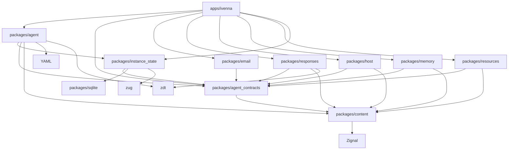

# Architecture

This guide describes how the application assembles Ivenna, how the kernel coordinates work, and how the runtime stores and restores it. For behavioral goals, configuration, and interface contracts, see the [documentation index](README.md).

## Responsibilities

| Unit | Responsibility |
| --- | --- |
| [apps/ivenna](../apps/ivenna) | Provide the CLI, load configuration, assemble the runtime, serve HTTP status and local channels, and manage process startup and shutdown |
| [apps/memory](../apps/memory) | Serve memory operations over SSH and own workspace files, capacity enforcement, and locking |
| [packages/agent](../packages/agent/src/root.zig) | Own sessions, scheduling, retained history, model input, prompts, and the communication and attention tools |
| [packages/agent_contracts](../packages/agent_contracts/src/root.zig) | Define the communication, history storage, and capability contracts shared by execution and concrete implementations |
| [packages/email](../packages/email/src/root.zig) | Own native addressing, message projection, submission, storage, and retention behind the communication and history contracts |
| [packages/responses](../packages/responses/src/root.zig) | Own DeepSeek transport, file uploads, request encoding and measurement, and response decoding |
| [packages/host](../packages/host/src/root.zig) | Define host tools and own command handles, process interaction and cleanup, logs, and completion output |
| [packages/memory](../packages/memory/src/root.zig) | Define memory tools and translate their operations and results through the SSH service protocol |
| [packages/resources](../packages/resources/src/root.zig) | Resolve resource references, read host files and directories, retrieve web pages, and present remote images by URL |
| [packages/instance_state](../packages/instance_state/src/root.zig) | Own the instance database and subscription store, and track open listener sessions |
| [packages/sqlite](../packages/sqlite) | Provide the embedded SQLite build and shared bindings |
| [packages/content](../packages/content/src/root.zig) | Define tool-result parts, classify source bytes, interpret image references, and read local file contents within a byte limit |

`ivenna serve` runs the kernel and its [HTTP listener](../apps/ivenna/src/service.zig) in the same process. Host commands receive the executable path and data directory in their [environment](host.md#command-environment). The kernel reaches the memory app over SSH. See [local service setup](../dev/README.md).

The graph follows imports between Ivenna's Zig modules and shows selected library dependencies.

The agent exposes `Kernel`, `Engine`, and `Input` and keeps checkpoint selection, session scheduling, deliveries, activations, and retained context internal. `Kernel.Config` and `Kernel.Limits` govern execution. `Engine.Reasoning` supplies the reasoning settings for model requests. Capability packages define service settings and protocols, and the application loads those settings from the environment. [Startup and interruption](#startup-and-interruption) · [Model requests](#model-requests-and-tools)

### Shared contracts

The application supplies the agent and host with capability implementations through in-process contracts. The agent encodes retained records and selects them with a checkpoint. Adapters translate their native service protocols.

| Contract | Operations | Implementation |
| --- | --- | --- |
| [Inbox](../packages/agent_contracts/src/inbox.zig) | Poll typed correspondence and callback envelopes with opaque receipts and acknowledge durable admission | Email integration |
| [Callback.Registrar](../packages/agent_contracts/src/callback.zig) | Register a host command completion for the calling session | Agent execution |
| [Callback.Publisher](../packages/agent_contracts/src/callback.zig) | Store the first result for a numeric callback delivery ID | Email integration |
| [Communication.Sender](../packages/agent_contracts/src/communication.zig) | Expose registered outgoing correspondent IDs and submit messages by ID | Email integration |
| [Channels](../packages/agent_contracts/src/channels.zig) | Reserve, activate, and close local channels, observe their receiver connections, and attempt handoffs by channel ID | Application |
| [HistoryStore](../packages/agent_contracts/src/history.zig) | Publish and load checkpoints, allocate storage groups, read and write records, and maintain retained history | Email integration |
| [Model.Port](../packages/agent_contracts/src/model.zig) | Prepare tool results for working history, measure requests, and run inference | Responses adapter |
| [Reference.Issuer](../packages/agent_contracts/src/reference.zig) | Allocate a named reference durably before the capability uses it | Agent execution |
| [Tools](../packages/agent_contracts/src/tool.zig) | Register a capability's declarations with its invocation entry point | Host, Memory, and Resources |

`Tools.Invocation` identifies the calling session by its internal ID and model-facing `focus_id`. It can also supply a callback registrar and a command reference issuer for the duration of the call. Host uses both during [command execution](#command-lifecycle).

Host passes the command name and `command_id` to the callback registrar. The registrar returns a numeric delivery ID for `Callback.Publisher` and the complete `callback_id` for the tool result. [Callback registration and admission](#event-sources-and-callback-admission)

[Reference](../packages/agent_contracts/src/reference.zig) validates names and formats the references allocated by execution. The checkpoint retains the focus and callback sequences and the sequence used for command and channel suffixes. These sequences continue after restart. The subscription store allocates its suffixes in SQLite. Resource lookup uses the complete reference. See [names and references](input.md#names-and-references).

## Service and reception

`ivenna serve` binds `SERVICE_ADDRESS` and the local channel socket before opening the instance database or accessing the mail account. Once the runtime is assembled, the application serves probes and channel readers concurrently with the kernel and host supervisor. The kernel completes startup recovery before opening reception and dispatching ready focuses. See [startup and interruption](#startup-and-interruption).

The HTTP listener handles probes independently of intake and model work. A health probe observes the listener. A readiness probe reads the kernel's reception state, which stays open while an individual focus waits for inference. The deployment's mail service uses readiness to decide whether to accept correspondence. Shutdown can follow a successful check, leaving accepted mail in the account. See the [reception contract](running.md#service-status-and-reception) and [local SMTP example](../dev/README.md#configuring-mail).

Each probe handler owns its connection. The kernel owns intake and session workers, and Host supervises commands independently of the session that launched them. A failed probe or receive request ends its connection. A listener failure or an unrecovered kernel or host error closes reception for this instance. The application cancels and joins concurrent work before releasing shared dependencies.

## Sessions, work, and communication

| Concept | Role and lifetime |
| --- | --- |
| Main session | Persistent session for the main focus, with its own history and input queue |
| Activity session | Session forked by the main focus with inherited context, an assignment, and its own subsequent history and queue |
| `input` event | Correspondence observation with sender IDs, text, and observation time |
| Delivery | An owned observation retained through durable admission and any transport receipt acknowledgement |
| Activation | One worker running a session through model and tool rounds until the activation completes or is interrupted |
| Model round | One model response followed by all tools it invoked |

The [session registry](../packages/agent/src/sessions.zig) serializes queue and history changes. A worker retains its inference output and context while the tool batch executes, then commits the complete round before its model-round arena ends.

The registry stores an internal numeric ID, a stable `focus_id`, and an `Input.Role` of `core` or `activity` for each session. The role selects the available tools. The input renderer uses `main` for the stored `core` role and presents the complete stored `focus_id`. Activity messages and endings go to the main focus. Subscription reports go to the focus that registered. Sleeping and interrupted sessions retain their identities and roles through context unloading and restart. The registry removes completed activities and issues monotonically increasing session IDs. The main focus remains registered.

### Scheduling and capacity

Each ready session can claim its own worker. The registry allows one activation at a time per session, preserving its model/tool order while other sessions advance concurrently. The worker holds its own copy of the session context through each round. Observations that arrive during inference or tool execution can enter working history at the [next admission](#activation-admission).

Separate [limits](running.md#configuration) bound registered sessions, ordinary deliveries buffered per session, and live host commands. The ordinary queue allowance counts correspondence, callbacks, assignments, and focus messages. Mail stays in its source when the destination is full. Startup and activity interruption notices can still enter the queue. The registry reads activity and subscription reports from their durable stores as it prepares model input.

Sleeping activities retain their session slots. Completing an activity releases its slot. Forks and activity resumption are independent of space in the main focus's ordinary queue. Outstanding callback registrations and unread reports can grow with pending work.

### Message delivery

Incoming correspondence enters the main focus's queue in intake order, independently of mail threads. The main focus also reads activity reports during admission. See [activity reports](#activity-reports) and [activation admission](#activation-admission).

The tool decoder reads the single field in `send.to` to select a destination variant. The kernel routes the complete ID to the mail sender, session registry, or channel registry. For a focus destination, the registry checks membership and queue capacity under its lock, then checkpoints the queued message with the calling focus's ID. The kernel renders the outcome as a tool reply. See [tool decoding](../packages/agent/src/tools.zig), [outgoing mail](#outgoing-mail), [local channels](#local-channels), and [sending outcomes](communication.md#sending-a-message).

### Local channels

The session registry owns channel IDs, their opening focuses, and descriptions. The opening round owns the transport reservation through tool execution. At commit, the registry holds its lock while it saves the registration with the round's tool replies. The transport exposes the channel after confirmation. If the round exits without confirmation, it releases its reservation. Closing a channel saves its retirement before the transport ends waiting reads. See [opening a channel](communication.md#opening-a-channel) for save outcomes and [channel lifetimes](communication.md#channel-lifetimes) for what survives restart.

The transport accepts connections on an abstract Unix `SOCK_SEQPACKET` socket named from the canonical instance directory and effective UID. Both peers check each other's UID. The versioned handshake registers the first pending read. After each handoff, the receiver requests its next read on the same connection and joins the back of the read queue. The application limits concurrent connection handlers and joins them at shutdown. [Socket protocol](../apps/ivenna/src/channel_ipc.zig) · [Receiver interface](communication.md#receiving-from-a-channel)

The transport tracks receiver connections between reads. A send tries the transport lock once, then tries nonblocking writes in read-request order. A successful write consumes one read. If no write succeeds, the transport checks whether a receiver is still connected. [Channel registry](../apps/ivenna/src/channels.zig) · [Send outcomes](communication.md#sending-to-a-channel)

Once the kernel confirms retirement, the transport removes the channel and wakes its connection handlers. Each handler tries to send the closing reply after any matched message. It can wait up to two seconds for socket capacity outside the registry lock, leaving other channels free to serve requests. libuv's stream shutdown similarly waits for pending writes before ending the write side. [Closing a receiver session](communication.md#receiving-from-a-channel) · [libuv stream shutdown](https://docs.libuv.org/en/v1.x/stream.html#c.uv_shutdown)

## Activation admission

The email adapter supplies correspondence and callback envelopes with optional opaque receipts. The agent routes correspondence to the main focus and callbacks to the registered session. A delivery owns its copy of the observation and any receipt needed to acknowledge it. See the [delivery and activation types](../packages/agent/src/work.zig).

At a model-round boundary, the registry puts any pending startup observation first. For the rest of the batch, it cycles through ordinary deliveries, subscription reports, and activity reports, starting at the focus's saved position. Only the main focus reads activity reports. The registry preserves arrival order within each source and reads reports in pages of 64. `Input.coalesceActivityReports` groups activity facts by focus before measurement.

The kernel measures how many encoded bytes the grouped observations add to the request. It extends the batch across report pages up to the observation batch target, checking the complete request against the adapter's limits. The first observation may exceed the batch target. If the full request with that observation exceeds an adapter limit, the kernel checks whether compaction can make room. See [context budgets](running.md#context-budgets) and [when compaction runs](#when-compaction-runs).

Unselected ordinary deliveries return to the front of their queue. Unselected reports remain in their respective stores. The next batch starts one position after the source of the first admitted observation other than startup. If the batch admits no such observation, the position stays the same. A checkpoint without a saved position defaults to ordinary deliveries.

The worker renders the selected observations in the current turn and appends a retained event record. The registry saves that history together with the remaining activity outbox, pending callbacks, the next source in the rotation, and the last admitted subscription report sequence. Once the checkpoint is confirmed, the registry acknowledges admitted subscription reports in SQLite and the kernel acknowledges mail receipts before inference.

## Activity forks

The main focus's `open_focus` call reserves an activity identity and prepares its assignment. After every tool in the round returns, the worker appends the model output and replies to the main focus's history. Each activity opened in that round inherits a copy, including replies from calls that ran after `open_focus`. The registry publishes the main focus's updated history, the new sessions, and their queued assignments in one checkpoint. See [opening a focus](attention.md#opening-a-focus).

The assignment enters the activity's first ordinary request through admission. Until then, the opening tool exchange remains part of the inherited history and can enter a reflection. On restart, an assignment still in the queue keeps the saved exchanges eligible for reflection. An assignment already in history marks the start of the activity's own rounds. An activity's continuity note keeps its own attribution even when written before the assignment. See [activation admission](#activation-admission), [assignment observations](input.md#assignments-and-reports), and the [context implementation](../packages/agent/src/context.zig).

## Activity reports

An ordinary activity response contributes one assistant message when it contains `output_text`, including an explicitly empty string. The registry records the source focus and the time it collected the response. If the response calls tools, the registry publishes the message before the first tool runs. The main focus can therefore receive the activity's stated intention even if execution stops before a tool result is saved. For a response without tool calls, the registry publishes the text at [round completion](#activation-and-session-completion).

The [activity outbox](../packages/agent/src/reports.zig) stores each message and ending as a separate immutable record linked to its predecessor. An ending records when the runtime closed the activity and calls for the main focus's attention even if the activity produced no text. Messages alone wait for the main focus's next ordinary input. The checkpoint selects unread records by storage group, head key, unread count, and ending count.

At [admission](#activation-admission), history retains the grouped observations with their original times. The outbox advances by the number of individual records and endings consumed. The remaining records stay available even after their source activity ends. See [working history](running.md#working-history) for the storage cost of unread reports.

## Activation and session completion

Tool replies lead to another round. For a response without tool calls, the registry checks pending work under its lock and commits the response's effects on history, reports, and session membership together.

| State after the response | Result for the focus |
| --- | --- |
| An observation requests further attention | The focus retains the response and continues its activation. |
| The main focus has no work requesting attention | The main focus goes idle with the response in its retained history. |
| An activity has no input ready and still has a pending callback or active subscription | The activity sleeps with its updated history until more work arrives. |
| An activity has no input ready, pending callback, or active subscription | The activity ends. One checkpoint drops the session from saved history and selects the outbox records for its final message (if present) and its ending, in that order. |

For a retained focus, the registry takes ownership of the worker's updated context. When a response with no output items completes a pending tool exchange or answers previously admitted observations, the checkpoint records an empty exchange. The kernel can then recognize the completed work after restart. A sleeping activity can unload its context after checkpoint confirmation.

At startup and after a withdrawal, the dispatcher checks sleeping activities. Queued reports make the receiving activity ready. An activity whose last registration was withdrawn can end as soon as it has no more work. The registry frees an ended activity's remaining state when its last worker releases it.

### Interrupted activations

An activation can end when admission cannot fit the next request, the model service rejects it, or the response cannot be used. The registry keeps the focus, its saved working history, and its registrations. It returns unadmitted deliveries and their receipts to the front of the queue. Unadmitted activity and subscription reports remain in their respective stores. If the model rejects a request after admission, its observations are already in history and receipt acknowledgement has finished.

For an interrupted activity, one checkpoint records the unfinished activity and a `focus_interrupted` observation for the main focus. The worker releases the focus and an activity may unload its context. After failed admission the focus waits for fresh input or a restart. The registry counts arrivals received while the worker was busy and compares the latest subscription report sequence with the sequence it sampled when collecting the batch. If admission succeeded before inference failed, the queued work following that input can resume the focus. See [interrupted reasoning](attention.md#interrupted-reasoning).

## Event sources and callback admission

Before returning a registration, the registry checkpoints the numeric delivery ID, complete reference, receiving session, and command ID. See [checkpoint recovery](#saving-and-restoration).

Intake uses the registration to route the result and attach the saved reference and command ID. It defers delivery when the receiving queue is full. `Delivery` keeps the numeric ID for admission and acknowledgement. `queued_callbacks` holds duplicate copies back until admission is durable and any receipt is acknowledged. Admission saves the observation and removes its registration in one checkpoint. The inbox adapter supplies positive IDs. An ID without a registration is acknowledged as a duplicate if it is below the saved next-ID counter. An unregistered ID at or above the counter fails intake. [Callback observation fields](input.md#callback-observations)

## Instance database

`<DATA_DIR>/state.sqlite3` holds subscription registrations, accepted report keys, and reports waiting for admission. `ivenna serve` opens it during startup. Independent listeners open their own connections to publish reports. [Subscription store](../packages/instance_state/src/subscriptions.zig)

### Mailbox pairing

The selected mailbox checkpoint names the database's identity. A checkpoint requires an existing database with that identity, and a database marked bound requires a matching checkpoint. On first startup the registry publishes a checkpoint with the identity before marking the database bound. If startup stops between those writes, the matching checkpoint is enough to reopen the database. [Startup and interruption](#startup-and-interruption) · [Backups and transfers](running.md#backups-and-transfers)

### Schema upgrades

In one SQLite write transaction, startup checks the database format and mailbox pairing, then commits the schema, migration ledger, and format markers together. [Migration entry point](../packages/instance_state/src/migrations.zig) · [SQLite transactions](https://www.sqlite.org/lang_transaction.html) · [Upgrade procedure](upgrading.md#resuming-with-continuity-notes)

The executable embeds the version 1 schema and the numbered scripts. A fresh installation starts from the cursorless version 1 schema. Zug records the cursor-removal step as already applied there and in earlier databases that already have that layout. For earlier databases with a cursor column, it runs the removal script. All paths apply the remaining scripts in order. [Version 1 schema](../packages/instance_state/src/migrations/baseline_v1.sql) · [Source schemas and migration plan](../packages/instance_state/src/migrations.zig) · [Cursor removal](../packages/instance_state/src/migrations/0001_drop_subscription_cursor.sql) · [Zug baselines](https://tangled.org/zzstoatzz.io/zug#baselines)

The ledger format uses `IVST` for SQLite's `application_id` and `2` for `user_version`, so earlier builds reject it. The `zug_migrations` table tracks individual schema changes. The kernel requires the installed migration IDs to match the beginning of its plan. Zug verifies those entries and applies the rest. An independent listener can open while the kernel is stopped, so it checks for the full plan with matching checksums and clean entries before accepting reports. [Compatibility checks](../packages/instance_state/src/migrations.zig) · [SQLite database header](https://www.sqlite.org/fileformat.html#the_database_header) · [Zug migration records](https://tangled.org/zzstoatzz.io/zug#migration-records)

### Subscription delivery

SQLite serializes report publication and withdrawal. The publication transaction checks the registration and saves a new report with its key and receiving focus. A repeated key on an active subscription confirms the original acceptance. Withdrawal deletes the registration and its keys. Queued reports keep their own copy of the destination. [Subscription store](../packages/instance_state/src/subscriptions.zig) · [Receipt protocol](subscriptions.md#write-receipts-and-recovery)

SQLite assigns report sequence numbers across all subscriptions. The kernel records the last sequence admitted to each focus's history as `subscription_through`. At startup, on each intake pass, and when a worker finishes, the dispatcher checks for work. An idle focus with a report beyond its saved sequence is ready to run. Each batch reads that focus's reports in order up to the latest sequence sampled for the batch. Later arrivals wait for the next input. See [activation admission](#activation-admission).

After the [startup checkpoint](#startup-and-interruption) is published, the registry deletes each focus's reports through the sequence saved in that checkpoint. This completes any acknowledgement interrupted by shutdown.

#### Listener connections

Each listener holds a Linux open-file-description read lock for its session. The registration's numeric ID selects a byte in `<DATA_DIR>/subscription-listeners.lock`. Several listeners can hold shared locks on that byte. The lock lasts until the listener closes its file description, so it can survive a kernel restart. [Lock implementation](../packages/instance_state/src/listener_presence.zig) · [Listener deployment](running.md#subscription-listeners)

## Working history and user messages

`Context` keeps retained events, continuity notes, and complete exchanges. An exchange keeps ordinary model output as opaque adapter continuation bytes, including reasoning, and tool replies as typed content. [Context](../packages/agent/src/context.zig) · [Persistent working history](#persistent-working-history) · [Tool results](#tool-results)

`Input` renders retained records and temporary turns as YAML user messages. The time adapter uses zdt to format numeric record times as UTC RFC 3339. `Context` keeps the rendered history and assembles each request in order, with the shared system prompt, the selected history, and the current turn. [Input contract](input.md) · [Input renderer](../packages/agent/src/input.zig) · [Time adapter](../packages/agent/src/time.zig) · [Shared system prompt](../packages/agent/src/system.md)

For an ordinary request, the kernel fits history and observations before sampling receiver sockets and listener locks. A failed socket or lock probe logs a diagnostic and omits the affected ID. SQLite contention leaves any channel notes available and omits the subscription list. Other database errors abort the request and close reception. The kernel adds the notes to the final turn only when the complete request still fits, leaving the history prefix available for reuse. [Connection fields](input.md#channel-receivers-and-subscription-listeners) · [Runtime availability](design.md#runtime-availability) · [DeepSeek context caching](https://api-docs.deepseek.com/guides/kv_cache/)

## Model requests and tools

[Engine](../packages/agent/src/engine.zig) combines messages, selected tool declarations, and reasoning effort into [Model.Request](../packages/agent_contracts/src/model.zig). [tools.zig](../packages/agent/src/tools.zig) selects agent declarations and parses their arguments using one explicit role rule. Memory and Resources join through `shared_tools`. Activity sessions also receive Host through `activity_tools`. Declarations stay with their owning capabilities; invocation uses the same role selection. Runtime action effects remain in Kernel's calling round, including focus preparation and atomic publication with the completed round.

Kernel calls inference and tool execution separately. The same worker owns the activation until the batch completes. Engine invokes the calls in order while other sessions can run their own batches concurrently. Unknown tools and invalid arguments become ordinary tool errors.

Engine selects ordinary reasoning effort by role. Quiet reflection uses the same effort for both roles. The Responses adapter encodes the selected value as `reasoning.effort` and uses the same encoder and limits for measurement and inference. See [reflection](../packages/agent/src/reflection.zig), the [Responses adapter](../packages/responses/src/provider.zig), and [model request settings](running.md#model-requests).

### Model transport

The adapter sends the selected history with each inference request because DeepSeek's Responses API is stateless. See [DeepSeek's Responses API](https://api-docs.deepseek.com/api/create-response/).

`Model.Port.next` checks the adapter's request limits before making one non-streaming HTTP attempt under a monotonic deadline. Inference and file uploads share a request writer. It finishes the HTTP body and flushes the connection, including any buffered TLS records, before waiting for response headers. The adapter checks any declared response length and validates the complete model output before returning tool calls. On timeout or cancellation, it joins the exchange before releasing borrowed data.

| Evidence from the inference endpoint | Adapter outcome and runtime action |
| --- | --- |
| Shared authentication or protocol failure, or exhausted account quota | The error reaches process supervision. HTTP 402 or an explicit `insufficient_quota` diagnostic in a complete, bounded HTTP 429 body establishes quota exhaustion. |
| Timeout, interrupted transfer, HTTP 408, rate limiting (429), or most 5xx responses | Temporary unavailability. A usable `Retry-After` delay sets the earliest retry. An explicit `x-should-retry: false` yields a rejection. |
| Adapter request limit, request-specific refusal, malformed response, or incomplete generation | Rejection. An adapter limit supplies the measured size or count and maximum. A recognized code in a bounded HTTP 400 diagnostic identifies a context-window rejection. Other request-specific refusals report that the service declined the request. |

Engine retries temporary unavailability during ordinary inference and compaction required by an adapter limit. The worker releases the attempt's temporary allocations and waits outside the registry lock. It retries with the same request, including the original observation time. Cancellation interrupts the exchange or the wait. A validated response can supply tool calls for execution. See [when model work stalls](running.md#when-model-work-stalls) for the retry schedule.

A rejected ordinary inference interrupts the activation. The interruption observation describes the reason, such as a context-window limit or an incomplete response. The runtime logs HTTP diagnostics and exact limit measurements. See [how compaction handles rejection](#resuming-after-quiet-reflection).

### Tool results

Tools return `Content` in the model-round arena. A file result includes its complete bytes and text identifying its source. After all calls run, Engine passes each result to `Model.Port.prepareToolResult` and pairs the prepared `Model.Content` with the original call ID. At round commit, Context copies the prepared results into working history alongside the model output. See the [tool content type](../packages/content/src/root.zig) and the [model contract](../packages/agent_contracts/src/model.zig).

The Responses adapter uploads each file under a generic filename with purpose `rich_layout_recognition`. On HTTP 400 it tries `user_data` once within the same deadline. It replaces the file bytes with a `file_reference` on success or a text part describing the failed or unconfirmed upload. See [DeepSeek file purposes](https://api-docs.deepseek.com/guides/files_api/#upload-a-file) and [file upload outcomes](content.md#complete-files).

The request encoder turns each tool result into a `function_call_output`. It preserves the tool's text and marks each uploaded file's position. After the consecutive tool outputs, it adds one user-role message for each result with file references. The message identifies the tool call and carries its file IDs as `input_file` parts in their original order.

Images travel in the function-call output as `input_image` parts. The encoder builds a Base64 data URL from inline image bytes. For an existing URL, it uses the stored address or adds a notice when an HTTP(S) address exceeds the adapter's length limit. See [image URL handling](content.md#image-url-references).

## Bounded model context

Compaction replaces an older part of working history with a note written during quiet reflection. Work already awaiting inference consists of admitted unanswered observations and any pending tool exchange. Observations still in the queue enter an ordinary request through admission. [Quiet reflection and resumption](input.md#quiet-reflection-and-resumption) · [Activation admission](#activation-admission)

### When compaction runs

When the ordinary request fits, the kernel can start soft compaction if there is eligible history and the configured threshold has been reached. It uses the last committed ordinary round's `usage.input_tokens`, including cached input. The checkpoint stores the count even for tool rounds and clears it when the response supplies none. After a restart the count is reusable for the same model and base URL. [Context budgets](running.md#context-budgets) · [Usage scope](../packages/responses/src/provider.zig) · [DeepSeek Responses usage](https://api-docs.deepseek.com/guides/responses_api/#response-fields)

When the count is unavailable, including on a new activity's first request or after history replacement, the kernel measures the encoded request with just the eligible older history and the ordinary prompt, tools, settings, and turn metadata. The full fit check also counts pending work and new observations. A lone continuity note is eligible for reflection when the full request exceeds an adapter limit. [Adapter and model limits](content.md#model-request-checks)

### History used for reflection

The reflection sees the history being replaced. Admitted unanswered observations carry forward intact. A pending tool exchange carries forward when it fits alongside those observations. If their combined request exceeds an adapter limit, the exchange can enter the reflection. Soft compaction can also keep up to two of the focus's own completed exchanges with their preceding observations. [Context selection](../packages/agent/src/context.zig)

### Sampling state and preparing the request

The registry samples the focus and its runtime state under its lock. For the main focus, the kernel adds the sender's registered outgoing correspondent IDs. It supplies the sample and reflection instructions in the temporary `quiet_reflection` turn. Reflection uses its own reasoning effort and has no tools. [Sampling implementation](../packages/agent/src/sessions.zig) · [Input contract](input.md#quiet-reflection-and-resumption) · [Reflection instructions](../packages/agent/src/quiet_reflection.md)

If the reflection request exceeds a media count limit, the kernel replaces media of that kind with omission notices and measures again. An encoded byte limit can require omitting both images and files. Each replacement keeps the source text and tool-call IDs, and applies only to the reflection request. [Media in the reflection input](input.md#quiet-reflection-and-resumption)

### Resuming after quiet reflection

The kernel takes nonblank text from a reflection response without tool calls and pairs it with the focus ID and the sampled state and time. It measures the next ordinary request with this proposed note. On acceptance, the registry saves the note, the entries carried forward, and any newly admitted observations in one checkpoint for a new epoch. [Continuity record](input.md#continuity-notes) · [History retention](#history-retention)

Soft compaction tries one reflection. The kernel tests a replacement with the observation batch already selected for ordinary inference and requires a smaller encoded request. A failed reflection or a replacement that saves no space uses the original, fitting request for inference.

At a hard limit, the kernel measures the history that must carry forward with the first queued observation. An observation that exceeds the limit even in this request stays queued. The kernel can continue admitted work on its own if the request fits. An activity whose first assignment is too large pauses before requesting a reflection.

When reflection is needed, the kernel measures the proposed note with the queued observations that can fit. A focus with admitted work can continue with the note and that work alone if the first queued observation is still too large. The kernel can ask for one revision with a fresh state sample if the first response contains a tool call, supplies blank or absent text, or produces a replacement that exceeds the limit. If reflection fails, the kernel can continue admitted work with the original history when that request fits. Otherwise it interrupts the activation. [Interrupted activations](#interrupted-activations) · [Inference retries](#model-transport)

## Persistent working history

The agent's [history persistence](../packages/agent/src/history.zig) stores immutable records and a checkpoint selecting each session's current history segment. A fork persists its copied entries in the activity's own storage group. Compaction advances a session's epoch and starts the new history with a continuity note while preserving identity and role.

| Term | Meaning |
| --- | --- |
| Session | A main or activity session with its own identity and role |
| Segment | An append-only sequence identified by `Scope { session_id, epoch }`. A fork starts the activity's first segment and compaction starts a replacement. |
| Storage group | An opaque identifier used by `HistoryStore` to discover related immutable records, such as a session segment or report journal |
| Committed chain | The checkpoint's selected records in one segment, identified by a head key and entry count |

Each entry contains an event record, a continuity note, or a complete model/tool exchange. Inherited records keep their original focus references. See the [retained record contract](input.md#retained-records) and [tool result preparation](#tool-results).

Working history and the activity outbox share a record codec for UTF-8 ZON bodies and SHA-256 content keys. The encoder can omit defaulted optional fields. An entry record contains the entry and its predecessor's key within the segment, or null for the first entry. The storage group and predecessor keys distinguish entries with equal payloads. Unread internal observations occupy a separate record in the session's current group. See the [record codec](../packages/agent/src/record_codec.zig).

The session record encoder stores inline image bytes as Base64 to avoid repeated escaping of binary data in ZON and JMAP JSON. The reader restores the original bytes and format. [Session record format](../packages/agent/src/history/record.zig)

One checkpoint covers all registered sessions. For each session it records the internal ID, `focus_id`, role, epoch, storage group, committed head, entry count, and an optional key for unread internal observations. See [recovery state](#recovery-state) for the state used to continue execution.

Appending advances the head and count without adding a per-entry reference to the checkpoint. A sleeping session can retain this confirmed selection without materialized context entries. The latest confirmed checkpoint selects the records kept by [history maintenance](#history-retention) and available for subsequent restoration.

### Saving and restoration

`HistoryStore` loads and publishes checkpoints, manages grouped records, and applies retention. History persistence and the activity outbox own their record schemas, chain selection, validation, and retention references. The shared record codec supplies encoding, decoding, and content-key functions. Adapters own native representation, locators, placement, and protocol limits. See the [storage contract](../packages/agent_contracts/src/history.zig).

The registry holds its lock through checkpoint publication at [admission](#activation-admission) and [round completion](#activation-and-session-completion). A completed tool round publishes its new [activities](#activity-forks) and [channel registrations](#local-channels) with its tool replies. Effects can have earlier commit points. For example, the registry saves a host command's callback registration before returning its reference.

Within an epoch, persistence carries forward the confirmed keys and encodes newly appended entries. It confirms the new records before publishing the checkpoint that selects them. Startup publishes a checkpoint even when the restored document is unchanged, because a delayed retirement from the previous run can still target the restored copy. After that publication, saves skip publication when the document's digest matches the confirmed one.

The registry records a checkpoint save error before releasing its lock and propagates it to the kernel for shutdown. The error stops further registry work and retention for all sessions, preserving the records of any checkpoint the mail service may have published. On restart, the registry restores the checkpoint the adapter selects. See [working history limits](running.md#working-history-limits) and [history storage](#history-storage).

Restoration follows the selected checkpoint's predecessor chains using record metadata, then fetches and decodes the selected bodies. The agent uses estimated stored sizes to group small records and fetch larger bodies individually. It validates record hashes, kinds, counts, and predecessor metadata. Matching physical duplicates can supply one logical record. A selected record that is missing, cannot be decoded, or fails validation prevents restoration.

On startup and when writing new entries, persistence checks that each event or continuity record belongs to the session's focus or to the main focus. When reloading an unloaded activity, it checks the records against the already confirmed content keys. A saved channel's opening focus ID must have a suffix below the next focus sequence. If the opener is still in the checkpoint, the recorded ID must match that session's complete ID. [History validation](../packages/agent/src/history.zig)

The history format modules convert earlier ZON bodies into the current types during restoration. The record reader restores images from raw bytes or Base64 and uses the saved upload ID for earlier file parts. It restores earlier handovers as continuity notes, converts old channel and subscription ID lists to sampled records, and drops retired feed IDs. Selected records keep their original bodies and keys. Newly stored records use the current representation. [Record reader](../packages/agent/src/history/record.zig) · [Upgrading working history](upgrading.md#working-history-encoding)

The checkpoint reader retires pending wakeup registrations from older builds and preserves the next callback ID. Intake can then acknowledge already published wakeup mail as a duplicate. Previously admitted wakeup observations and dated samples remain readable. [Checkpoint reader](../packages/agent/src/history/checkpoint.zig) · [Callback admission](#event-sources-and-callback-admission) · [Retained callback fields](input.md#callback-observations) · [Upgrade guide](upgrading.md#removing-scheduled-attention)

At startup the registry validates every selected session's history in temporary memory, then keeps a materialized context for the main focus. When it schedules an activity with no loaded context, it reads that activity's segment. The registry restores the outbox's unread metadata at startup and reads report bodies at admission. Delivery objects, receipts, worker ownership, and host process handles exist only at runtime. See [startup and interruption](#startup-and-interruption).

### History retention

The confirmed checkpoint selects the current history segment. A confirmed compaction replaces that selection with the new epoch, including its continuity note. Confirming an activity's removal drops its history from the selection. The activity outbox retains its unread messages and ending until they enter the main focus's history. Unloading a context preserves its selection for resumption. Shared autonomous memory has its own lifecycle.

Maintenance runs before reception opens. During intake, it runs after a poll once at least 60 seconds have passed since the previous maintenance run finished. The registry serializes maintenance with checkpoint saves. `HistoryStore.Retention` names every `(group, key)` selected by the confirmed checkpoint, including unread observations and outbox reports.

The [email adapter](#mail-retention) keeps selected records in History and retires unselected records to Trash. The mail service owns Trash expiry and space reclamation.

## Startup and interruption

During assembly, the application discovers the mail account and checks memory with `inspect_memory_space`. Kernel initialization selects the mailbox checkpoint once. It passes that selection to the database for pairing and to the session registry for restoration. On first launch, the registry creates the main focus. [Kernel initialization](../packages/agent/src/kernel.zig) · [Instance database](#instance-database) · [Recovery state](#recovery-state)

The registry restores pending internal observations before deciding whether a restored activity needs `startup`. A queued initial assignment supplies the first observation. For other activities, `was_running` or an unread internal observation triggers startup during restoration. An activity that was asleep with an empty queue receives startup when dispatched for new work. The checkpoint sets `was_running` for activities that were running or interrupted or had startup queued when saved. The main focus always receives startup with the sender's registered IDs. See the [startup input contract](input.md#startup-and-restart).

The registry publishes a fresh checkpoint before acknowledging subscription reports already admitted to working history. The kernel rebuilds the live channel registry from every saved registration. Pending receive requests are tied to connections from the earlier runtime, so programs reconnect and request fresh reads. [Checkpoint publication](#history-storage) · [Subscription delivery](#subscription-delivery) · [Local channels](#local-channels)

After startup maintenance, the kernel resolves restored host callback registrations before opening reception and dispatching work. The publisher preserves any identifiable result already stored for a delivery ID. When it finds no stored result, it writes an interruption diagnostic for that ID. See [callback publication](#callback-delivery) and [command lifetimes](host.md#command-lifetimes).

Correspondence can appear again after a crash between history persistence and acknowledgement. Callback IDs support durable admission deduplication. The [intake rules](#mail-intake-and-acknowledgement) describe how the kernel handles repeat receipts during a run.

Host effects, memory writes, mail submission, subscription changes, acknowledgement, and history publication have separate commit points. Effects may precede their saved results, and repeating uncertain actions can duplicate them. The [availability contract](design.md#runtime-availability) determines when execution can continue.

### Recovery state

| State | Durable source | Details |
| --- | --- | --- |
| Instance identity and database binding | Identity in the mailbox checkpoint and SQLite, binding status in SQLite | [Instance database](#instance-database) |
| Focus identity, role, startup eligibility, and history selection | Mailbox checkpoint | [Startup and interruption](#startup-and-interruption) · [Persistent working history](#persistent-working-history) |
| Working history and pending internal observations | History records selected by the mailbox checkpoint | [Saving and restoration](#saving-and-restoration) |
| Next observation source and last admitted subscription report sequence | Mailbox checkpoint | [Activation admission](#activation-admission) · [Subscription delivery](#subscription-delivery) |
| Input token count and its model scope | Mailbox checkpoint | [When compaction runs](#when-compaction-runs) |
| Unread activity messages and endings | Outbox records selected by the mailbox checkpoint | [Activity reports](#activity-reports) |
| Reference sequences, open channels, and host callback registrations | Mailbox checkpoint | [Reference allocation](#shared-contracts) · [Local channels](#local-channels) · [Callback admission](#event-sources-and-callback-admission) |
| Checkpoint revision and publication markers | Mailbox checkpoint metadata | [History storage](#history-storage) |
| Published callback results | Callback mail | [Callback delivery](#callback-delivery) |
| Unadmitted correspondence | Eligible incoming mail | [Mail intake and acknowledgement](#mail-intake-and-acknowledgement) |
| Subscription registrations, accepted keys, and pending reports | Instance SQLite database | [Instance database](#instance-database) |

## Email boundary

The mail service checks which From addresses a sender may use. On intake, the email adapter maps supported addresses in the configured domain to correspondent IDs. See [mail service setup](running.md#mail-service) and [mail intake and acknowledgement](#mail-intake-and-acknowledgement).

### JMAP requests

The [JMAP client](../packages/email/src/jmap.zig) sets one 60-second monotonic deadline per call, including any retry. Reads and updates that assign fixed folder and keyword values to known Email IDs can reuse connections. If the connection fails, the client can repeat either operation once on a fresh connection. Creates, including submissions, use fresh connections and can retry once only if the connection fails before transmission begins. The client logs the method, phase, and cause of a broken exchange, closes its connection, and joins canceled work.

During [session discovery](running.md#mail-service), the client resolves each `Location` against the current URL. It checks the origin before sending another authenticated GET and closes the redirect connection without waiting for its body. A connection retry resumes at the current URL with the remaining redirects. The session document supplies the `apiUrl` for subsequent JMAP calls.

At startup the adapter locates `Ivenna Callbacks` and `Ivenna History` by their exact top-level names and null roles. It locates Trash by its `trash` role. If a folder is missing, it creates it. If the create outcome is uncertain, the adapter lists folders again and applies the same selection. Startup needs a matching folder to proceed.

### Outgoing mail

At startup the application supplies the registered recipient addresses to the email integration. The transport indexes them by case-sensitive local part. Its sender exposes the keys as correspondent IDs and uses the same index to resolve the address on each send. See the [email transport](../packages/email/src/email_transport.zig) and [outgoing registration](running.md#outgoing-correspondents).

The adapter creates a draft marked `ivenna-outbound` with the resolved address as its sole recipient. It uses the returned draft ID in `EmailSubmission/set`. If draft creation is unconfirmed, the call ends before submission.

When the submission outcome is uncertain, the adapter queries `EmailSubmission` by draft ID and sending identity. This includes a lost response or a `serverUnavailable` method error, which Stalwart can return after queuing delivery. A matching record confirms acceptance. If the lookup fails or finds no match, the outcome remains unknown. The sending identity may lack read access, and the service can discard submission records after sending. [RFC 8621 §7](https://www.rfc-editor.org/rfc/rfc8621.html#section-7)

### Callback delivery

The publisher stores each callback directly through JMAP as a self-addressed `Email` in `Ivenna Callbacks`. Before creating it, the publisher searches the whole account, including Trash, for the keywords `ivenna-callback` and `ivenna-callback-<id>`. It checks the sender and recipient and matches the positive `X-Ivenna-Callback-Id` header to the keyword. An identifiable copy preserves the first result even when its body is unreadable. If creation loses its acknowledgement, the same lookup must find the intended callback or publication fails.

Intake reads callbacks only from `Ivenna Callbacks` and also requires a complete plain-text body. It logs and skips invalid callback records. If an old copy has expired and the publisher creates another, the [admission checkpoint](#event-sources-and-callback-admission) still prevents a consumed ID from producing a second observation.

### Mail intake and acknowledgement

Ordinary intake finds unhandled correspondence outside `Ivenna Callbacks`, `Ivenna History`, Drafts, Junk, and Trash. Drafts and private callback, outbound, or state records are excluded. Read and starred state do not select input. [EmailTransport](../packages/email/src/email_transport.zig) projects supported From IDs, complete text, and observation time according to [communication](communication.md#incoming-email-text).

`Inbox.Poll { messages, callbacks }` supplies independent allowances; zero disables a stream. The registry accounts for tracked receipts and pending callbacks and disables correspondence when the main focus is full. The adapter reads each oldest eligible prefix, paging past unsupported records, then merges by `receivedAt` without a combined cap. Correspondence backlog cannot consume callback allowance; FIFO applies within each selected stream and session queue, not account-wide across destinations. Rejected input stays stored.

After durable admission, acknowledgement sets `ivenna-handled` and moves the copy to Trash, preserving its read and answered state. The registry tracks receipts in memory. It defers a repeat receipt while the original delivery is in progress. If a later poll still offers an acknowledged receipt, the kernel repeats the same update. A new mail copy of an already consumed callback also needs acknowledgement. If the adapter cannot confirm the update after recovery, the kernel closes reception and exits. See the [inbox contract](../packages/agent_contracts/src/inbox.zig), [callback admission](#event-sources-and-callback-admission), and [reception](#service-and-reception).

### History storage

The adapter stores immutable records and checkpoints as self-addressed JMAP `Email` objects. Each has a plain-text ZON body, the `ivenna-state` keyword, and an `X-Ivenna-History-Kind` header with value `record` or `checkpoint`. Ivenna uses the mailbox's message IDs, keywords, and folder membership to identify records and determine which checkpoints in `Ivenna History` are eligible for restoration. The selected checkpoint's body determines which records to restore.

Each record carries its storage group's `ivenna-history-<token>` keyword, its content key in `X-Ivenna-History-Key`, and its predecessor's key, if any, in `X-Ivenna-History-Previous`. A single `Email/set` creates the metadata and body together. If the response to a batch create is lost, the adapter queries the affected groups. It can confirm the batch from metadata alone when every requested record is present with its expected key and predecessor. An incomplete batch leaves the previous checkpoint in effect.

A checkpoint is prepared as an immutable message with `ivenna-prepared` and a numeric `X-Ivenna-History-Revision`. After the server confirms its `Email.id`, the adapter publishes it by setting `ivenna-current` on that ID with a keyword-only update. A lost preparation acknowledgement stops the save before publication. After an unconfirmed publication, the adapter reads the keywords and folder membership of that message to determine whether it became eligible for recovery. See the [email history adapter](../packages/email/src/history.zig) and [JMAP patch semantics](https://www.rfc-editor.org/rfc/rfc8620.html#section-5.3).

For restoration, published messages carrying both `ivenna-prepared` and `ivenna-current` take precedence over legacy checkpoint messages carrying `ivenna-current` alone. This prevents a delayed legacy create from superseding the updated kernel's checkpoint. Startup selects the highest revision in the applicable format. Distinct messages tied at that revision cause `AmbiguousHistoryRevision`.

Each subsequent page of checkpoint candidates uses the preceding page's last `Email.id` as its anchor. A delayed move of a message before the anchor leaves the next page's starting point intact. If the anchor itself leaves the results, the query fails and startup stops. See [JMAP query anchors](https://www.rfc-editor.org/rfc/rfc8620.html#section-5.5).

The fresh startup publication gets a new `Email.id` and a revision above the prepared-format candidates found by the scan. The revision starts at 1 when the scan finds no candidates in the prepared format. An earlier process using the prepared format could request publication only for a message whose ID it already obtained. If that message is still eligible when the update arrives, its revision ranks below the new checkpoint. Delayed Trash moves can only address earlier message IDs.

The adapter discovers records by state and group keywords in pages of up to 512 IDs. It validates ownership and group membership and returns `Email.id` as an opaque locator and `Email.size` as a stored-size estimate. When the agent requests a batch of selected bodies, the adapter uses `Email/get` to fetch the complete text and rechecks ownership, group, key, and predecessor. See [saving and restoration](#saving-and-restoration).

Get and set batches split at record boundaries. Each batch can contain up to 32 objects, subject to the session's `maxObjectsInGet`, `maxObjectsInSet`, and `maxSizeRequest`. The size limit applies to the whole encoded JMAP request. If creating a single record would exceed it, the adapter returns `HistoryRecordTooLarge` before checkpoint publication.

Preparing the checkpoint takes one `Email/set` create request. If that encoded request exceeds `maxSizeRequest`, the adapter returns `HistoryCheckpointTooLarge` before sending it and preserves the confirmed selection. See [working history limits](running.md#working-history-limits) for recovery after a size rejection.

### Mail retention

Communication copies, admitted callback mail, and unselected history records retire into Trash. The mail service owns expiry and storage reclamation under deployment policy, independently of whether Ivenna is running. The [running guide](running.md#data-and-retention) describes retention and preservation requirements.

#### Communication copies

During initialization and before each poll, the adapter moves acknowledged inputs and outgoing copies to Trash. It recognizes outgoing copies by the outbound keyword and the sender's identity. This includes drafts left by interrupted sends, regardless of submission outcome. Maintenance shares a lock with sending, so it sees a draft only after the send releases it. Each move assigns Trash membership and clears draft state. The adapter checks the service's update acknowledgement for every selected Email ID.

#### Working history

The adapter inventories its state objects in `Ivenna History` against the agent's [retention selection](#history-retention). It checks the confirmed checkpoint and every selected `(group, key)` before moving anything. A missing selection or invalid metadata on an owned object fails maintenance. Trash is outside both inventory and restoration.

The folder keeps the confirmed checkpoint and every physical copy of a selected record. Maintenance moves superseded checkpoints and unselected records to Trash. A delayed publication can still set a keyword on an earlier checkpoint, which remains superseded. Retired records include those from replaced epochs, obsolete observation arrays, and writes that never became part of a committed chain.

## Autonomous memory

[Memory](../packages/memory/src/root.zig) defines memory tool declarations and translates calls into typed JSON requests for [memory.nu](../apps/memory/src/memory.nu). The adapter owns host file sources and SSH transport. The handler represents rooms as directories and memories as files, and owns workspace addresses and capacity. The [memory shell](../apps/memory/memory-shell.sh) locks each request across observation, capacity checks, and publication. Other sessions can act between requests, so a sequence of calls is not a transaction. See [memory rooms](memory.md) for the operation contract and [service setup](running.md#memory-service) for deployment.

### Reads and searches

The handler reads byte ranges from Nushell streams and returns the source header, total length, and selected offset with each range. For a nonzero text offset, the same request includes up to three preceding bytes so the adapter can recognize an offset inside a UTF-8 character. It checks for an image or PDF signature at the start of the entry. A recognized signature or binary bytes in the selected range can require a second read of the complete entry from offset `0`. That response is classified independently because another request may have changed the entry. Partial binary ranges do not become native files.

Room visits enumerate one directory; recursive size requests traverse all its child rooms before pagination. Capacity inspection traverses the entire workspace and remains separate from navigation. Visit and search results are sorted and selected within the encoded reply budget. Name search gathers the matched names before pagination. Content search wraps the query to match each whole line once, avoiding a submatch record for every occurrence. It drains ripgrep's JSON incrementally and retains a bounded page and total count. Each matching line is still read and decoded as a whole before its preview is selected. A fixed shell wrapper appends the exit status to the stream so the handler can distinguish no matches from a failed search after draining it.

### Writes and capacity

Writes prepare complete content in the handler-owned `.ivenna-tmp` directory, then rename it onto the destination. The staging directory shares the workspace filesystem and is excluded from memory observations and logical capacity. Before removing abandoned unpublished files, each request verifies the directory's ownership marker.

Publication replaces one file name, leaving other hard links on their previous content. Capacity counts regular-file lengths for each directory entry, including separate hard-link names. The projected usage is current usage plus the replacement length minus the addressed entry's previous length, checked while holding the workspace lock. All recording modes validate the proposed write before creating missing parent directories and publishing the entry. Entry transfers and revisions have a separate size limit from the workspace's shared capacity.

Unique revisions use Nushell's bounded `split row` to distinguish zero, one, and several matches before constructing a replacement. Literal replacement of all matches counts them from the byte-length reduction after deletion. Regex replacement of all matches retains a `parse` prepass: the selected Nushell version can panic on a backtracking error in `str replace`, whereas `parse` reports it as an operation error. That prepass still materializes its match list.

### Transport and failures

Transfers buffer each request and reply. Returned text, image, and file content is copied into the model-round arena before the SSH buffers are released. The adapter supervises concurrent request writing, response draining, and child completion against one deadline. Timeout and cancellation stop SSH before joining its writer and protected wait.

The handler translates selected-entry filesystem and pattern failures into tool outcomes. The adapter translates host source-file failures before transfer, while transport and protocol errors propagate to runtime supervision. The [memory interface](memory.md#results-and-errors) defines the outcomes, infrastructure failures, and uncertain effects.

## Resource reads

[Resources](../packages/resources/src/root.zig) provides `read_resource` to the main focus and every activity. Its [locator](../packages/resources/src/locator.zig) selects the reader for a host path or file URI, a web URL, or a snapshot URI. Resources and Host receive the same startup directory from the application and share a [path representation](../packages/agent_contracts/src/local_path.zig) that preserves filename bytes.

Local files and web snapshots share the [text page sizing and UTF-8 boundary rules](../packages/resources/src/window.zig). The [local reader](../packages/resources/src/local.zig) sizes directory pages by entry count and the space their URIs occupy. It reads entry names and types during iteration and looks up metadata on request or when the type is unknown.

For file previews, the local reader uses Content to recognize media. Explicit image and file views use the same [bounded file reader](../packages/content/src/local_file.zig) as memory imports.

For a web URL in the image view, Resources returns an image part carrying the URL to the model service. A page preview goes through the optional [web reader](../packages/resources/src/web.zig), which supplies a title and Markdown. When configured, its service and billing notice appears in the tool description. The [DeepSeek adapter](../packages/resources/src/deepseek.zig) sends an authenticated Fetch request with a 60-second deadline and a 32 MiB response body limit.

One [snapshot store](../packages/resources/src/pages.zig) serves all focuses. Each successful fetch retained in the store gets its own URI, even when two fetches use the same source URL. Reads of that URI come from kernel memory. The store evicts the oldest snapshots first and retains at most 256 pages and 32 MiB of source URLs, title previews, and Markdown combined. See [reading a web page](resources.md#web-pages).

## Host execution

[Host](../packages/host/src/root.zig) owns a shared command registry and the operations that launch, observe, and control its processes. Each job retains its references, control settings, and log handles independently of the model-round arena. [Shell](../packages/host/src/shell.zig) prepares the environment and log files, resolves the working directory, and launches a fresh shell. See the [host interface](host.md) for modes, arguments, and results.

### Command lifecycle

Execution supplies a command reference issuer and a completion registrar for every command invocation. Host reserves live capacity and requests a reference before launching. Execution appends the next suffix to the supplied name and saves the advanced counter before returning the reference. See [reference allocation](#shared-contracts).

`run_host_shell` waits on `std.Io.Condition` until process and input cleanup finish or the call's wait expires. If cleanup has completed, the call returns the final state and bounded output previews, then retires the handle. Otherwise Host registers the completion, retains the command, and returns the complete command and callback references. Other activities can discover and control a command while its caller waits. [Callback registrar](#shared-contracts)

Registration failures propagate under the [availability contract](design.md#runtime-availability). Host stops and joins the command when registration fails. The registration may already be saved when history publication reports a failure.

`Host.run` supervises commands independently of session workers. Jobs are reference-counted so returning from a call does not release state still in use by a task or another caller. Completion releases live capacity; a separate eight-handle cache can retain finished commands for recent output collection. Its size is independent of `MAX_HOST_COMMANDS`. Full logs have independent [deployment retention](running.md#host-output-and-deployment-files).

Retained commands belong to the host runtime, while a pending completion registration keeps its receiving activity available across sleep. Completion publication can outlive the registry's control handle; the supervisor retains the command until publication ends. Shutdown cancels and joins command tasks before releasing their logs, terminals, publisher, or other dependencies. Startup restores [saved working history](#startup-and-interruption) and resolves pending host observations, not host processes or command handles.

### Interaction and synchronization

The Host mutex protects registry state, references, capacity, and input admission. Each command has an operation lock for continuation calls consuming its shared stdout/stderr cursors. Input, signal, and resize actions apply before taking that lock so an observation wait does not delay interaction. One byte-stream input write can be in flight per command. It runs separately from the observation call; completion cancels and joins it before releasing the live slot.

The initial call keeps `handoff_pending` set until it rejects handoff or has saved the registration and prepared its tool result. Supervision waits for that flag to clear before publishing a completion, covering commands that finish during registration. It sets `settled` after process and input cleanup. Failure cleanup waits for that state without waiting for publication, so it can finish while the initial call still owns the handoff decision.

Command lookup checks the complete reference and is shared across activities; inspection records retain the originating `focus_id` as provenance. Inspection pages the current registry within a 32 KiB complete-reply budget, returning `offset`, `next_offset`, and the filtered `total_commands`. Registry changes can alter later pages. Initial observations and completion publication do not take the continuation lock; their [output collection](#output-and-delivery) is independent of the shared cursors.

### Processes and terminals

[process.zig](../packages/host/src/process.zig) owns child supervision through `std.process.Child` and `std.Io.Select`, including deadlines, cancellation, and protected reaping. It selects the process transport from the command's input mode.

[pty.zig](../packages/host/src/pty.zig) supplies the Linux terminal operations absent from `std.Io`. It opens the slave from the master with `TIOCGPTPEER`, resizes it with an ioctl, and uses `std.posix.tcgetpgrp` for foreground-group lookup. Launch uses `setsid --ctty` because `std.process.spawn` exposes process groups without a new-session option. The terminal master carries input and merged stdout/stderr; terminal EOF is a control byte rather than a pipe half-close.

In terminal mode, interrupt targets the foreground group so an interactive shell can continue afterward. Terminal termination and cleanup cover the original session, including background job-control groups. The backend enumerates `/proc`, filters with `getsid`, then binds candidates with pidfds and rechecks their session before signaling. Host cleans up `batch` and `pipe` commands by process group.

Normal completion and timeout report cleanup failures as unavailable outcomes. Error unwinding and cancellation make a final best-effort cleanup before joining. A program can escape into another session; if it retains a terminal slave, output draining stops after a one-second wait. Terminal [deployment requirements](running.md#runtime-requirements) belong to the running guide.

### Output and delivery

Shell keeps private logs for stdout and stderr. Terminal mode merges both streams into the stdout log. Shell divides the preview budget between the streams and uses [Output](../packages/host/src/output.zig) to distinguish text from binary data. For each stream it can return complete text inline or supply that stream's log path. If collection fails, the observation includes both log paths.

Continuation calls consume shared per-stream cursors. They check log growth and wait on the condition so completion can wake them. An initial handoff reads its prefix using independent cursors starting at zero. Synchronous completion and callback publication take independent beginning/end previews. The callback source identifies the command that produced the observation. See [host command results](host.md#output-and-results).

Shell preparation, source reading, and command controls translate their operation failures into tool outcomes. Task scheduling and runtime supervision failures propagate to the application, as do cancellation and allocation errors.
